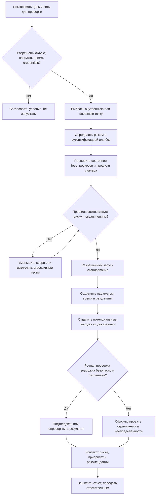

# Диаграмма — глава 06 «Поиск уязвимостей»

**Provenance:** RAG `p0185:c01`–`p0206:c01`. Схема — редакционная визуализация логики главы; не официальный workflow OpenVAS, Nessus или рисунок из PDF.

Источник описывает сбор технических сведений, сравнение с базой и возможное активное тестирование ([p0185:c01](../../../rag/chunks/p0101-p0200/p0185-c01.md)–[p0186:c01](../../../rag/chunks/p0101-p0200/p0186-c01.md)), различие внутреннего/внешнего и auth/no-auth ([p0187:c01](../../../rag/chunks/p0101-p0200/p0187-c01.md)–[p0188:c01](../../../rag/chunks/p0101-p0200/p0188-c01.md)), профили и создание сканирований ([p0195:c01](../../../rag/chunks/p0101-p0200/p0195-c01.md), [p0203:c01](../../../rag/chunks/p0201-p0300/p0203-c01.md)), анализ отчётов ([p0206:c01](../../../rag/chunks/p0201-p0300/p0206-c01.md)).

**Критичная граница:** отказ в запуске или неуспешная проверка не даёт права расширять сеть, привилегии или набор активных тестов. Rollback для воздействия на сервис: [Needs confirmation].
