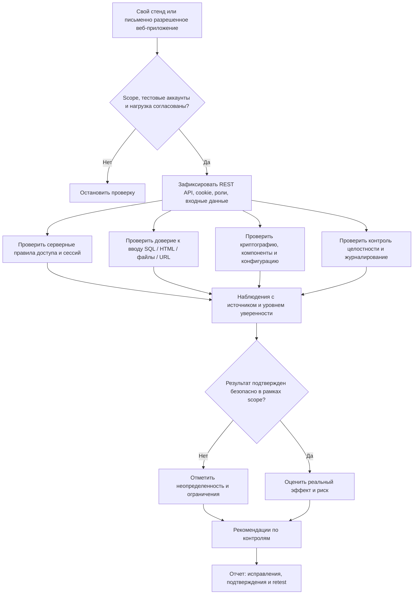

# Diagram — глава 07 «Атаки на веб-приложения»

**Источник:** только RAG `p0207:c01`–`p0241:c01`. Ниже **концептуальная схема**, не авторский рисунок и не эксплойт-процедура.

Узлы основаны на разделах cookie/REST ([p0208:c01](../../../rag/chunks/p0201-p0300/p0208-c01.md)–[p0210:c01](../../../rag/chunks/p0201-p0300/p0210-c01.md)), контроль доступа ([p0213:c01](../../../rag/chunks/p0201-p0300/p0213-c01.md)–[p0216:c01](../../../rag/chunks/p0201-p0300/p0216-c01.md)), injection ([p0220:c01](../../../rag/chunks/p0201-p0300/p0220-c01.md)–[p0228:c01](../../../rag/chunks/p0201-p0300/p0228-c01.md)), integrity/logging/SSRF ([p0238:c01](../../../rag/chunks/p0201-p0300/p0238-c01.md)–[p0241:c01](../../../rag/chunks/p0201-p0300/p0241-c01.md)). Любая активная проверка меняет трафик и может изменять состояние тестового окружения. Универсальный rollback — [Needs confirmation].
