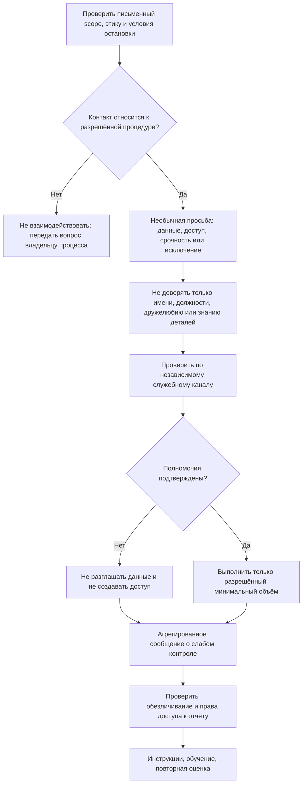

# Диаграмма — глава 08: угрозы доверия и защитные контроли

**Provenance:** RAG `p0242:c01`–`p0257:c01`. Ниже редакционная схема **защитного** процесса, не последовательность обмана и не воспроизведение рисунка книги.

Психологические триггеры и независимая проверка основаны на [p0244:c01](../../../rag/chunks/p0201-p0300/p0244-c01.md)–[p0245:c01](../../../rag/chunks/p0201-p0300/p0245-c01.md) и описанной подмене внутреннего согласования [p0251:c01](../../../rag/chunks/p0201-p0300/p0251-c01.md); ограничения на использование персональных контактов и отчётность — [p0243:c01](../../../rag/chunks/p0201-p0300/p0243-c01.md). Сценарии писем/клонирования из книги сознательно **не переведены в исполняемую блок-схему**.

**Rollback для данных и воздействия на сотрудников:** [Needs confirmation].
