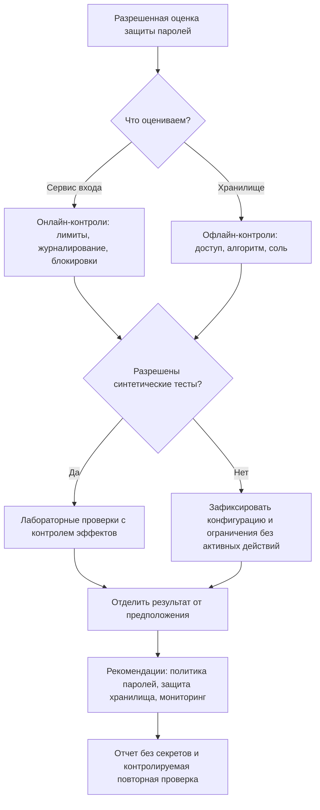

# Диаграмма · Глава 09

**Source:** RAG `p0258:c01`–`p0271:c01`; редакционная защитная модель, не воспроизведение рисунка книги.

Онлайн/офлайн сопоставление — [p0258:c01](../../../rag/chunks/p0201-p0300/p0258-c01.md), [p0262:c01](../../../rag/chunks/p0201-p0300/p0262-c01.md), [p0266:c01](../../../rag/chunks/p0201-p0300/p0266-c01.md); алгоритмы/соли — [p0266:c01](../../../rag/chunks/p0201-p0300/p0266-c01.md); форматы и ограничения — [p0269:c01](../../../rag/chunks/p0201-p0300/p0269-c01.md), [p0270:c01](../../../rag/chunks/p0201-p0300/p0270-c01.md). Универсальный rollback: **[Needs confirmation]**.
