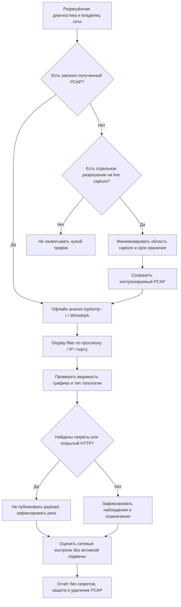

# Diagram — глава 10 «Перехват информации»

**Источник:** `p0272:c01`–`p0286:c01`. Схема — редакционная защитная интерпретация книги, не оригинальный рисунок и не последовательность MitM-эксплуатации.

Подтверждение различия shared medium и switch: [p0272:c01](../../../rag/chunks/p0201-p0300/p0272-c01.md)–[p0273:c01](../../../rag/chunks/p0201-p0300/p0273-c01.md); capture/display filters: [p0274:c01](../../../rag/chunks/p0201-p0300/p0274-c01.md)–[p0276:c01](../../../rag/chunks/p0201-p0300/p0276-c01.md); риски открытого HTTP: [p0277:c01](../../../rag/chunks/p0201-p0300/p0277-c01.md), [p0280:c01](../../../rag/chunks/p0201-p0300/p0280-c01.md); активное вмешательство CAM/ARP/Ettercap: [p0282:c01](../../../rag/chunks/p0201-p0300/p0282-c01.md)–[p0286:c01](../../../rag/chunks/p0201-p0300/p0286-c01.md). **Никакие активные атаки не выполнялись.**
