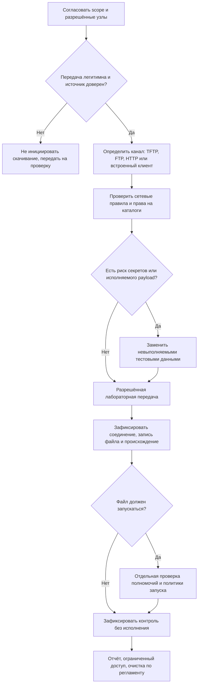

# Диаграмма — глава 11 «Передача файлов»

**Источник:** RAG `p0287:c01`–`p0292:c01`. Схема — **защитный** процесс рассмотрения передачи файлов, а не посткомпрометационная цепочка или рисунок автора.

Контекст TFTP/FTP: [p0287:c01](../../../rag/chunks/p0201-p0300/p0287-c01.md)–[p0289:c01](../../../rag/chunks/p0201-p0300/p0289-c01.md); отличие удалённого shell и интерактивности: [p0290:c01](../../../rag/chunks/p0201-p0300/p0290-c01.md); Windows-автоматизация: [p0291:c01](../../../rag/chunks/p0201-p0300/p0291-c01.md)–[p0292:c01](../../../rag/chunks/p0201-p0300/p0292-c01.md). Сценарии обхода защиты и доставки исполняемых файлов в диаграмму не включены.

**Rollback:** [Needs confirmation].
