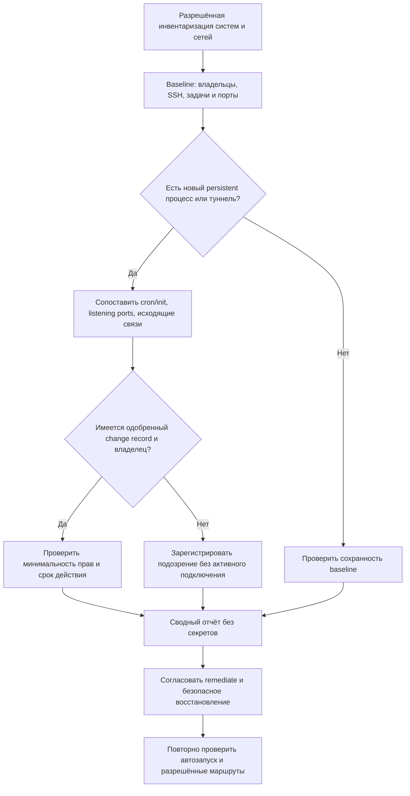

# Диаграмма — глава 12 «Закрепление в системе»

**Provenance:** canonical RAG `p0293:c01`–`p0301:c01`. Это **защитный workflow наблюдения**, не оригинальный рисунок автора и не схема эксплуатации.

Задания и shell listeners [p0293:c01](../../../rag/chunks/p0201-p0300/p0293-c01.md)–[p0295:c01](../../../rag/chunks/p0201-p0300/p0295-c01.md), port forwarding [p0295:c01](../../../rag/chunks/p0201-p0300/p0295-c01.md)–[p0299:c01](../../../rag/chunks/p0201-p0300/p0299-c01.md), proxy/Plink [p0300:c01](../../../rag/chunks/p0201-p0300/p0300-c01.md), [p0301:c01](../../../rag/chunks/p0301-p0400/p0301-c01.md). Запуск новых туннелей для доказательства в рамках этого артефакта не предусмотрен. Rollback: **[Needs confirmation]**.
