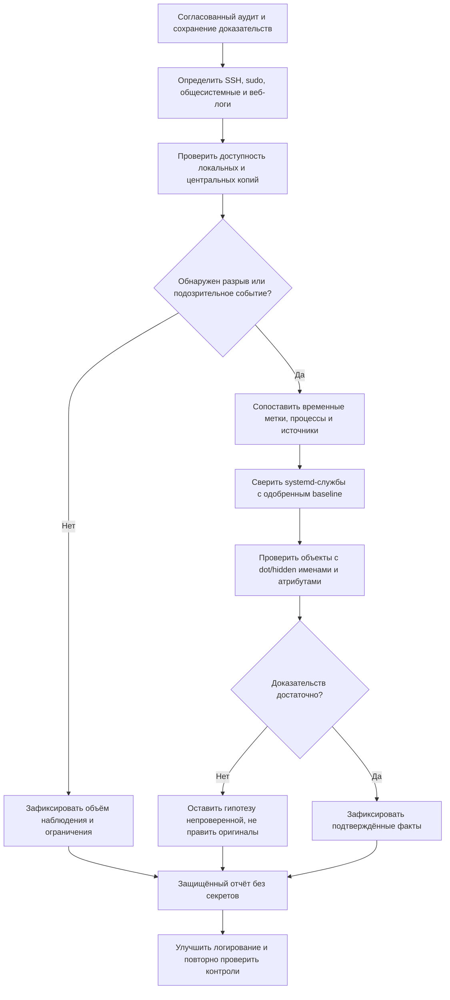

# Диаграмма — глава 13 «Сокрытие следов»

**RAG:** `p0302:c01`–`p0307:c01`. Схема — редакционный **defensive evidence workflow**, не инструкция подмены журналов и не оригинальная иллюстрация книги.

Исходная роль журналов: [p0302:c01](../../../rag/chunks/p0301-p0400/p0302-c01.md)–[p0304:c01](../../../rag/chunks/p0301-p0400/p0304-c01.md); веб-события: [p0305:c01](../../../rag/chunks/p0301-p0400/p0305-c01.md); сервисы [p0306:c01](../../../rag/chunks/p0301-p0400/p0306-c01.md); файловые атрибуты [p0307:c01](../../../rag/chunks/p0301-p0400/p0307-c01.md). **Rollback изменённых/утраченных логов:** [Needs confirmation].
