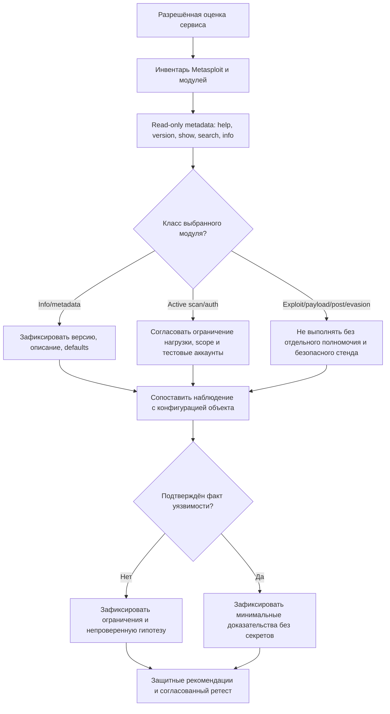

# Диаграмма — глава 14 «Metasploit Fremework»

**Provenance:** canonical RAG `p0308:c01`–`p0331:c01`; **защитная концептуальная схема**, не оригинальный рисунок автора и не рабочая последовательность эксплуатации.

Модули и интерфейс [p0308:c01](../../../rag/chunks/p0301-p0400/p0308-c01.md)–[p0312:c01](../../../rag/chunks/p0301-p0400/p0312-c01.md); параметры и влияние [p0313:c01](../../../rag/chunks/p0301-p0400/p0313-c01.md); payload и encoder [p0315:c01](../../../rag/chunks/p0301-p0400/p0315-c01.md)–[p0324:c01](../../../rag/chunks/p0301-p0400/p0324-c01.md); WMAP/EasyFTP [p0327:c01](../../../rag/chunks/p0301-p0400/p0327-c01.md)–[p0331:c01](../../../rag/chunks/p0301-p0400/p0331-c01.md). **Исполняемые цепочки payload generation / exploitation / evasion отсутствуют.**
