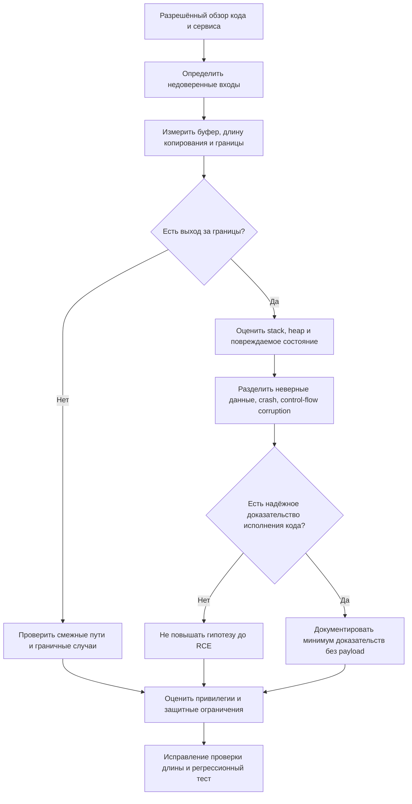

# Диаграмма — глава 15 «Переполнение буфера»

**Источник:** canonical RAG `p0332:c01`–`p0360:c01`. Редакторская **защитная** схема, не оригинальный рисунок автора, не инструкция по формированию shellcode/SEH.

Source grounding: buffer consequences [p0333:c01](../../../rag/chunks/p0301-p0400/p0333-c01.md)–[p0334:c01](../../../rag/chunks/p0301-p0400/p0334-c01.md), сегменты памяти [p0336:c01](../../../rag/chunks/p0301-p0400/p0336-c01.md)–[p0338:c01](../../../rag/chunks/p0301-p0400/p0338-c01.md), stack/return [p0339:c01](../../../rag/chunks/p0301-p0400/p0339-c01.md)–[p0346:c01](../../../rag/chunks/p0301-p0400/p0346-c01.md), return-to-libc и heap [p0347:c01](../../../rag/chunks/p0301-p0400/p0347-c01.md)–[p0349:c01](../../../rag/chunks/p0301-p0400/p0349-c01.md), исторический fuzz/debug кейс [p0350:c01](../../../rag/chunks/p0301-p0400/p0350-c01.md)–[p0360:c01](../../../rag/chunks/p0301-p0400/p0360-c01.md). **Не выполнялось**.
