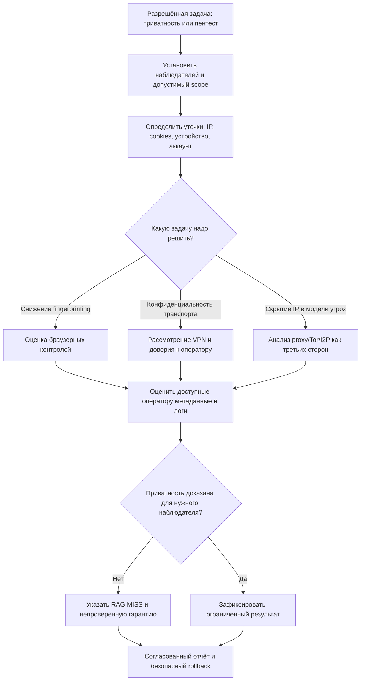

# Диаграмма — глава 16 «Сохранение анонимности»

**Provenance:** canonical RAG `p0361:c01`–`p0374:c01`. Это **редакторская модель threat/privacy review**, а не сетевой маршрут обхода контроля.

Fingerprinting: [p0362:c01](../../../rag/chunks/p0301-p0400/p0362-c01.md)–[p0364:c01](../../../rag/chunks/p0301-p0400/p0364-c01.md); proxy [p0364:c01](../../../rag/chunks/p0301-p0400/p0364-c01.md)–[p0369:c01](../../../rag/chunks/p0301-p0400/p0369-c01.md); VPN [p0370:c01](../../../rag/chunks/p0301-p0400/p0370-c01.md)–[p0372:c01](../../../rag/chunks/p0301-p0400/p0372-c01.md); Tor/I2P/Tails [p0372:c01](../../../rag/chunks/p0301-p0400/p0372-c01.md)–[p0374:c01](../../../rag/chunks/p0301-p0400/p0374-c01.md). **Никаких подключений и смены маршрута нет**.
