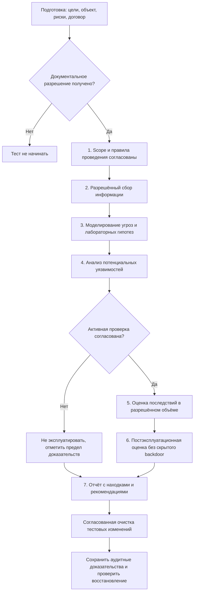

# Диаграмма — глава 17 «Тесты на проникновение: обобщение»

**RAG-only:** PDF 375–383, `p0375:c01`–`p0383:c01`. Защитная редакционная схема семи авторских фаз `PETS`, **не способ автоматизировать атаки**.

Классификация форматов теста: [p0375:c01](../../../rag/chunks/p0301-p0400/p0375-c01.md)–[p0376:c01](../../../rag/chunks/p0301-p0400/p0376-c01.md); подготовка/разрешения: [p0377:c01](../../../rag/chunks/p0301-p0400/p0377-c01.md)–[p0379:c01](../../../rag/chunks/p0301-p0400/p0379-c01.md); сбор, threat model, уязвимости: [p0380:c01](../../../rag/chunks/p0301-p0400/p0380-c01.md)–[p0381:c01](../../../rag/chunks/p0301-p0400/p0381-c01.md); эксплуатация, post, отчёт, очистка: [p0382:c01](../../../rag/chunks/p0301-p0400/p0382-c01.md)–[p0383:c01](../../../rag/chunks/p0301-p0400/p0383-c01.md). **«Зачистка» не добавлена восьмой фазой**: это отдельный шаг завершения из текста.
