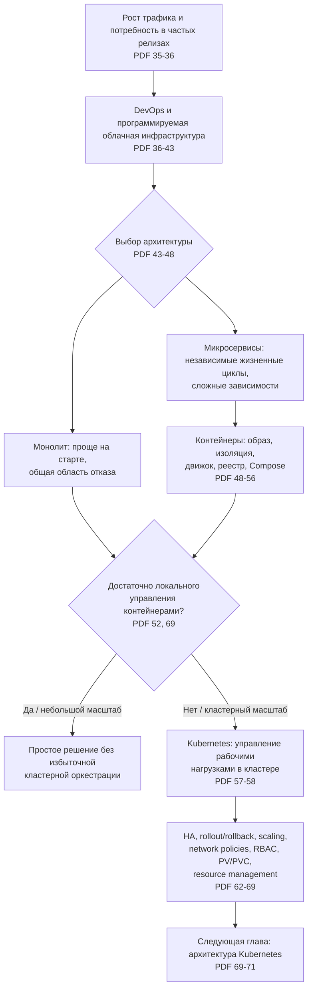

# Логика главы 1 — conceptual flow

Глава преимущественно концептуальная; схема следует последовательности изложения, а не изображает выполненную диагностику.

## Границы интерпретации

- Разветвление **«монолит/микросервисы»** — не требование перехода на микросервисы: книга прямо говорит, что Kubernetes работает и с монолитами (PDF 48).
- Возможность обойтись без Kubernetes при отсутствии контейнеров или нескольких сервисах указана в PDF 69.
- Схема не задает универсальных количественных порогов принятия решений: **[Needs confirmation]**.
- RAG chunks: `kubernetes-complete-guide-madapparambat-mckendrick-2e-ru-2026:p0035:c01` … `kubernetes-complete-guide-madapparambat-mckendrick-2e-ru-2026:p0069:c01`.
