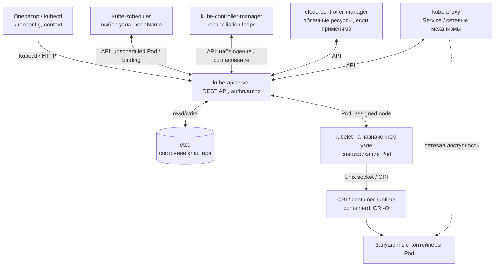
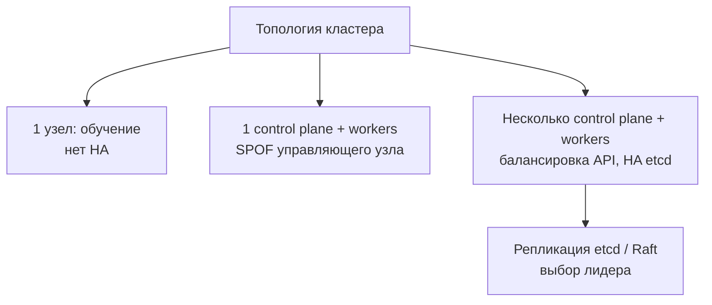

# Архитектура Kubernetes — Mermaid

**Тип:** source-grounded conceptual flow (PDF 79–96, 103, 113). Это не сетевой трассировщик фактического кластера.

## Варианты отказоустойчивости

Source locators: control plane 74–89, workers/runtime 90–96, kubectl 99–107, HA 108–113. Элементы диаграмм — реконструкция **по тексту главы**, не перерисовка исходного иллюстративного PDF. Связи компонентов описывают логические взаимодействия, не маршруты и не проверенную конфигурацию узлов.
