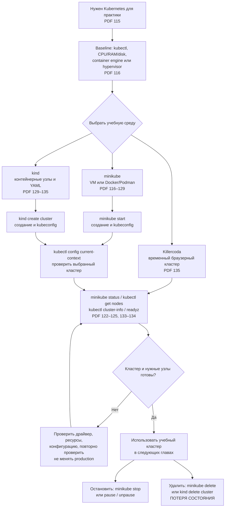
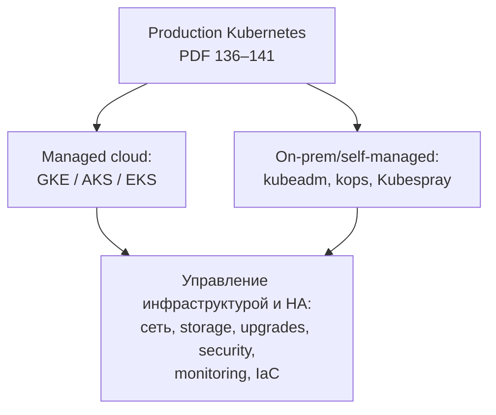

# Концептуальная схема главы 3 — выбор и запуск учебного кластера

Это **RAG-grounded концептуальный workflow**, а не автоматизированный сценарий установки. Источник: PDF 115–142.

## Вне учебного сценария

**Ограничения схем:** команды нельзя исполнять из блок-схемы без контекста и прав; `minikube delete` и `kind delete cluster` необратимы по описанию главы (стр. 127, 134). `kind stop` из источника помечен [Needs confirmation], не используется как достоверный rollback.
