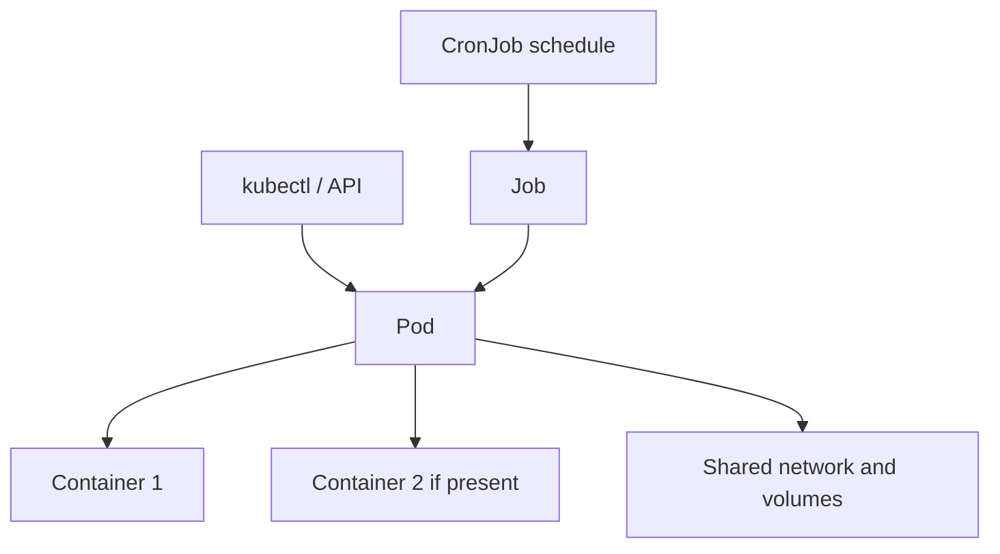
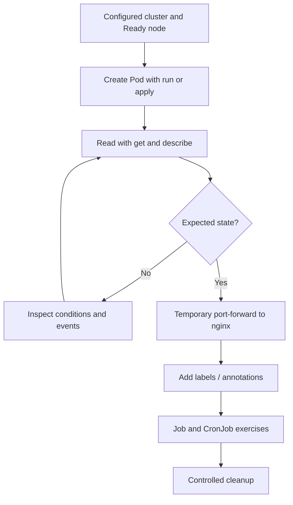

# Diagram — Глава 4 (RAG-only)

Source: PDF 143–180; Pod p0144–p0149, Job p0165–p0172, CronJob p0173–p0178. Conceptual reconstruction from extracted text, not an exact reproduction of source figures.

## Flow of chapter exercises

Source caveat: creating or deleting objects changes a Kubernetes cluster; labels may affect selectors, CronJob schedules repeat executions. Read-only verification and effects are separated in cheatsheet.md and commands.md. Rollback for arbitrary changes: [Needs confirmation].
