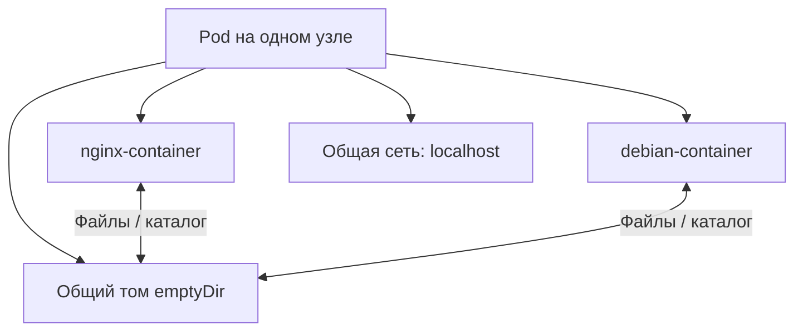
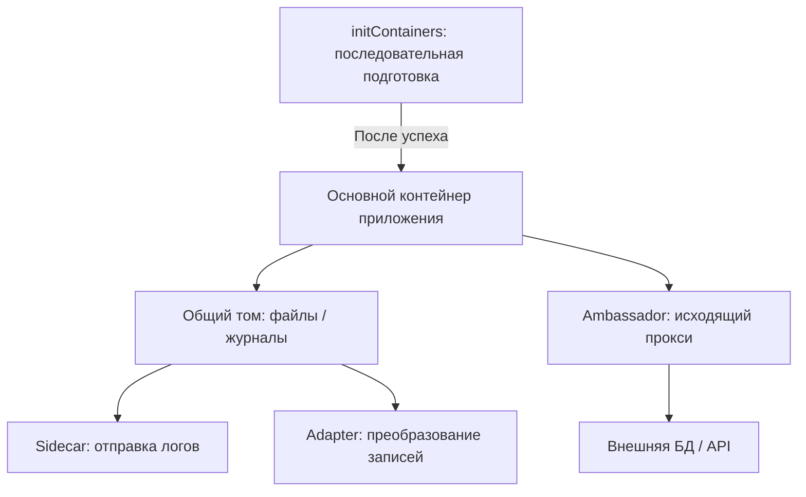
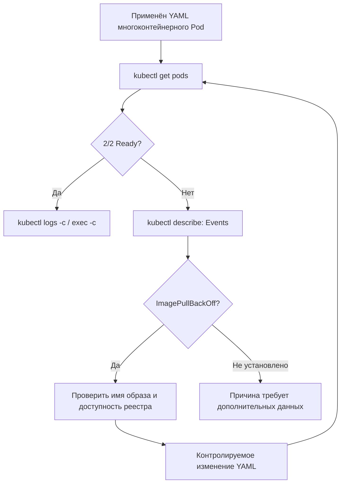

# Mermaid-схемы главы 5 (RAG-only)

**Source:** PDF 181–217; RAG p0181–p0217. Диаграммы являются концептуальным представлением извлечённого текста, не точными копиями иллюстраций PDF.

## Размещение и общий том

Книга: совместное размещение p0182–p0185, работа с файлами `emptyDir` p0201–p0203. После удаления Pod данные `emptyDir` теряются. `hostPath` — том, основанный на каталоге узла, с риском привязки Pod к узлу (p0204–p0206).

## Init, обычный Sidecar и Adapter

RAG: init p0194–p0197; Ambassador p0207–p0209; Sidecar p0209–p0212; Adapter p0212–p0215. Native sidecar отдельно представлен через `initContainers` с `restartPolicy: Always` на p0216, совместимость с фактическим кластером **[Needs confirmation]**.

## Учебная диагностика Pod

RAG: p0184–p0187, p0190–p0198. Применение/удаление YAML — **state-changing**; диагностика через `get`, `describe`, `logs` — read-only. Для force-delete p0189 отдельно предупреждает об отсутствии гарантии реального завершения. Реальные показатели и rollback **[Needs confirmation]**.
