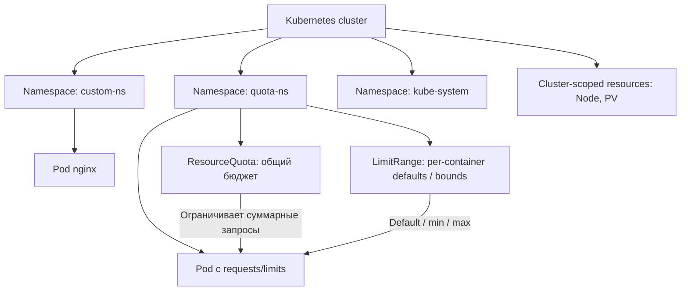
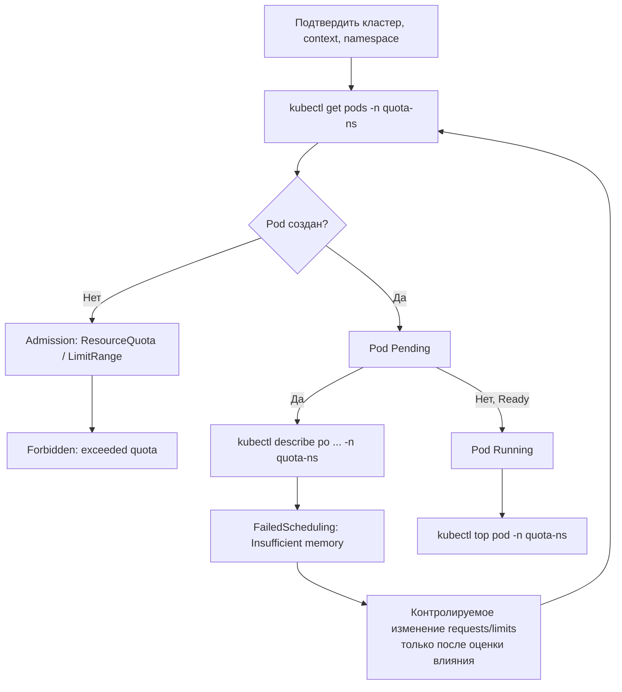
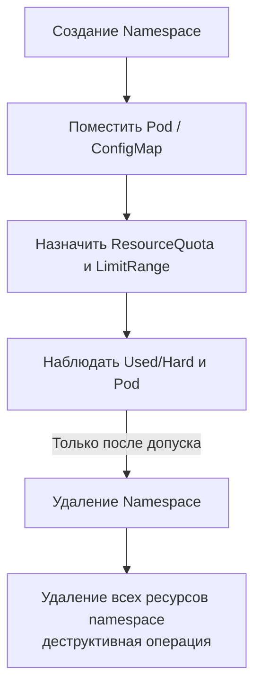

# Диаграммы главы 6 — namespace, ResourceQuota, LimitRange

**Источник:** PDF/printed p0218–p0247, RAG chunks `p0218:c01`–`p0247:c01`. Диаграммы реконструированы из текста главы; исходные иллюстрации напрямую не просматривались.

## Ресурсные области и бюджеты

Namespace упорядочивает ресурсы, но **не гарантирует сетевой изоляции**; доступ между разными namespaces через Service DNS, ограничения посредством дополнительных NetworkPolicy/RBAC обсуждаются в p0221 и p0231–p0233. Cluster-scoped объекты описаны в p0230–p0231.

## Диагностическая цепочка для Pod в namespace

Пример отрицательного результата по quota: p0241–p0243; scheduling `Pending` и `Insufficient memory`: p0238–p0240. Процедуры восстановления при отказах приложения вне главы: **[Needs confirmation]**.

## Safety / lifecycle

p0224–p0225: `kubectl delete namespaces` необратим по описанию автора; не использовать как штатный rollback. `kubectl config set-context` p0228–p0229 изменяет локальную конфигурацию и может перенаправить последующие команды в другой namespace.
