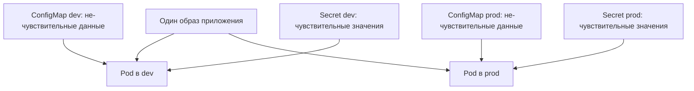
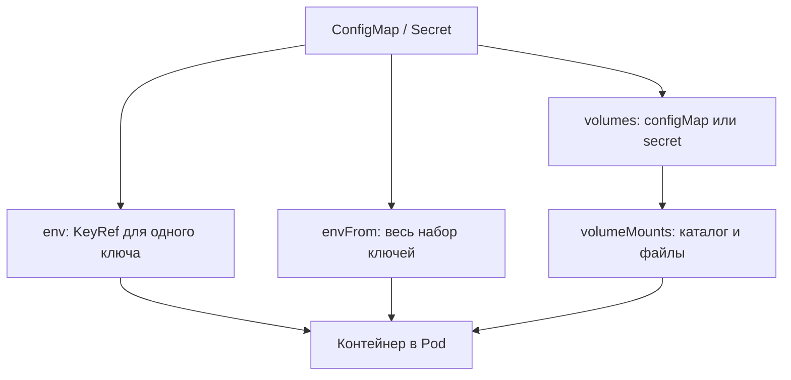
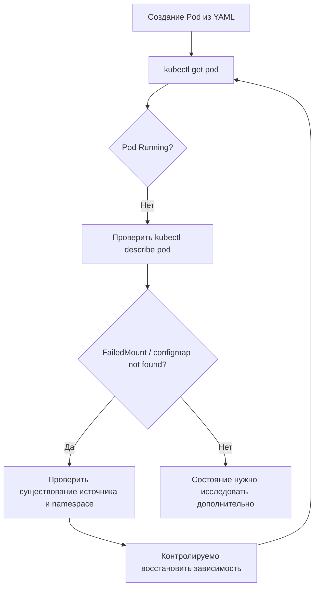

# Глава 7 — Mermaid diagrams (RAG-only)

**Source:** PDF 248–280; текстовые чанки p0248–p0280. Концептуальные схемы реконструированы по тексту RAG, не по оригинальным иллюстрациям книги.

## Один образ, разные конфигурации

Основание: переносимость контейнера, разделение приложения и конфигурации, p0249–p0252.

## Два способа получения значений

Основание: p0252–p0253, p0262–p0265, p0275–p0278. Вариант `env` с реальным Secret может раскрывать значение в окружении процесса. В книге для чувствительных данных предпочтён том (p0253); p0275 также показывает env, что не равнозначно security-одобрению.

## Диагностика ошибочной зависимости

Книга p0266–p0267 показывает `my-sixth-configmap` удалённым и `FailedMount` для Pod, ожидающего его том. Подстановка/возврат исходного содержимого Secret/ConfigMap в реальной среде **[Needs confirmation]**. Команды `kubectl delete` — деструктивны для конфигурационной зависимости. Пример `kubectl get secret -o yaml` может раскрыть Base64, а `exec -- env` — plaintext; не печатать реальные значения.
