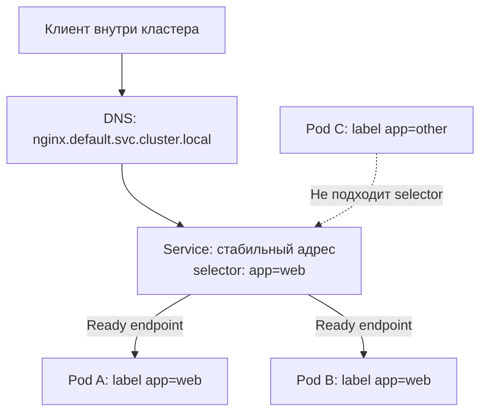
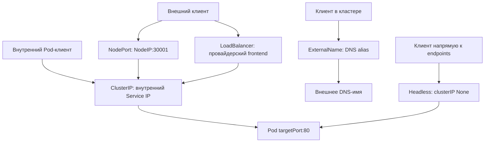
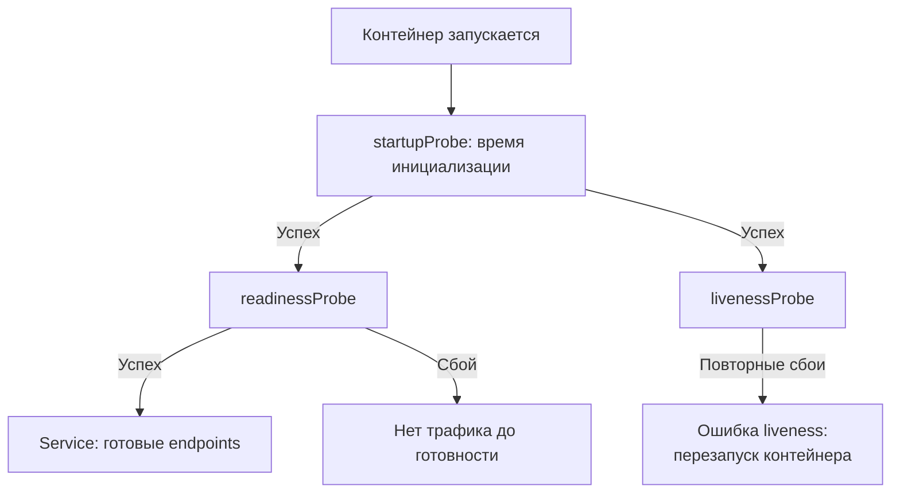

# Диаграммы главы 8 — Service и сетевые проверки

**Источник:** PDF 281–325; `kubernetes-complete-guide-madapparambat-mckendrick-2e-ru-2026:p0281:c01`–`…:p0325:c01`. Схемы концептуально реконструированы по текстовому RAG; рисунки исходного PDF непосредственно не прочитаны.

## Service discovery и связь с Pod

Источник p0288–p0297, p0316–p0318. Результат зависит от реального selector, labels, readiness и endpoint table. Наличие одного только Service не гарантирует работающие endpoints.

## ClusterIP / NodePort / LoadBalancer / ExternalName

Источник p0298–p0316. `NodePort` служит внешней точкой входа через порты узлов, `LoadBalancer` зависит от интеграции/стоимости облака, `ExternalName` указывает на DNS-имя, `headless` не имеет VIP. Логические стрелки означают **связность по архитектуре**, не подтверждённую сетевую доступность целевого кластера.

## Probes: разные последствия

RAG p0316–p0324: readiness определяет включение в пул, liveness проверяет долгоживущий процесс, startup даёт медленно запускаемому приложению время. Источник приводит в Nginx примеры `/healthcheck` и `/healthz` без подтверждения их реализации; такие проверки могут постоянно завершаться ошибкой. Изменения манифестов не выполнялись.

## Operational safety

Создание/удаление Pod и Service, внешнее открытие NodePort, использование `port-forward` и health probes требует подтверждения целей и последствий. Удаление Service не удаляет Pod (p0305), удаление Pod может поменять IP (p0286), непроверенная livenessProbe может инициировать серию перезапусков (p0321). Rollback [Needs confirmation].
