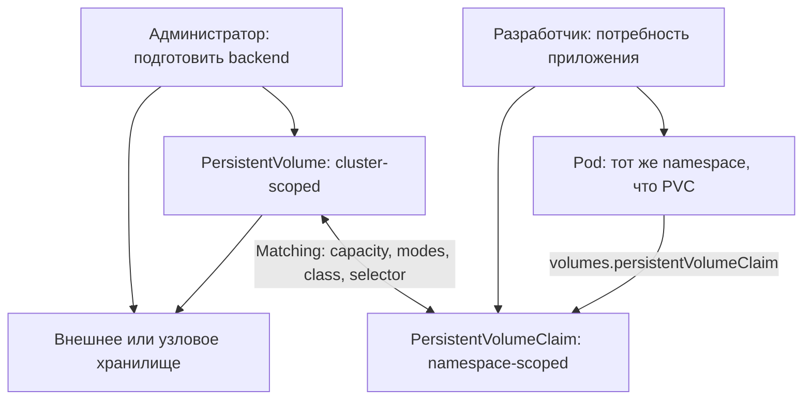
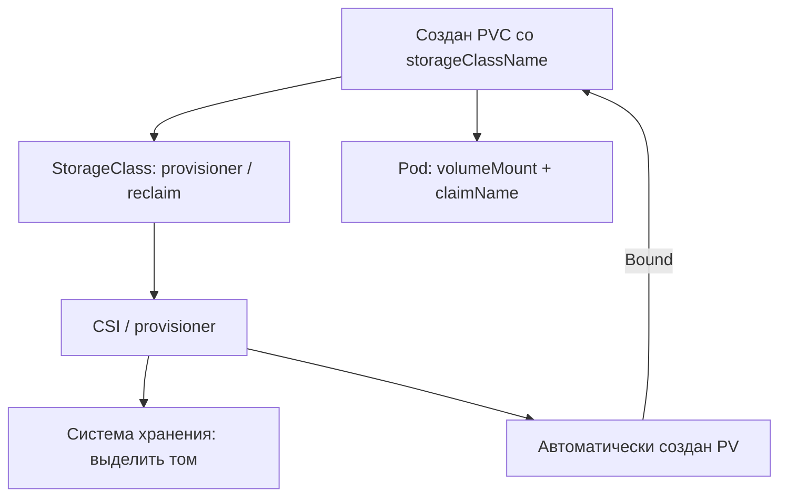
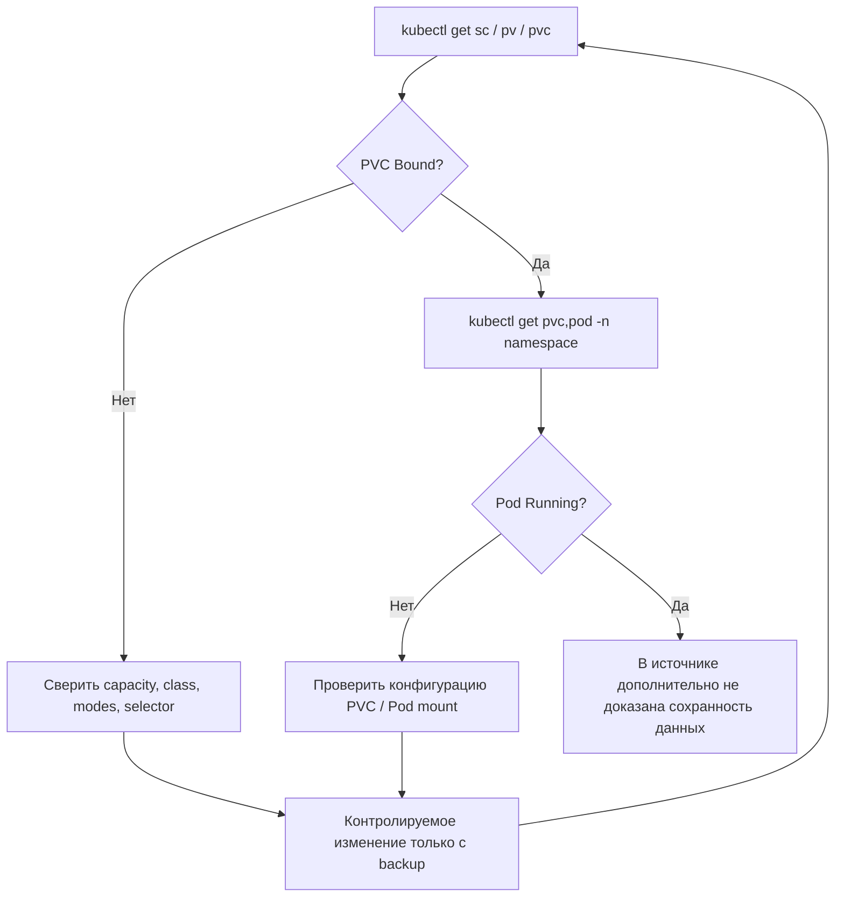
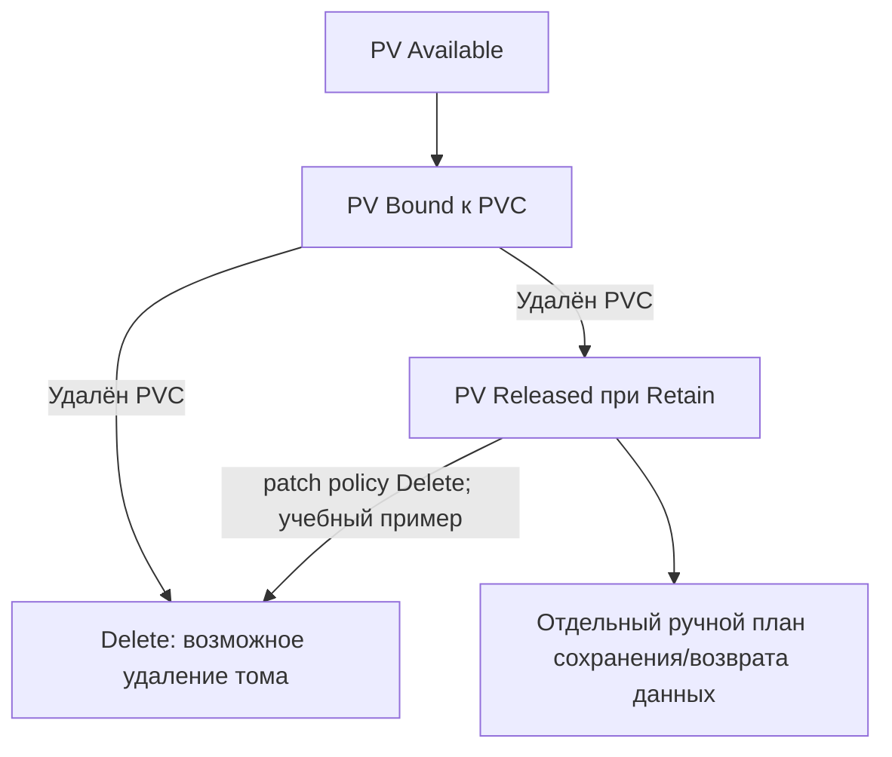

# Диаграммы главы 9 — постоянное хранилище

**Source:** RAG PDF 326–365, `p0326:c01`–`p0365:c01`. Mermaid-схемы реконструированы из текста, не являются точной копией иллюстраций PDF.

## Статическое выделение тома

p0341–p0347: PV определён администратором, PVC заявлен разработчиком, Pod подключает **имя PVC**, а не PV. Статический пример hostPath ограничен узлом.

## Динамическое выделение PV

p0352–p0360: minikube `standard` — *только учебный пример*. Для clone/snapshot/expansion нужна поддержка драйвера и других объектов; не считать универсальной.

## Проверка состояния без разрушительных действий

Предметная причина Pending, события и команда диагностики при конкретной ошибке в RAG **[Needs confirmation]**. Следует избегать придуманных CLI steps, которых нет в главе.

## Lifecycle / reclaim risk

p0349–p0351, p0360–p0361. **Не выполнять** patch/delete на ресурсах с нужными данными. Возможность восстановить байты из RAG не следует: backup/restore [Needs confirmation].
