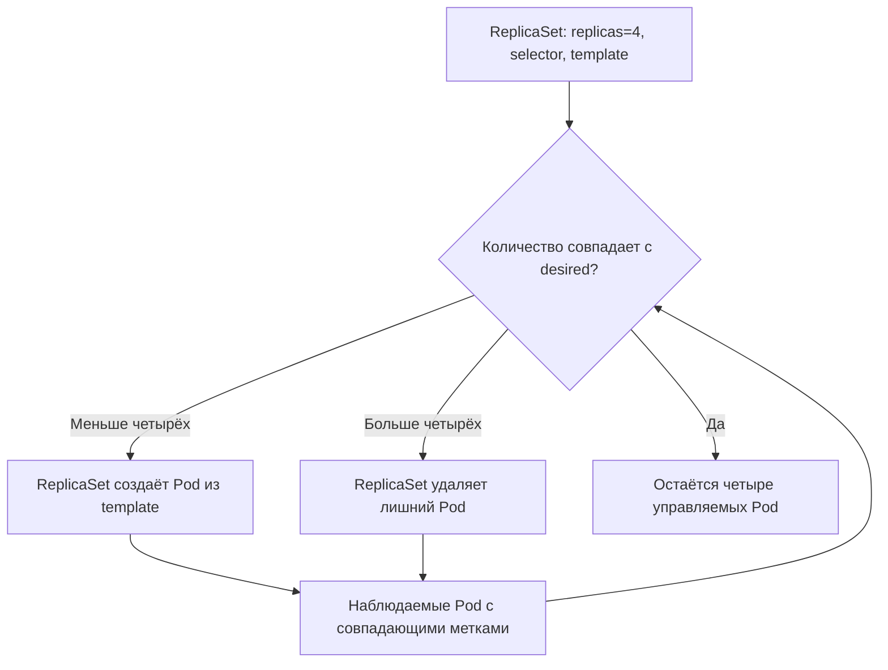
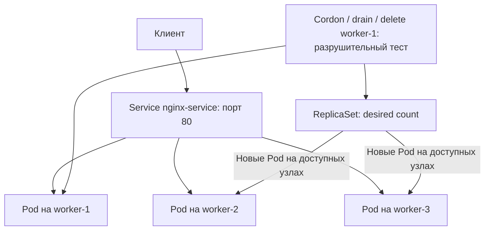
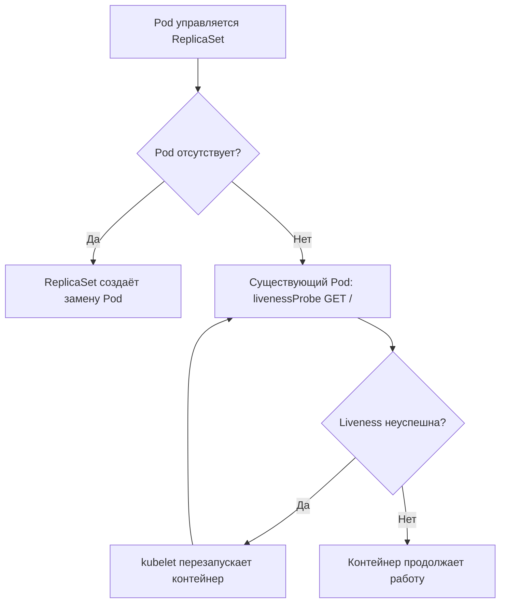

# Диаграммы главы 10 — репликация, failover и liveness

**Source:** PDF 366–383, RAG p0366:c01–p0383:c01. Схемы концептуальные, построены по тексту, не являются точной реконструкцией оригинальных рисунков.

## Контур согласования ReplicaSet

RAG p0370, p0372–p0376. Bare Pod с подходящими `metadata.labels` может быть захвачен и удалён. Отсутствие пересечений селекторов и текущий namespace [Needs confirmation].

## Доступность приложения и восстановление узла

RAG p0377–p0378. В конкретном примере четыре реплики продолжают выполняться на двух узлах после отвода одного. **Не** доказывает отсутствие простоя, независимость от сети, storage или control plane. Выполнение действий только с разрешением в disposable кластере.

## ReplicaSet vs kubelet: разные циклы восстановления

RAG p0375, p0380–p0381. Source имитирует неуспешный HTTP 403 удалением HTML-файла; recovery файла/сервиса [Needs confirmation].

## Safety and rollback

Удаление ReplicaSet по умолчанию каскадно удаляет Pod; `--cascade=orphan` оставляет их, но не предотвращает последующее adoption другими контроллерами (p0382). Вывод worker из кластера и `exec rm` — не read-only процедуры. Практический откат и влияние на реальных пользователей [Needs confirmation].
