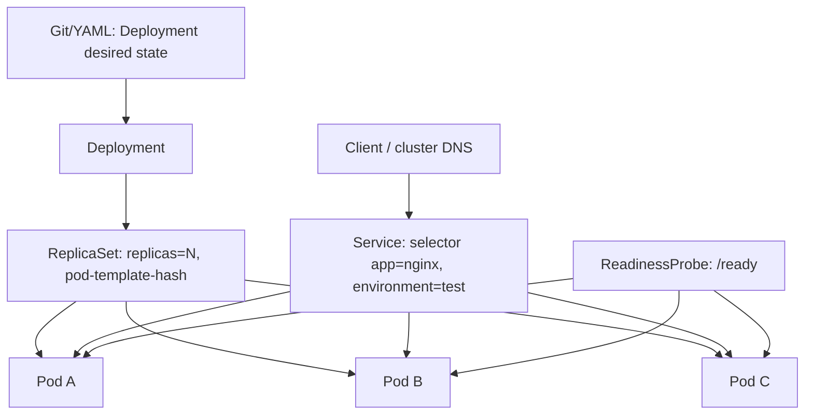
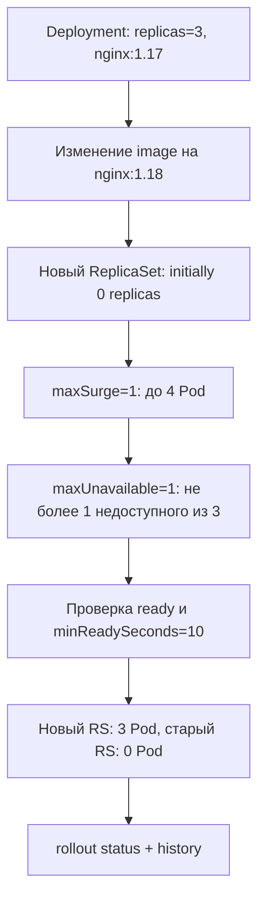
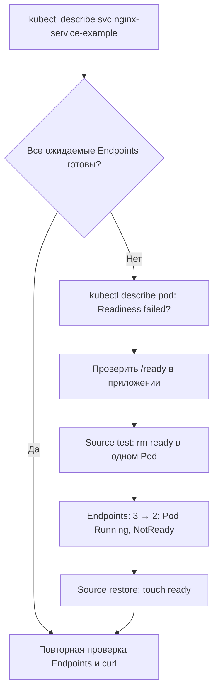
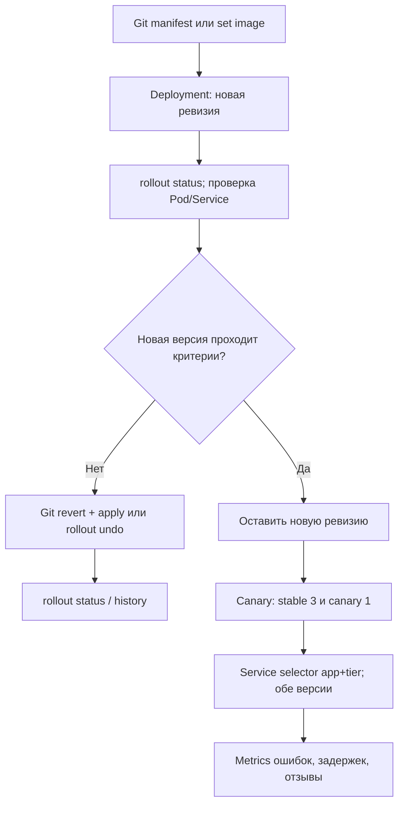

# Диаграммы главы 11 — Deployment / Service / rollout

**RAG-only:** PDF/printed p0384–p0419, chunks p0384:c01–p0419:c01. Mermaid концептуально воспроизводит извлечённый текст, не точные рисунки PDF.

## Контроллеры и Service

RAG p0387–p0395, p0397–p0402. Стрелки Service → Pod означают пригодные по labels **и готовности** endpoints; при failed readiness Pod остаётся Running, но исключается из Service endpoints. Реальный target cluster/Service admission [Needs confirmation].

## RollingUpdate: изменение шаблона

RAG p0405–p0409. `Recreate` в книге завершает все старые Pod до создания новых и допускает downtime; **не** объявлять RollingUpdate гарантией измеренного нулевого простоя.

## Диагностика readiness

p0397–p0402. `rm` и `touch` внутри контейнера — **state-changing, destructive test**, не безопасная диагностика реального workload. Имена Pod и IP источника — не идентификаторы текущего кластера.

## Rollout / rollback / canary

p0409–p0413. Из соотношения 3:1 и общего Service не выводится подтверждённый процент трафика, 10% — отдельный пример с дополнительной маршрутизацией. Полный production rollback [Needs confirmation].
