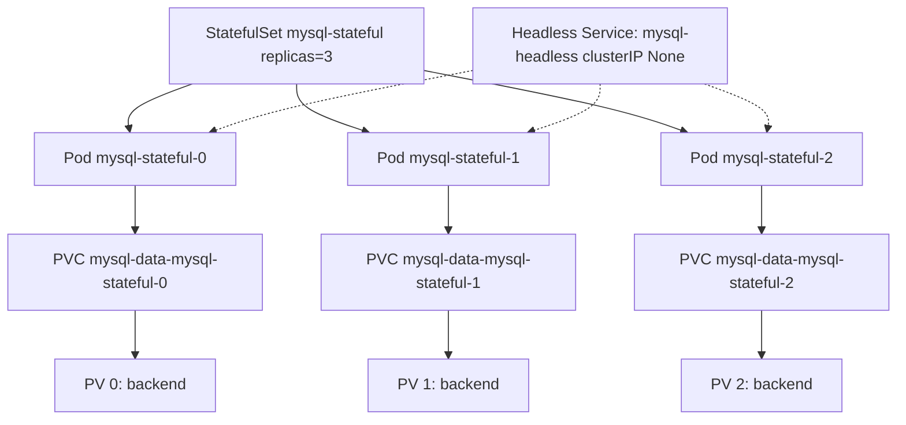
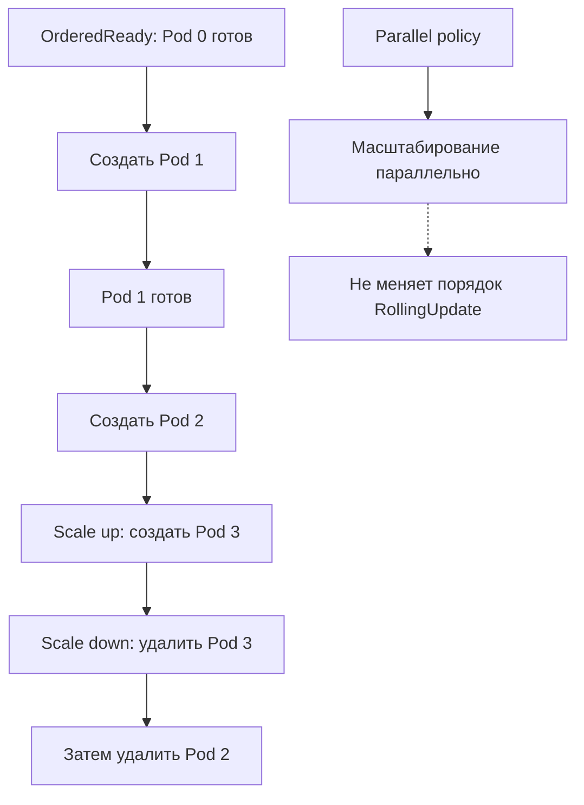
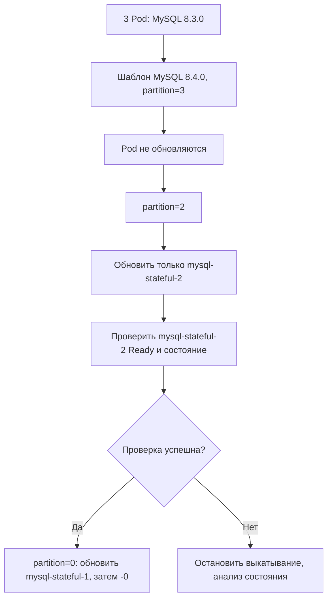
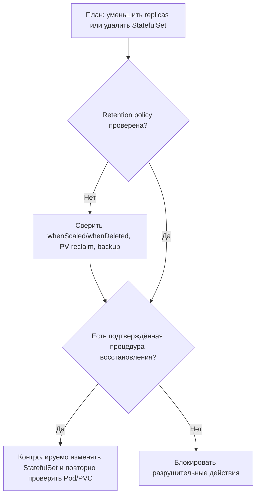

# Диаграммы главы 12 — StatefulSet, PVC, DNS и upgrade

**Источник:** RAG PDF 420–456, `p0420:c01`–`p0456:c01`. Диаграммы синтезированы из текста главы, не являются копией PDF-рисунков.

## Идентичность Pod и отдельные PVC

p0424–p0436. Каждый ordinal имеет **собственный** PVC. Подсистема StatefulSet не синхронизирует данные между PV/Pod (p0427). DNS-имена стабильны, IP могут меняться.

## OrderedReady vs Parallel

p0425, p0440–p0441. Для неизвестного кластера успешность Ready и время зависят от приложения и storage [Needs confirmation].

## Поэтапный rollout StatefulSet

p0444–p0451. `partition` не является механизмом automatic data migration, reconciliation или backup; если обновление повреждает DB schema, обратный образ может быть несовместим (p0452).

## Reclaim / data-safety decision

p0426–p0427, p0442–p0443, p0452–p0454. `kubectl delete pvc` при `reclaimPolicy: Delete` может уничтожить данные, **не** является rollback.

## Verification boundary

Книга показывает `ststest` после пересоздания `mysql-stateful-0`, но **не** проверяет данные на `-1`/`-2`, автоматическую репликацию, multi-node failure или disaster restore. Claim о сохранности одного тома нельзя расширять на состояние распределённой БД.
