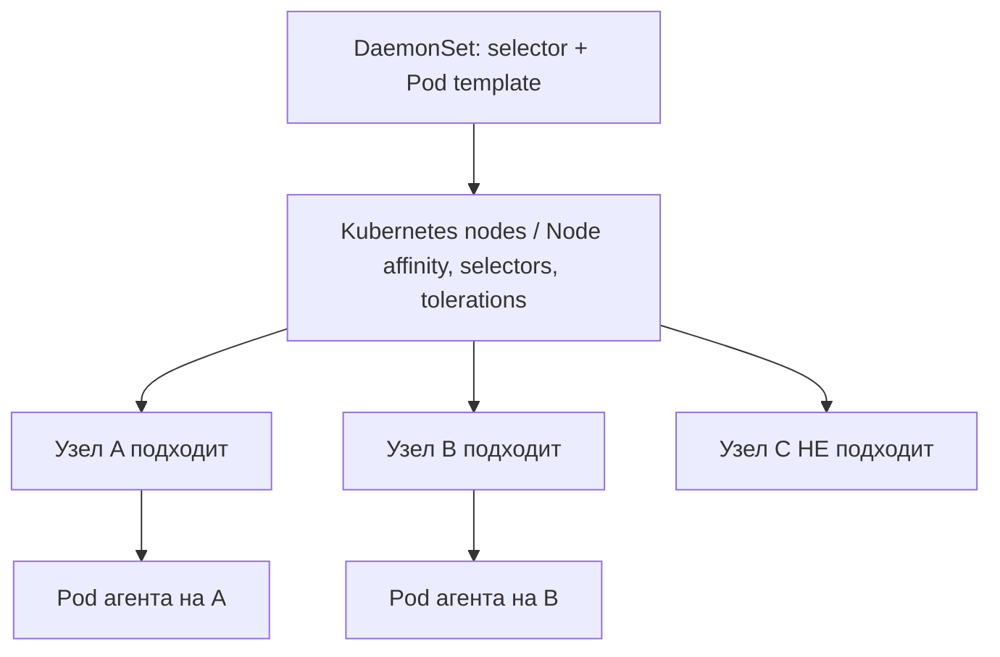
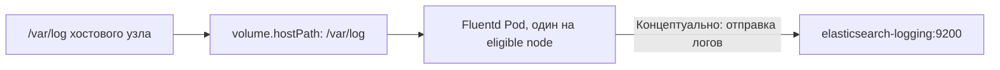
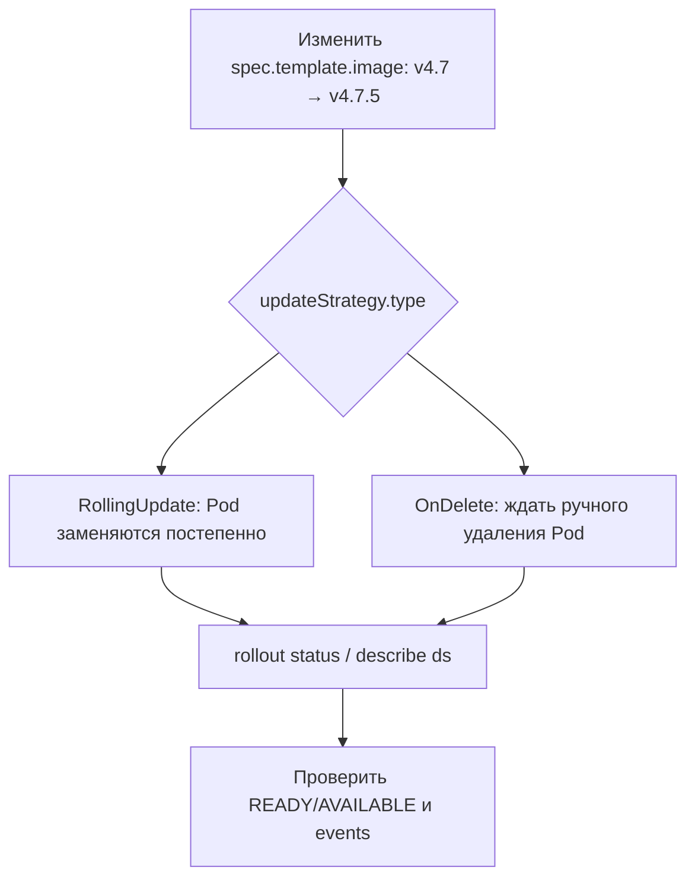
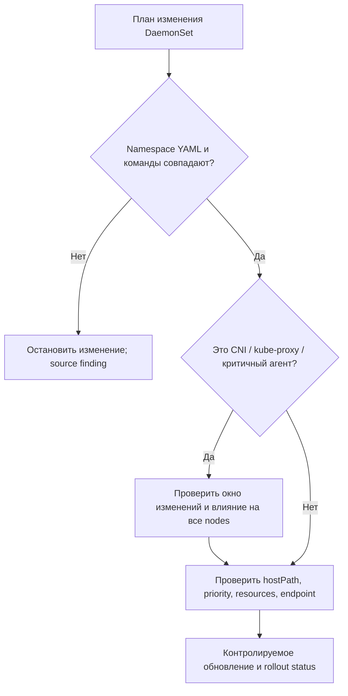

# Диаграммы главы 13 — DaemonSet

**Источник:** RAG PDF/printed 457–473, `p0457:c01`–`p0473:c01`. Mermaid реконструирует **текст** главы; оригинальные изображения напрямую не просматривались.

## DaemonSet и eligibility узлов

p0457–p0460, p0464, p0468. Формулировка «один на каждом» относится к **подходящим** узлам, не ко всем независимо от политики scheduling.

## Поток узловых логов: Fluentd source example

p0463–p0465. В учебном RAG endpoint `elasticsearch-logging` **не создаётся** и доставки логов нет в проверенных output. Исходный YAML объявляет DaemonSet в `kube-system`, а команды/Pod выводы используют `logging` — это **source mismatch**, не исполнимая верифицированная схема.

## RollingUpdate vs OnDelete

p0467–p0469. В книге `RollingUpdate` применяется по умолчанию; наблюдаемый пример 2/3→3/3. `kubectl rollout undo daemonset` описан, но без live проверки rollback, особенно при конфликте namespaces.

## Операционная оценка перед изменением

Source p0461–p0469. В главе нет полного approval/rollback plan; реальная готовность к production **[Needs confirmation]**.

## Альтернативы

p0472–p0473: sidecar для сопровождения отдельного Pod, `CronJob` для расписания, systemd для узлового демона без Kubernetes, static Pod для специальных задач kubelet. Выбор зависит от того, требуется ли **один агент на каждый узел**, а не только выполнение задачи.
