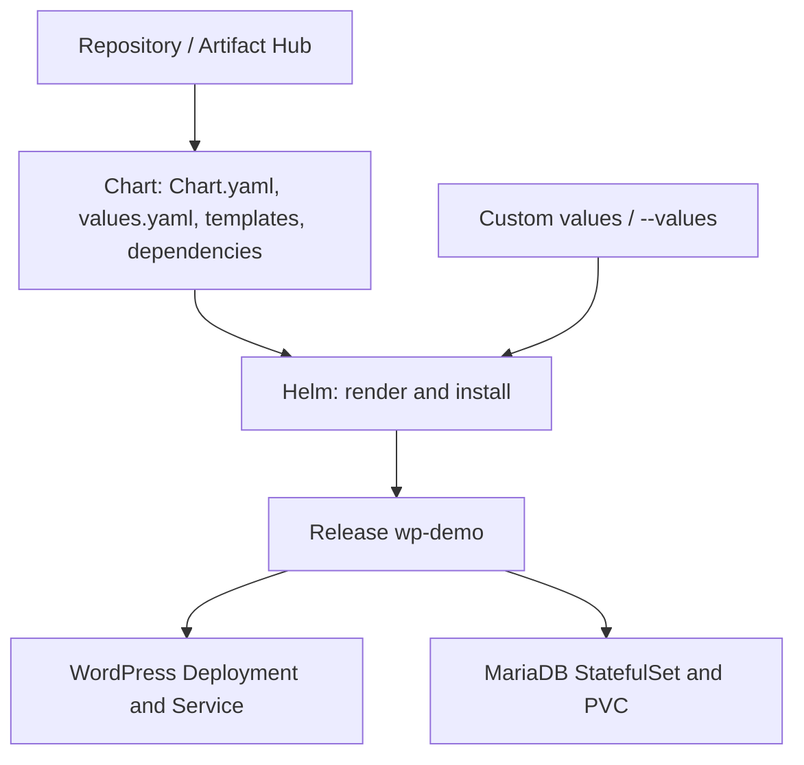
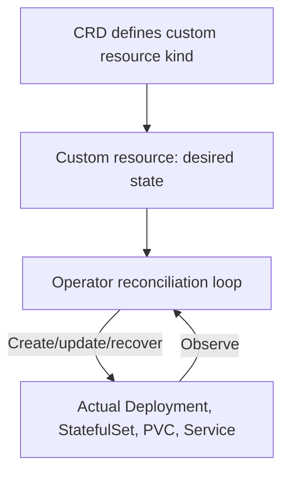
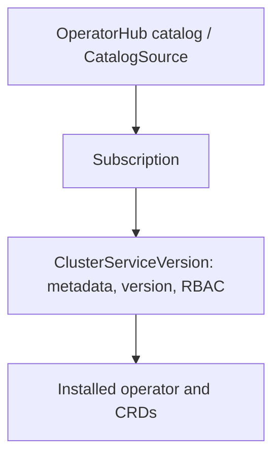
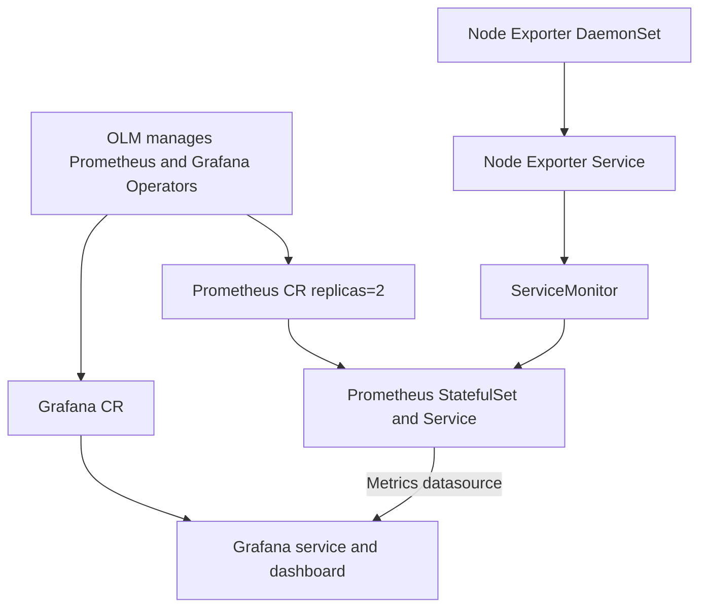
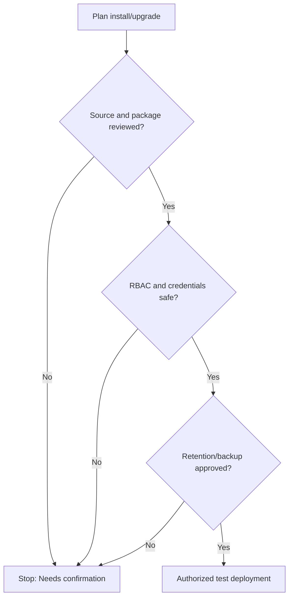

# Диаграммы главы 14 — Helm, OLM и операторы

**Источник:** RAG PDF p0474–p0514. Диаграммы синтезированы из текстовых chunks; иллюстрации PDF напрямую не просмотрены.

## Helm: chart → release

RAG p0475–p0489. Установка чарта создаёт ресурсы, включая базу данных и PVC; не следует считать uninstall полным удалением всех данных.

## Operator control loop

p0495–p0499. CRD определяет тип, custom resource хранит параметры конкретного экземпляра. Результат зависит от прикладной логики оператора.

## OLM lifecycle

p0500–p0504. Из успеха одного CSV нельзя выводить Ready всех operator/catalog Pods.

## Monitoring pipeline

p0505–p0513. `servicemonitor-instance.yaml` not fully printed in chapter RAG; actual match labels and scrape coverage [Needs confirmation].

## Risk gate

p0479, p0482, p0487, p0490–p0494, p0502, p0506. Исторические учебные инструкции не равны актуальному production runbook.
