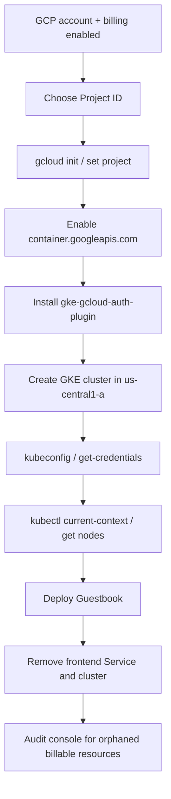
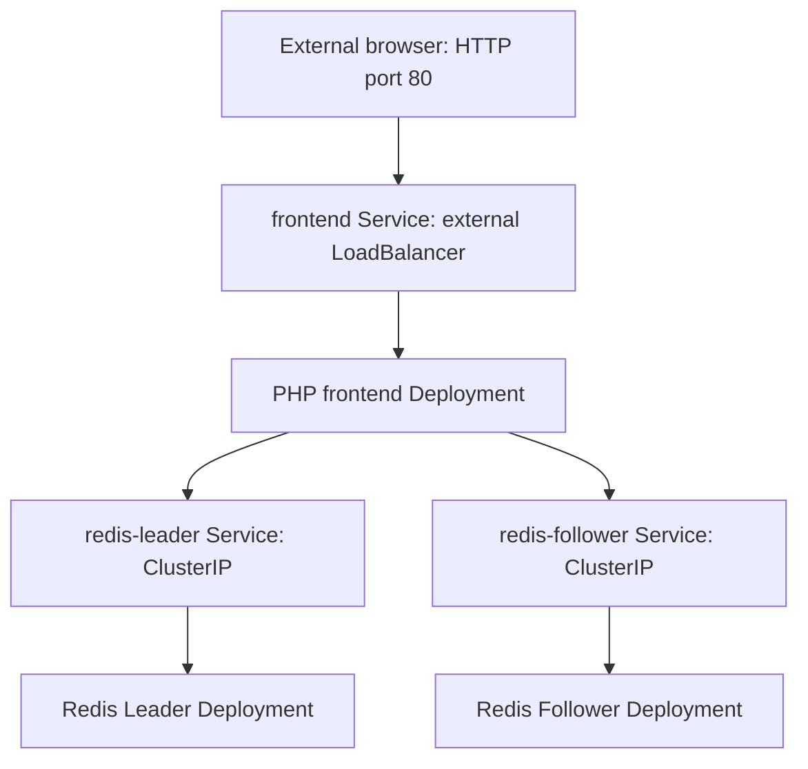
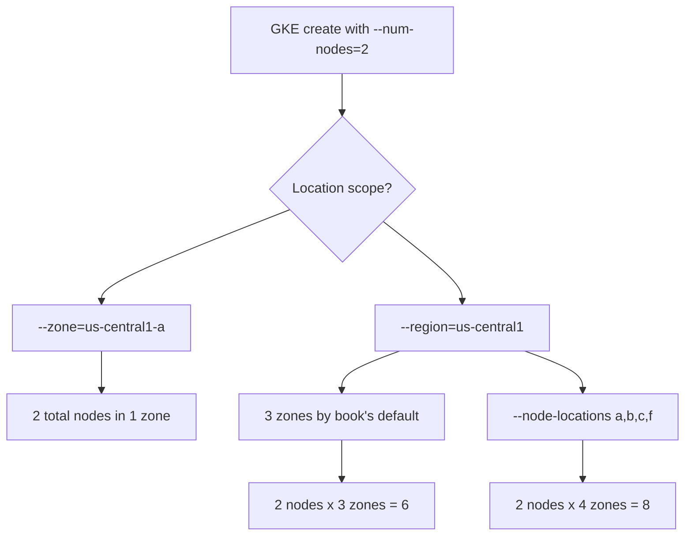
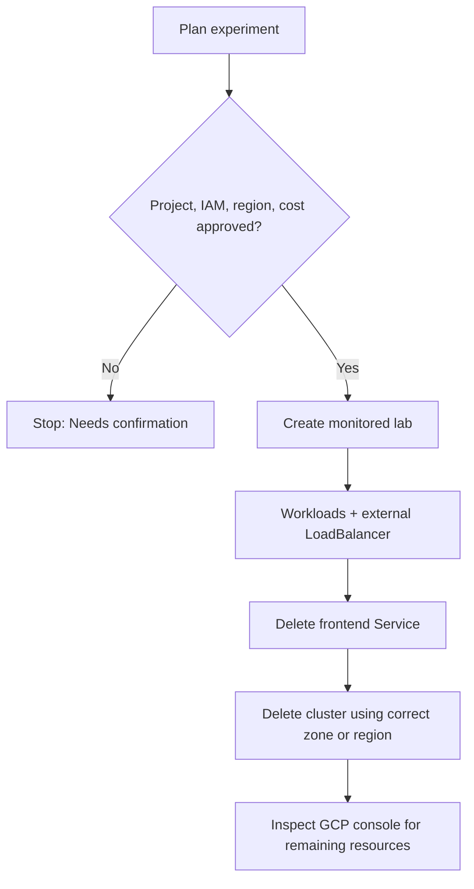

# Схемы главы 15 — GCP / GKE

**Source:** only chapter RAG PDF pp515–536; Mermaid reflects text, not original screenshot reconstruction.

## GKE lifecycle and local context

Evidence p0515, p0518–p0527, p0533. Billing, permissions and missing backups prevent this being a production procedure. `gcloud` project and `kubectl` context are distinct targets; verify both.

## Guestbook components

Evidence p0527–p0531. The text demonstrates three deployments/services but contains no reviewed full manifest YAML. Public IP and node port are environment-dependent; backend data durability, secret handling and SSL not demonstrated.

## Zonal versus regional nodes

Evidence p0533–p0536. Counts are from *the chapter's examples*, not a guaranteed current GKE default. Regional cluster not equivalent to proven app HA/SLO.

## Cost and cleanup guardrails

Evidence p0515, p0530–p0535. Resource deletion can destroy state and is not a substitute for a validated recovery plan.
