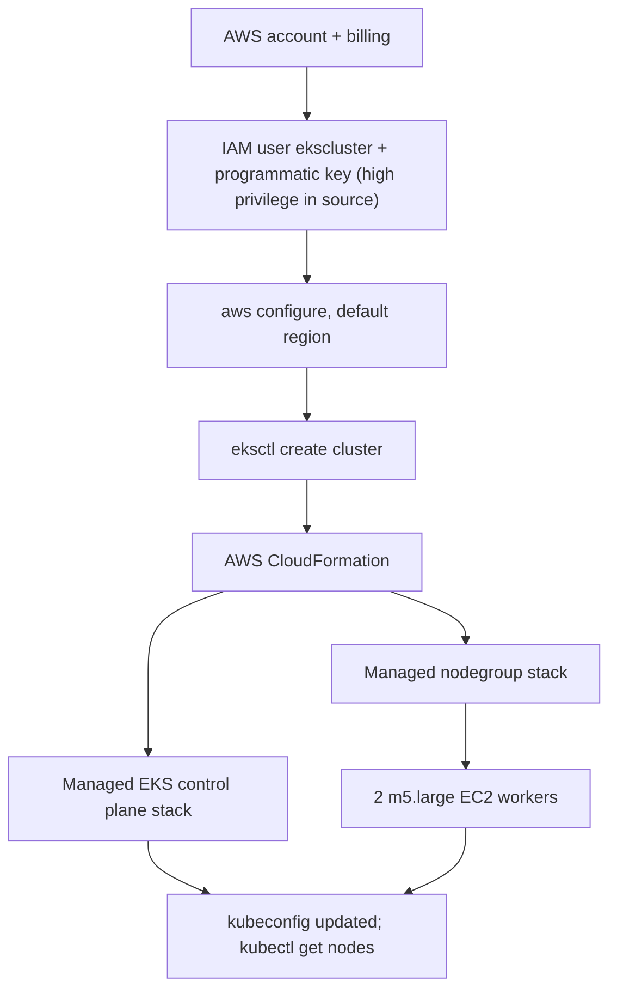
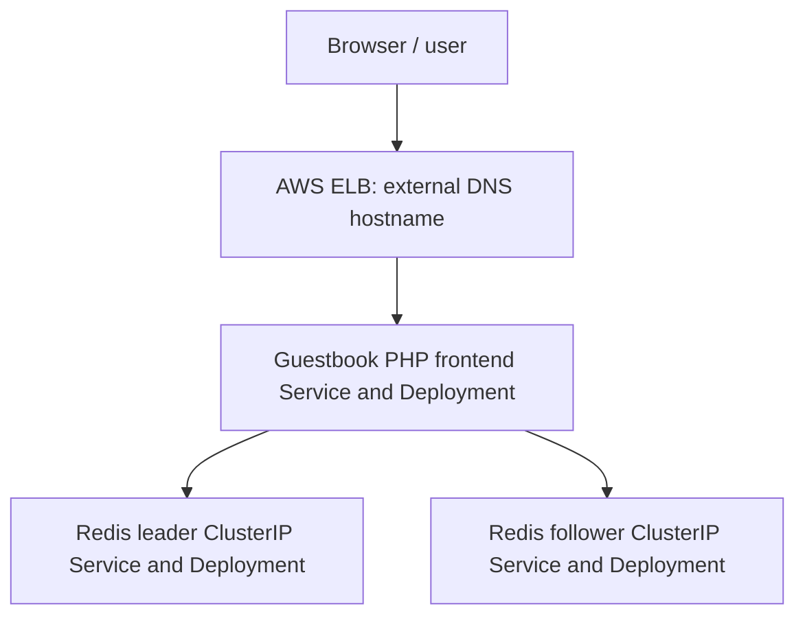
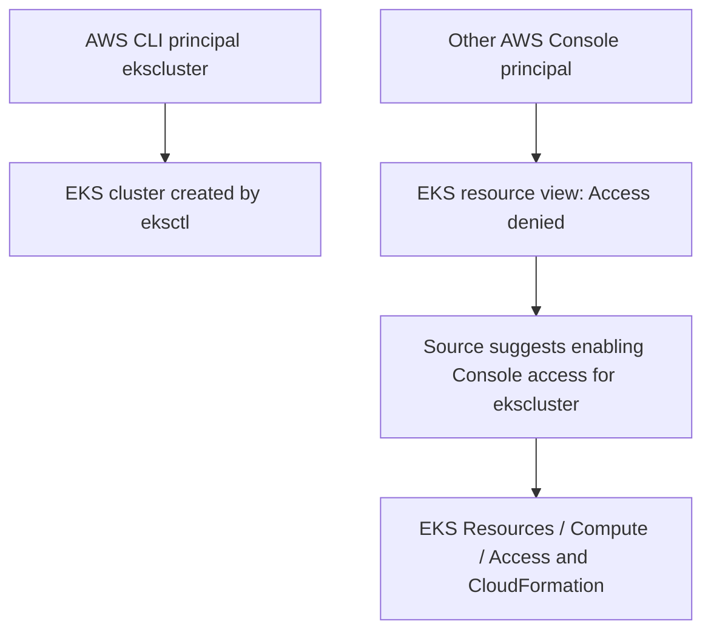
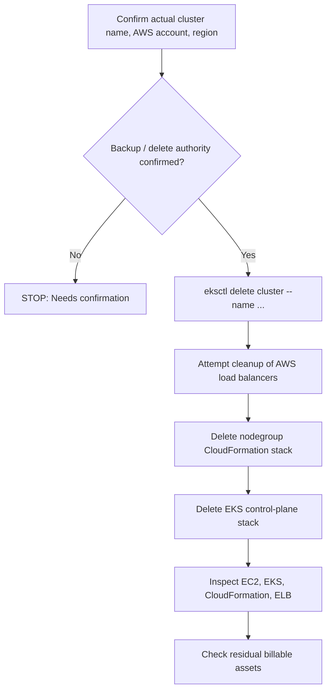

# Диаграммы главы 16 — Amazon EKS, CloudFormation и Guestbook

**Evidence:** RAG-only p0537:c01–p0560:c01, PDF pp537–560. Концептуальные схемы по тексту главы, не скриншоты оригинального PDF.

## Account → EKS

Source pp540–549. p547 describes region `us-west-1` while terminal shows `us-west-2`; all creation is billable. Login with `AdministratorAccess` is **not** a least-privilege example.

## EKS and cloud endpoints

Source pp549–551, 555. The six YAML files are remote `raw.githubusercontent.com/.../main` resources and are not fully included in the chapter; no TLS or data-backup workflow is demonstrated.

## AWS Console authorization

Source pp552–556. Enabling console access creates **more credentials**; it is not a validated safe fix for a real production IAM/RBAC problem. Access levels of a real environment **[Needs confirmation]**.

## Cleanup and residual cost

Source pp557–559. Deletion is destructive. The chapter's success log and recommendation to audit orphan resources do not amount to a guaranteed zero-cost teardown, and no disaster restore plan is presented.

## Data-flow and operational assumptions

The source's sample cluster API endpoint is publicly accessible and CloudWatch cluster logging is off (p548). Both facts are **sample output**, not asserted current settings of a target cluster. CloudFormation IaC constructs the cluster but does not guarantee application health, monitoring, authentication hardening or safe rollback.
