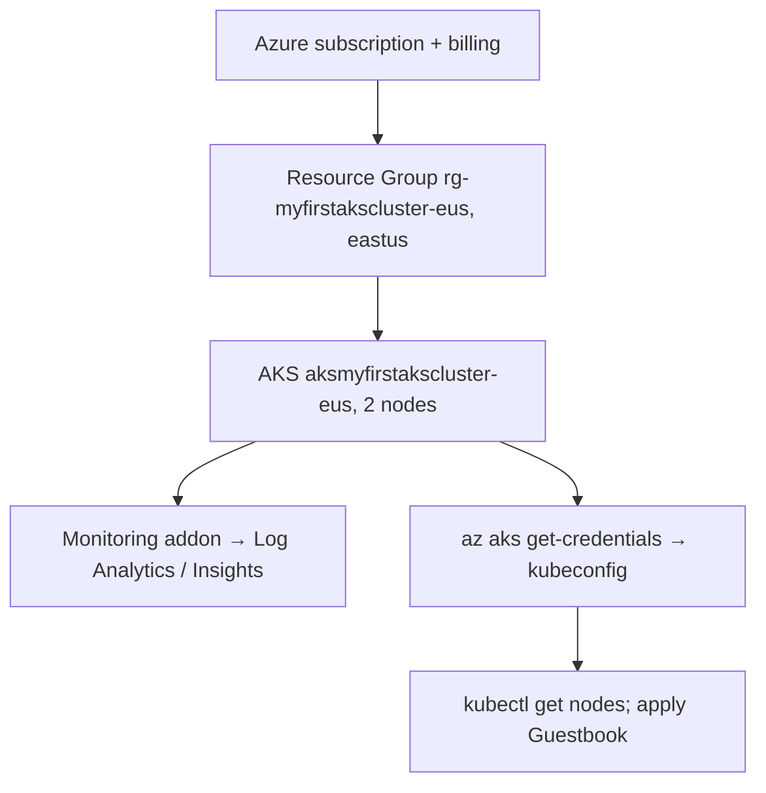
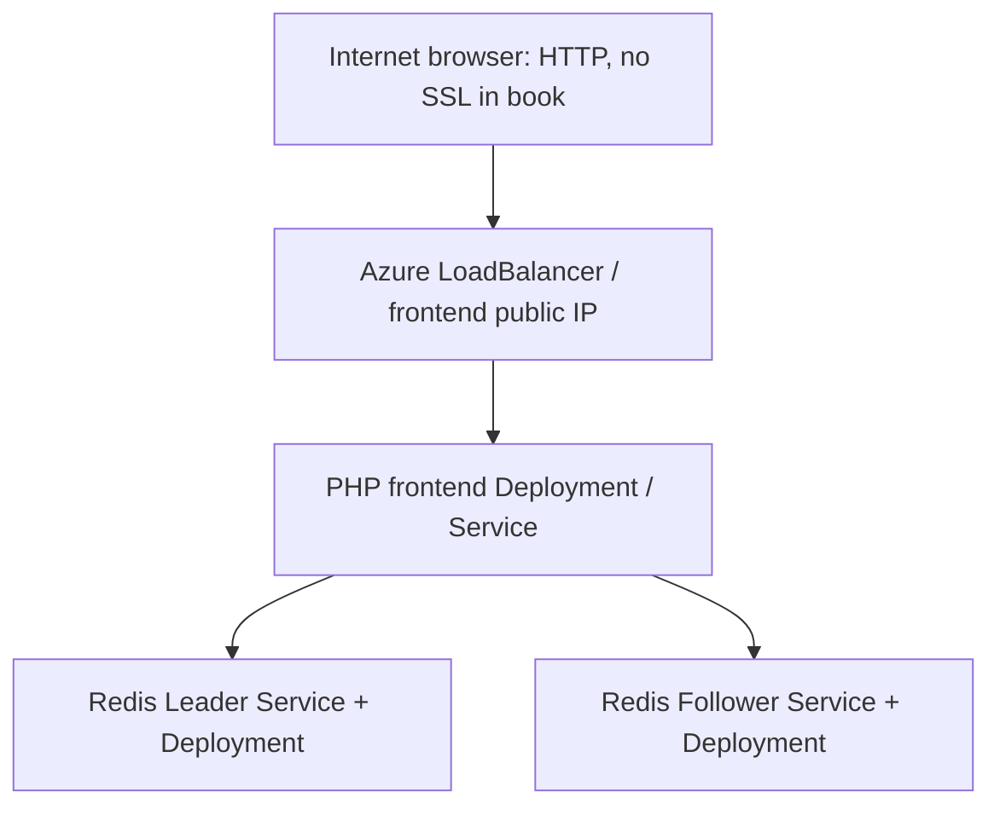
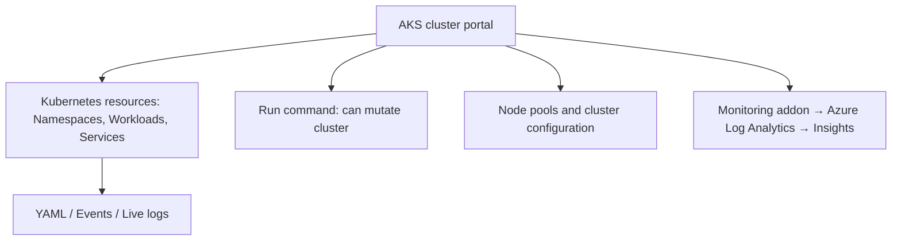
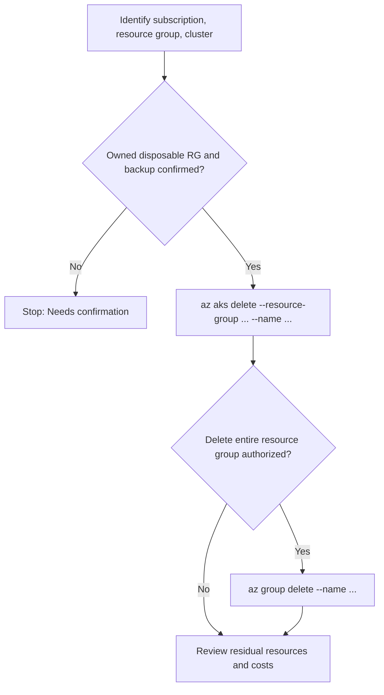
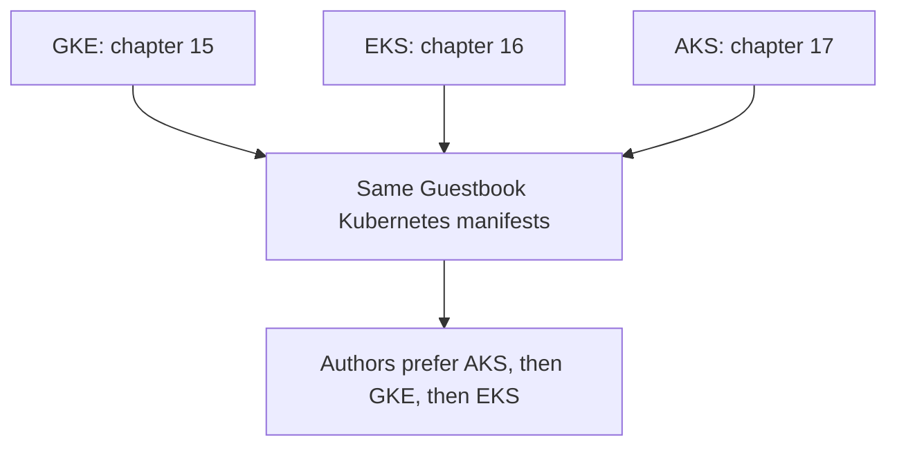

# Диаграммы главы 17 — Microsoft Azure / AKS

**Source:** RAG-only PDF pp561–586, `p0561:c01`–`p0586:c01`. Mermaid reconstructs the chapter text, not direct PDF screenshots. The referenced Azure account/cluster has not been accessed.

## Resource hierarchy / lifecycle

RAG p0567–p0571 and p0581. `az group delete` removes the whole resource group; `az aks delete` removes the cluster but not the group. Source p0573 uses a different portal cluster spelling: `aks-myfirstakscluster-eus` [Needs confirmation].

## Guestbook traffic

Source pp572–573. Only the six remote URL manifests are listed, not their complete content; no TLS/security or data persistence verified.

## Azure Portal observation and management

Source pp573–582. Viewing is observation; clicking a modification control or invoking Run command can change resource state. Backup is discussed, but a restore is not demonstrated.

## Controlled cleanup

Source p0582. Data recovery and verified zero remaining billable assets are [Needs confirmation].

## Cross-cloud conclusion in source

p0583–p0585. The authors' preference reflects their historical experience, not an objective or verified current ranking. Full workload portability (storage/IAM/network/security) was not established.
