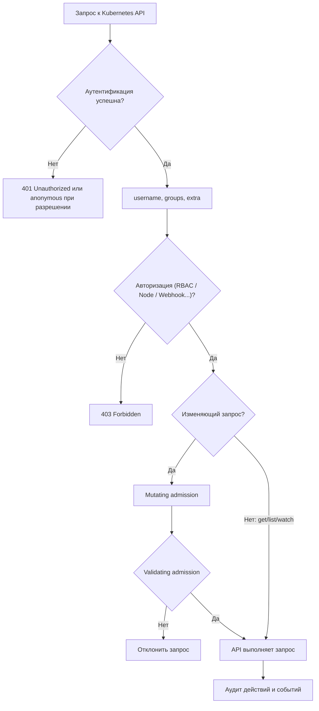
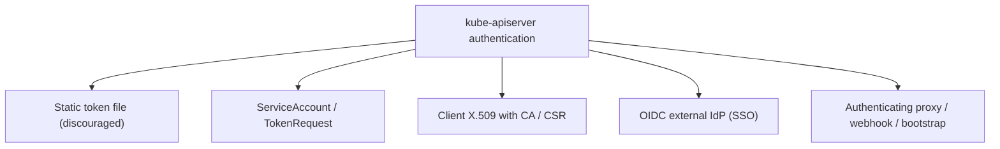
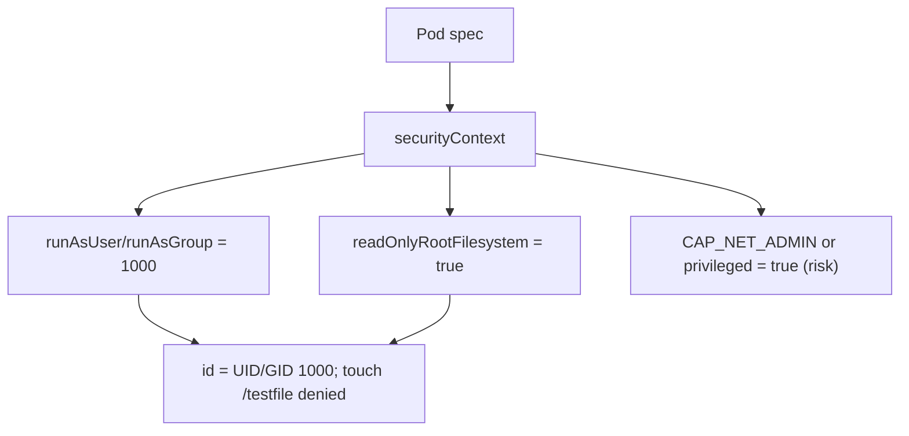
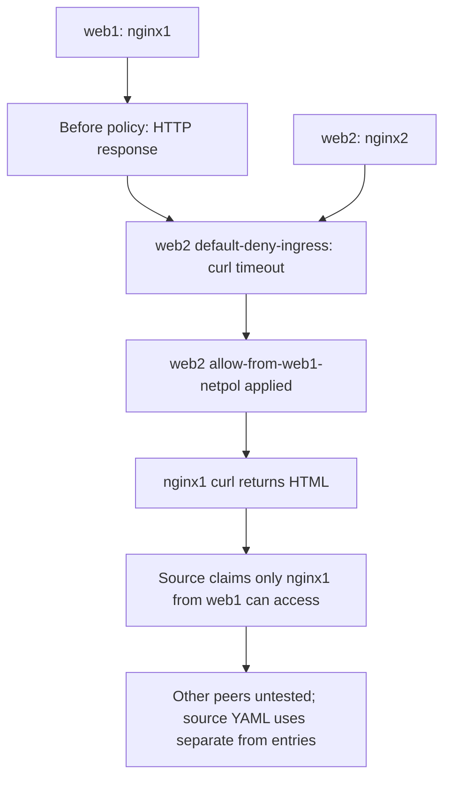
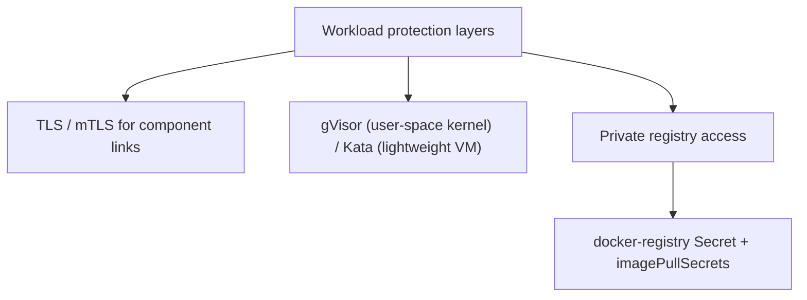

# Диаграммы главы 18 — многоуровневая безопасность Kubernetes

**Source:** chapter RAG PDF pp587–640, `p0587:c01`–`p0640:c01`. Mermaid-схемы синтезированы по тексту, не являются копиями рисунков PDF и не вводят внешних фактов.

## API request: identity → authorization → admission → audit

pp589–592, p612, pp619–622. Source states admission does not reject pure reads; audit is discussed as logging cluster actions, not a source-tested policy.

## ServiceAccount and RBAC negative/positive test

```mermaid
flowchart TD
  POD["Pod pod-logger-app, SA pod-logger"]
  REQUEST["GET /api/v1/namespaces/rbac-demo-ns/pods"]
  RULE["Role pod-reader: get/watch/list pods"]
  BIND{"RoleBinding read-pods exists?"}
  FORBIDDEN["403 Forbidden"]
  OK["PodList from API"]
  REMOVE["kubectl delete rolebinding read-pods"]
  POD --> REQUEST --> BIND
  RULE --> BIND
  BIND -->|"Нет"| FORBIDDEN
  BIND -->|"Да"| OK --> REMOVE --> FORBIDDEN
```

pp614–619. ServiceAccount identity does **not** itself grant Pods-listing rights. Source shell echo says "default namespace" but API URI and Resource are `rbac-demo-ns` (see findings).

## Authentication methods

pp591–611. `kubectl create token` is sensitive; CSR approval grants credentials; identity issuance is not a mere observation.

## Admission controllers and securityContext

pp624–628. Elevated settings are **not** recommended defaults. The source uses writable `emptyDir` at /usr/share/nginx/html alongside read-only rootfs.

## NetworkPolicy source experiment and discrepancy

pp630–634. The last test proves **a connection from nginx1**, not exclusion of every other source; the YAML has separate namespaceSelector and podSelector entries rather than a shown conjunctive peer. The printed resource name after apply is also inconsistent.

## TLS / runtime and registry image access

pp634–639. No end-to-end TLS, RuntimeClass deployment or private image pull executed in chapter RAG; encryption-at-rest for Secrets and availability of runtime handler **[Needs confirmation]**.
