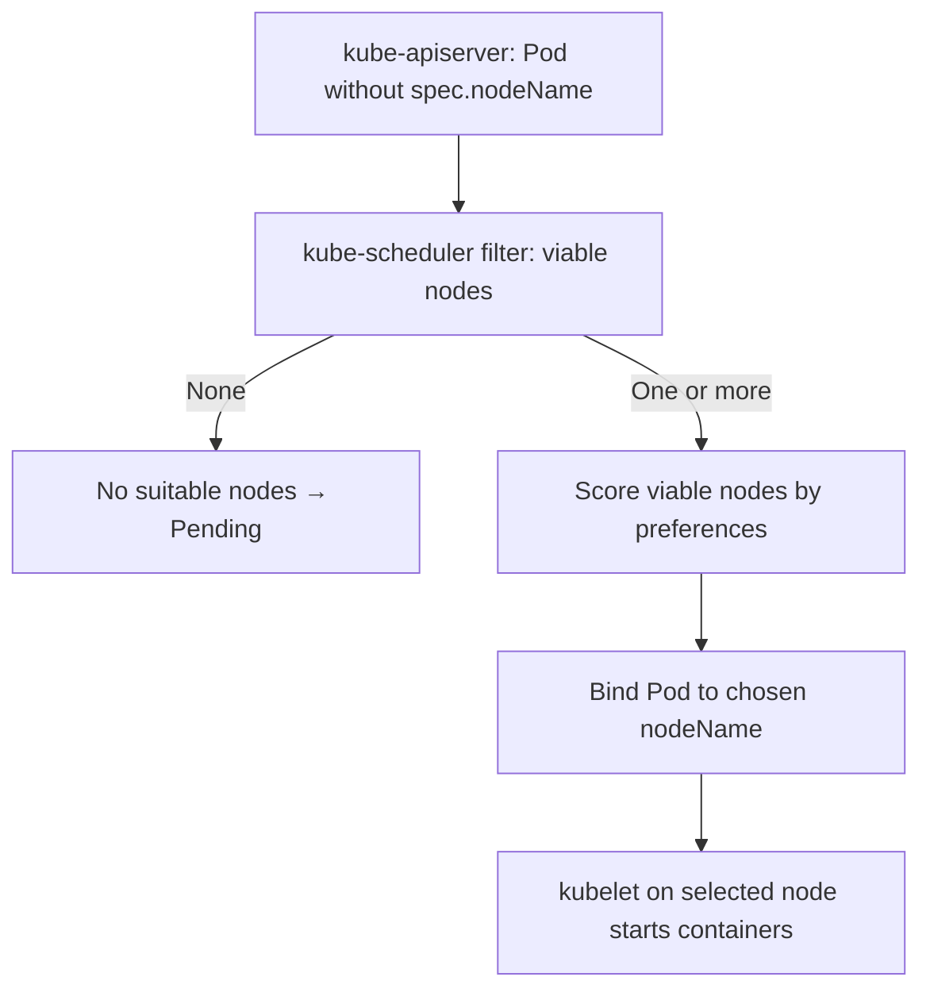
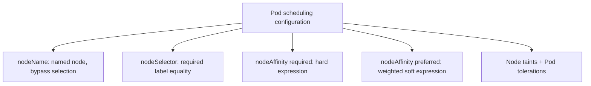
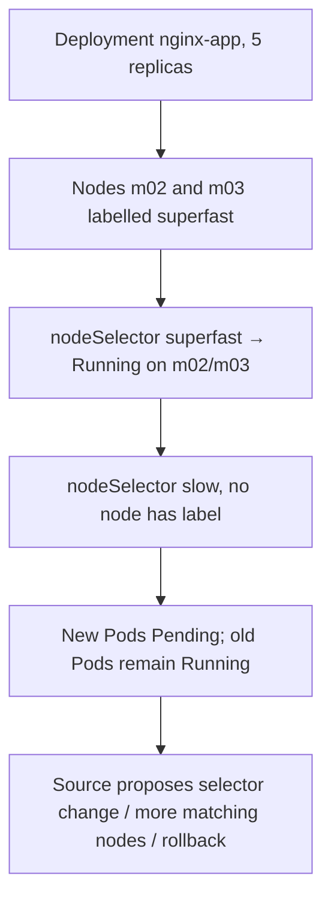
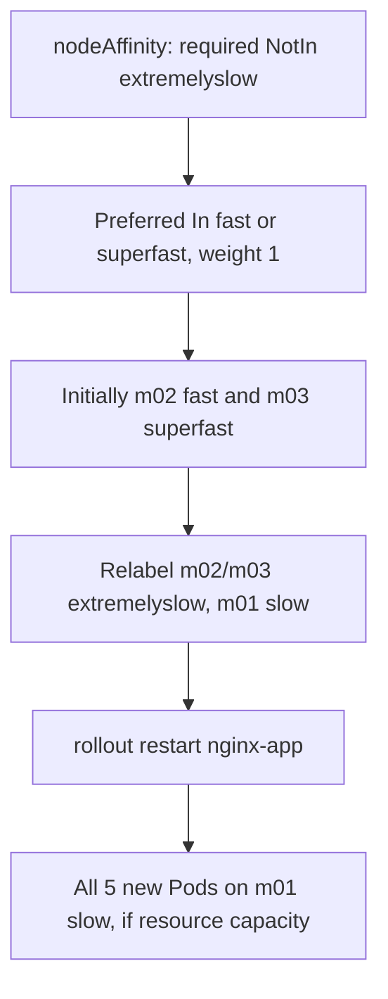
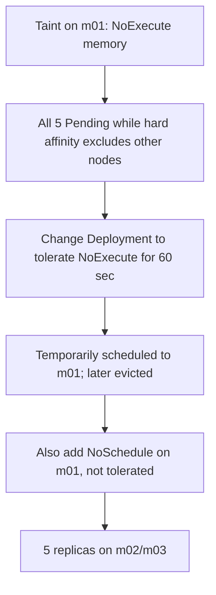
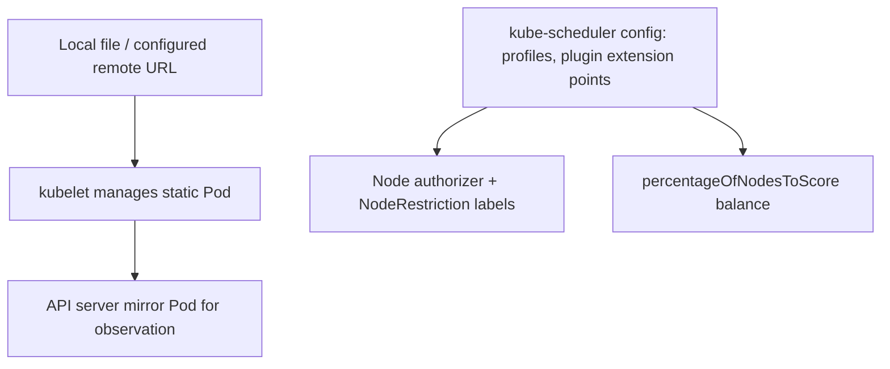

# Диаграммы главы 19 — планирование Pod

**RAG:** pp641–667, `p0641:c01`–`p0667:c01`. Схемы синтезированы по исходному тексту, а не реконструированы с рисунков PDF.

## Scheduler filter → score → node binding

p642–p644. Source notes scheduling decision not continuously revisited after Pod is running. Direct `spec.nodeName` bypasses scheduler choice (pp645–648).

## Placement constraint hierarchy

pp645–659. Tolerations are permissions to tolerate, not a command to target a specific node. Soft preference still allows fallback.

## Matching vs rollout Pending

p649–651. Source p651 shows 3 Pending and 4 old Running in one rollout snapshot; do not generalize exact count to all Deployment configurations.

## Hard and soft affinity

p652–656. Already running Pods are not automatically migrated merely because labels changed.

## NoExecute and NoSchedule

p660–662. Taints can evict running workloads; do not reproduce on non-disposable nodes. Source two-taint cleanup command p662 is malformed.

## Static Pod and scheduler configs

p663–666. No static Pod runtime test, profile deployment or scheduler config verification is supplied. `v1alpha1/algorithmSource` fragment is not production-ready evidence.
