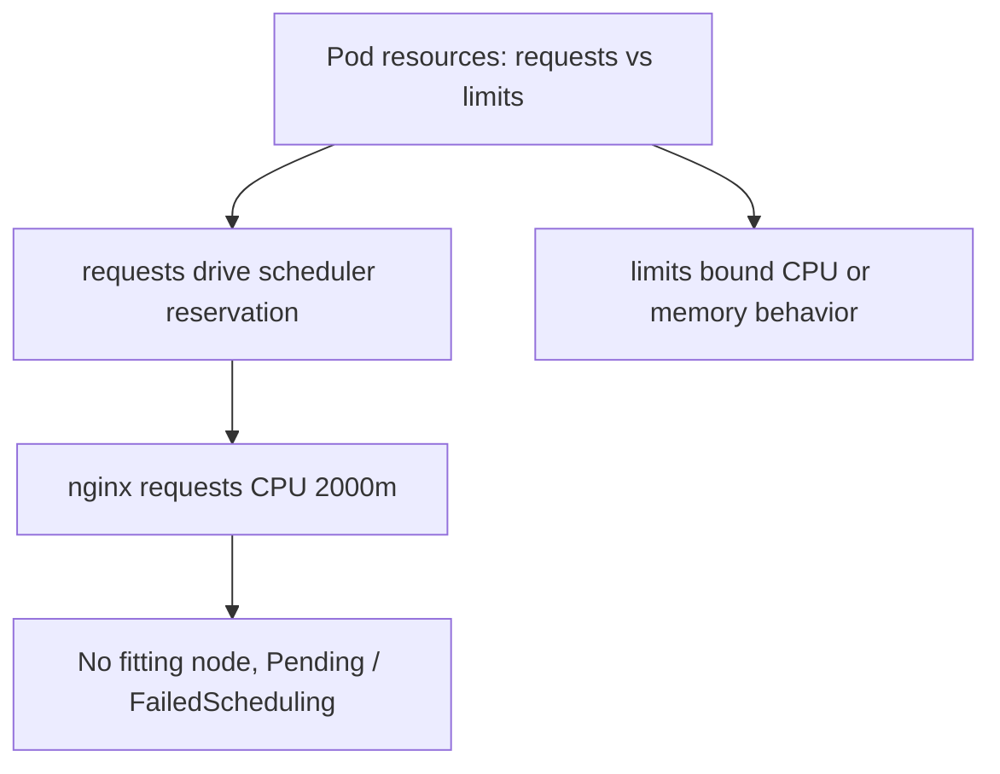
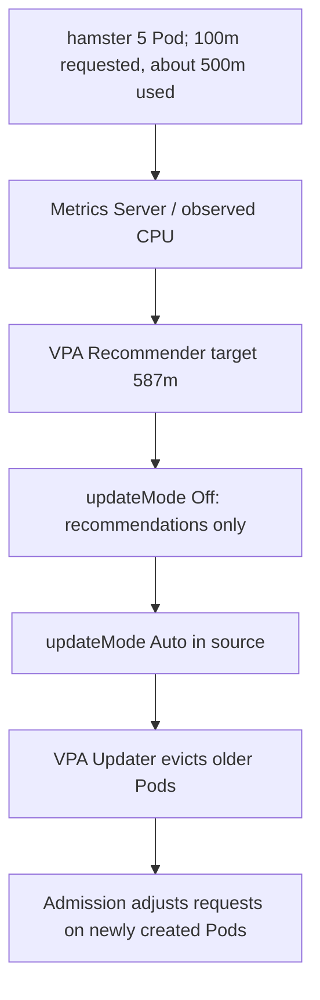
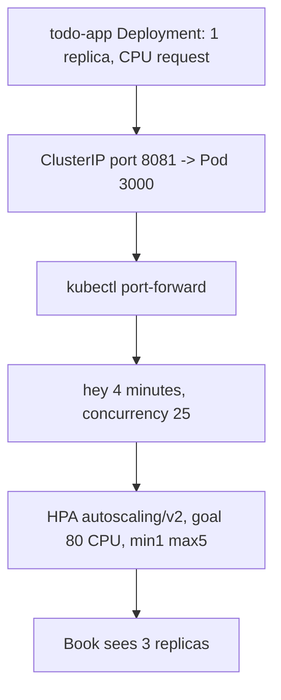
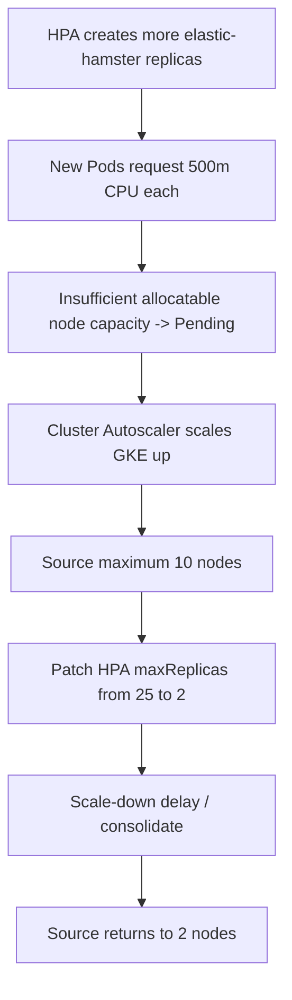
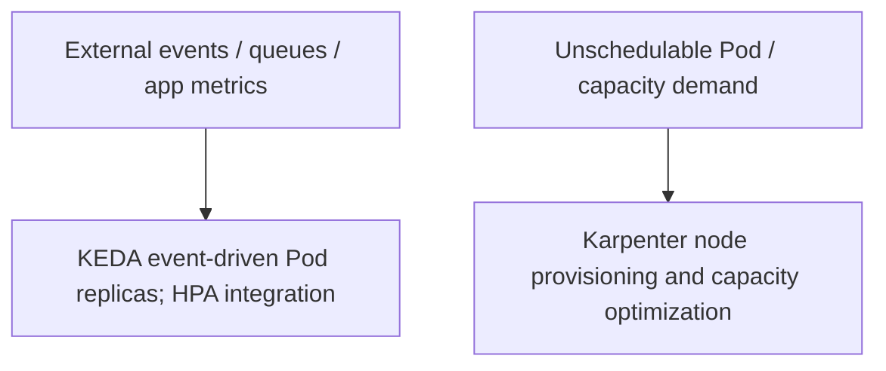
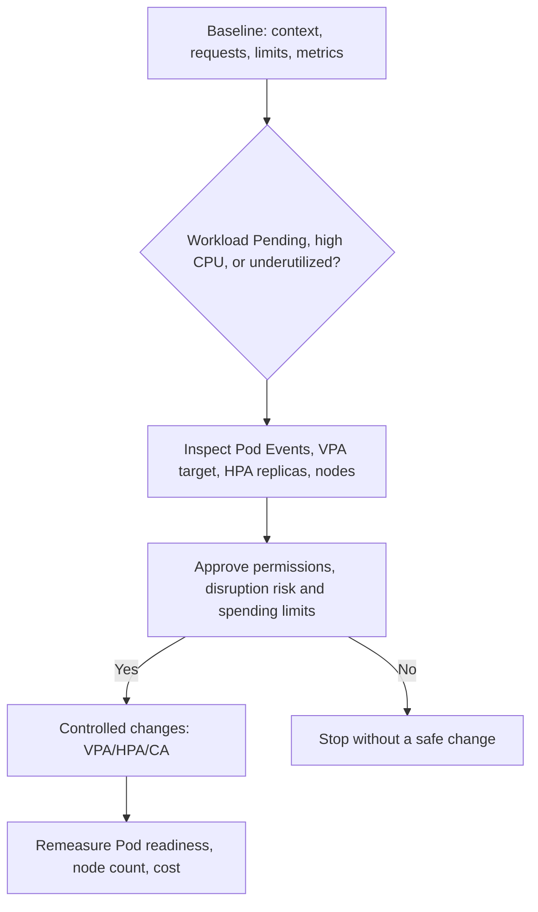

# Диаграммы главы 20 — VPA, HPA, CA и event-driven scaling

**Provenance:** RAG-only pp668–704. Mermaid depicts book concepts and demo observations, not original PDF screenshots.

## Resource requests and Pending

p670–673. Event also lists leftover `machine-check-exception:memory` taint; CPU shortage is not sole scheduler reason in example.

## VPA recommendation and Pod replacement

pp674–682. Source says in-place resizing experimental, with v1.35 stable footnote. Do not treat this specific legacy Auto flow as current API contract.

## HPA load-test loop

pp685–690. Actual Todo YAML contains conflicting image and indentation; diagram expresses intended model, not proof its source manifest is valid.

## Horizontal Pod scaling drives Node scaling

pp691–700. CA RBAC/SA and HPA API versions are inconsistent in source; treat as conceptual flow until manifests are corrected via explicit external verification.

## KEDA and Karpenter

pp701–703. No installation, ScaledObject YAML, Karpenter NodePool or live testing in chapter.

## Operational check

As a safety interpretation of source pp673, 678, 692, 700, rather than an executed runbook.
