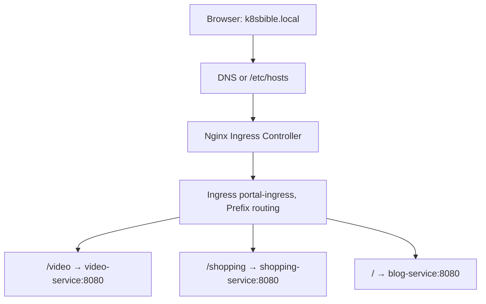
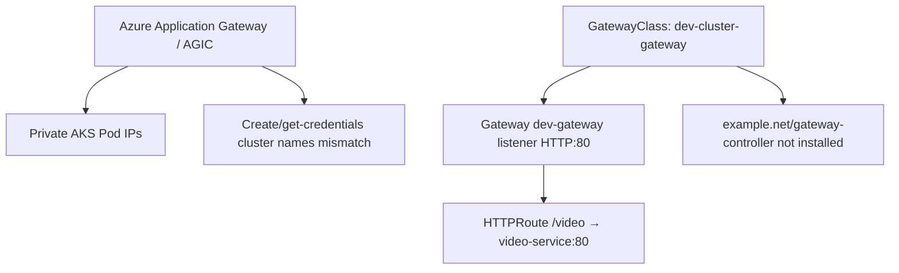
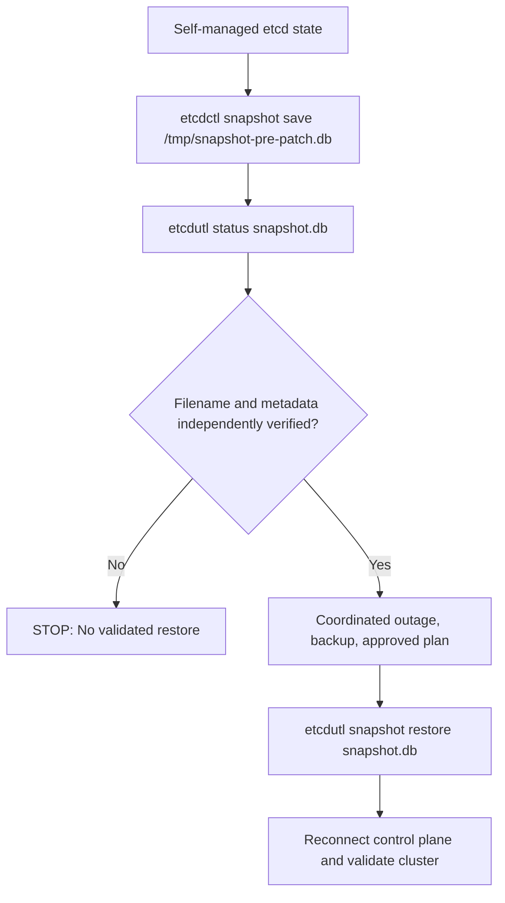
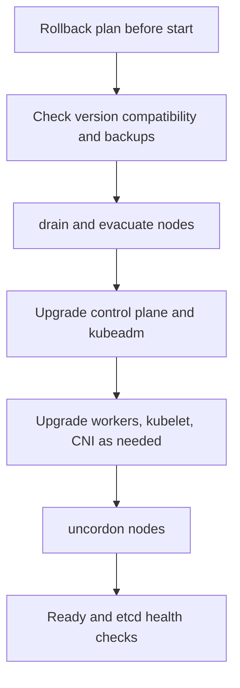
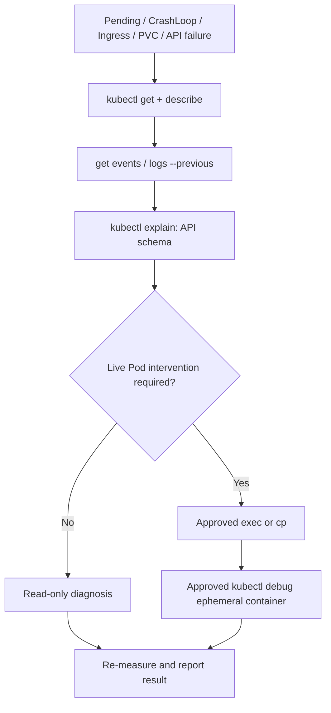
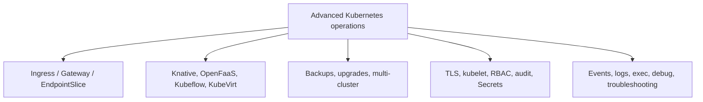

# Mermaid — Глава 21. Продвинутые механизмы Kubernetes

**RAG-only:** pages 705–749. Diagrams synthesize textual source evidence; original PDF figures were not reproduced. No runtime state verified.

## Shared L7 entry with Ingress

pp708–715. Source lab uses HTTP without TLS; Ingress alone does not process packets. Host setting discrepancy p708 vs p709 must be resolved before any actual deployment.

## AKS Application Gateway and Gateway API

pp717–722. AGIC and Gateway API are distinct conceptual paths. Gateway lacks verified controller and deploy/test sequence.

## Backup and restore gate

pp727–729. The filename discrepancy belongs to the source, not a tested command. Snapshots may contain credentials and restore can replace cluster state.

## Day-2 upgrade and configuration

pp730–732. Upgrade/downgrade not executed. `drain` may disrupt running applications; `uncordon` does not reverse a version upgrade.

## Troubleshooting workflow

pp739–747. Observation and modification are separate. `exec`, `cp` and `debug` cannot be claimed read-only.

## Broader chapter map

pp705–749. Ecosystem projects described conceptually, not installed.
