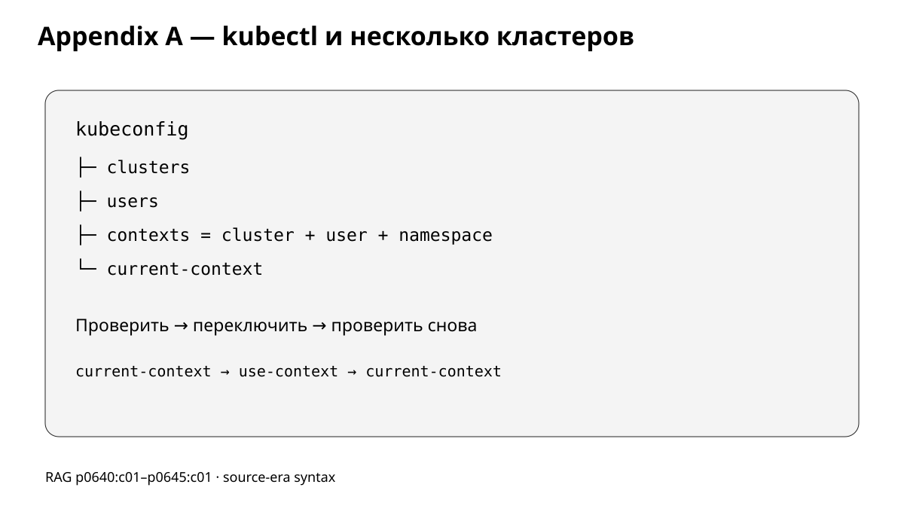
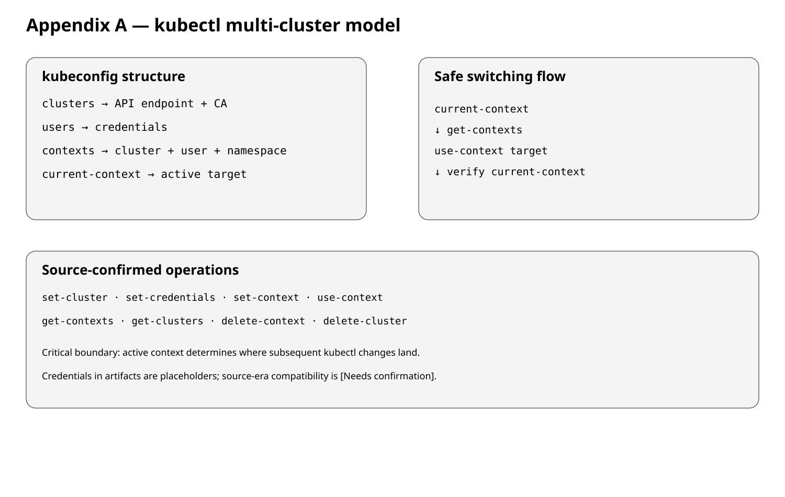

# Приложение A — Использование kubectl с несколькими кластерами

Практические заметки по приложению A книги «Kubernetes в действии» Марко Лукши.





## Идентификация

- Book ID: `kubernetes-in-action-marko-luksa-ru`
- Appendix: A
- Slug: `kubectl-multiple-clusters`
- Source policy: `rag_only`
- External sources: запрещены
- Model memory: запрещена
- Прямой доступ к canonical PDF: не использовался

## Provenance

- RAG chunks: `p0640:c01–p0645:c01`
- PDF pages: 640–645
- Printed pages: 639–644
- `p0640:c01` начинает приложение A.
- `p0646:c01` начинает приложение B.
- Boundary verified: yes
- Source SHA-256: `0d50f167ed86088d0cc65d15e27f1ab397e7c0a0c8de4db3801b50439f24266f`

## Карта приложения

1. Быстрое переключение между Minikube и GKE.
2. Назначение `~/.kube/config` и переменной `KUBECONFIG`.
3. Четыре логические части kubeconfig: clusters, users, contexts, current-context.
4. Контекст связывает cluster + user + default namespace.
5. `kubectl config set-cluster` добавляет/изменяет cluster entry.
6. `kubectl config set-credentials` добавляет/изменяет credentials.
7. `kubectl config set-context` связывает cluster/user/namespace.
8. `kubectl config use-context` переключает текущий context.
9. `kubectl config get-contexts` и `get-clusters` дают inventory.
10. `delete-context` и `delete-cluster` удаляют записи.

## Основной принцип

```text
kubeconfig
  ├─ clusters
  ├─ users
  ├─ contexts
  └─ current-context

context = cluster + user + default namespace
```

Операционная граница: перед state-changing kubectl-командой необходимо понимать, какой context является текущим.

## Conditional artifacts

- `summary.md`: не создан — отдельного appendix-end summary в источнике нет.
- `review-questions.md`: не создан — отдельного блока контрольных вопросов нет.
- `review-answers.md`: не применимо.

## Ограничения

Команды отражают состояние инструментов эпохи книги. Современная совместимость и текущий синтаксис: **[Needs confirmation]**.
