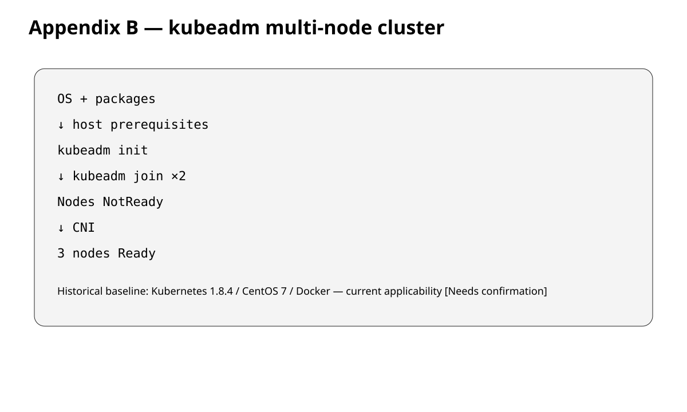
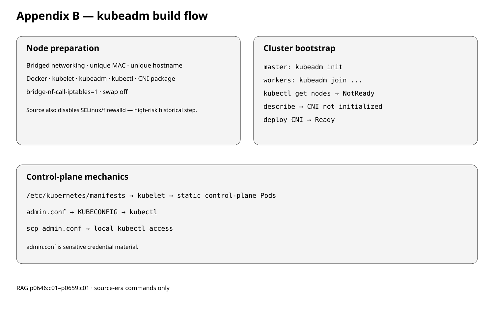

# Приложение B — Настройка многоузлового кластера с помощью kubeadm

RAG-grounded анализ приложения B.





## Идентификация

- Book ID: `kubernetes-in-action-marko-luksa-ru`
- Appendix: B
- Slug: `multi-node-cluster-kubeadm`
- Source policy: `rag_only`
- External sources/model memory: запрещены

## Provenance

- RAG chunks: `p0646:c01–p0659:c01`
- PDF pages: 646–659
- Printed pages: 645–658
- `p0646:c01` начинает приложение B.
- `p0660:c01` начинает приложение C.
- Boundary verified: yes
- Source SHA-256: `0d50f167ed86088d0cc65d15e27f1ab397e7c0a0c8de4db3801b50439f24266f`

## Карта приложения

1. Создание трех VM в VirtualBox, bridged networking.
2. CentOS 7 как source-era baseline.
3. Установка Docker, kubelet, kubeadm, kubectl, kubernetes-cni.
4. Source отключает SELinux/firewalld и swap; это существенные modifying actions.
5. Включается `net.bridge.bridge-nf-call-iptables=1`.
6. VM клонируется, MAC и hostnames должны различаться.
7. Узлы должны разрешать имена друг друга.
8. `kubeadm init` поднимает control plane.
9. `/etc/kubernetes/manifests` содержит static-pod manifests control plane.
10. `KUBECONFIG=/etc/kubernetes/admin.conf` дает kubectl доступ на master.
11. Workers присоединяются через `kubeadm join`.
12. До CNI узлы остаются `NotReady`.
13. Weave Net разворачивается как CNI; после этого узлы становятся `Ready`.
14. `admin.conf` можно скопировать на локальную машину для kubectl.

## Основной принцип

```text
OS baseline
  → node prerequisites
  → kubeadm init
  → kubeadm join
  → CNI deployment
  → nodes Ready
```

## Критические границы

Это наиболее исторически чувствительное приложение книги. В нем прямо фигурируют Kubernetes 1.8.4, CentOS 7, Docker и source-era kubeadm/CNI instructions.

Команды отключения SELinux/firewalld, старый yum repository, Docker runtime и Weave URL **не должны считаться современным production baseline**. Их актуальность: **[Needs confirmation]**.

## Conditional artifacts

Отдельных summary/review questions в приложении нет.
