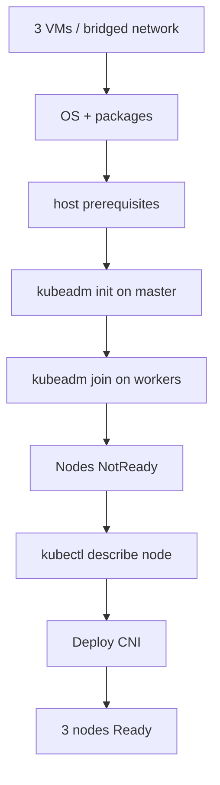

# Приложение B — diagrams



```mermaid
flowchart LR
  Manifest[/etc/kubernetes/manifests] --> Kubelet
  Kubelet --> APIServer[kube-apiserver Pod]
  Kubelet --> Scheduler[kube-scheduler Pod]
  Kubelet --> Controller[kube-controller-manager Pod]
  Kubelet --> Etcd[etcd Pod]
```
