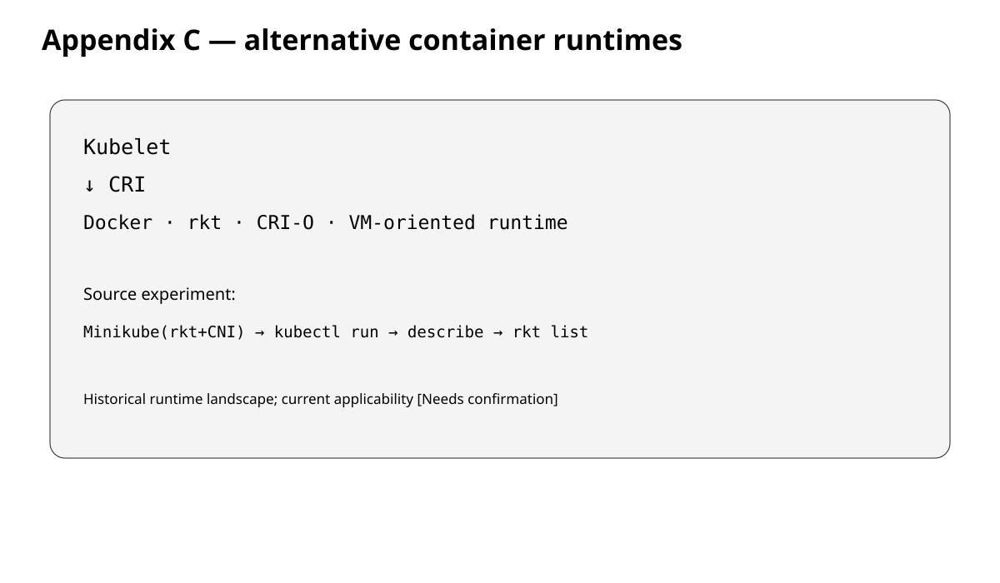
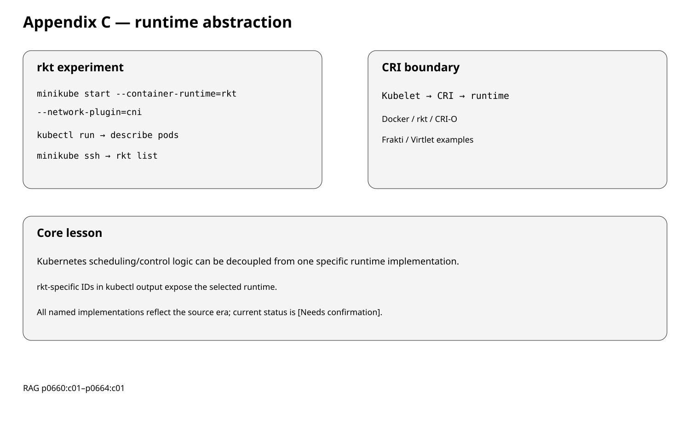

# Приложение C — Использование других контейнерных сред выполнения

RAG-grounded анализ приложения C.





## Идентификация

- Book ID: `kubernetes-in-action-marko-luksa-ru`
- Appendix: C
- Slug: `alternative-container-runtimes`
- Source policy: `rag_only`
- External sources/model memory: запрещены

## Provenance

- RAG chunks: `p0660:c01–p0664:c01`
- PDF pages: 660–664
- Printed pages: 659–663
- `p0660:c01` начинает приложение C.
- `p0665:c01` начинает приложение D.
- Boundary verified: yes
- Source SHA-256: `0d50f167ed86088d0cc65d15e27f1ab397e7c0a0c8de4db3801b50439f24266f`

## Карта приложения

1. rkt рассматривается как альтернатива Docker.
2. rkt нативно моделирует Pod и запускает workload без Docker-style daemon architecture.
3. Kubelet в source-era примере переключается на rkt через `--container-runtime=rkt`.
4. В Minikube rkt требует CNI networking.
5. Workload запускается обычным `kubectl`; runtime различие видно через `kubectl describe pods`.
6. `minikube ssh`, `rkt list` и `rkt image list` дают runtime-level visibility.
7. CRI введен как plugin API между Kubelet и container runtime.
8. Source утверждает, что начиная с Kubernetes 1.6 Docker и rkt используются через CRI.
9. CRI-O показан как OCI-oriented runtime implementation.
10. Frakti/Virtlet показывают возможность запускать VM-backed workloads через CRI abstractions.

## Основной принцип

```text
Kubelet
  ↓
CRI
  ↓
runtime implementation
  ├─ Docker
  ├─ rkt
  ├─ CRI-O
  └─ VM-oriented implementations
```

## Ограничения

Материал исторический: rkt, source-era CRI behavior и упомянутые VM runtime implementations требуют современной перепроверки: **[Needs confirmation]**.

## Conditional artifacts

Отдельных summary/review questions нет.
