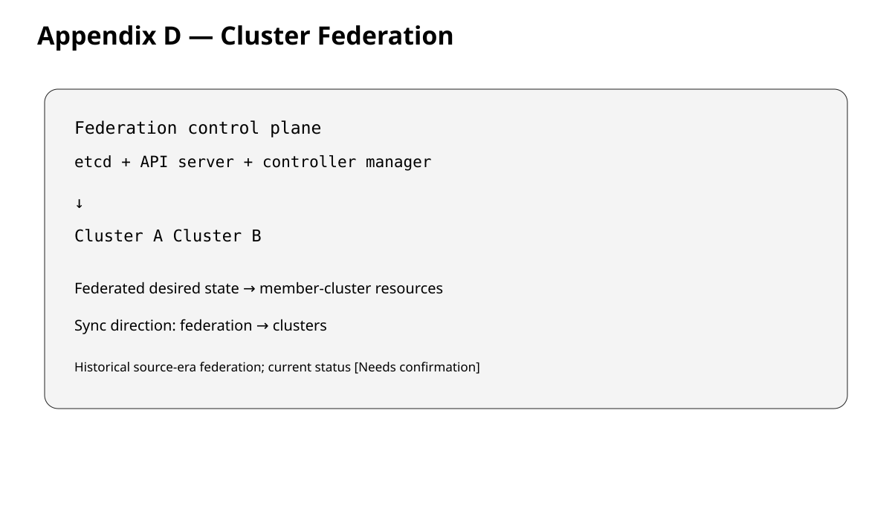
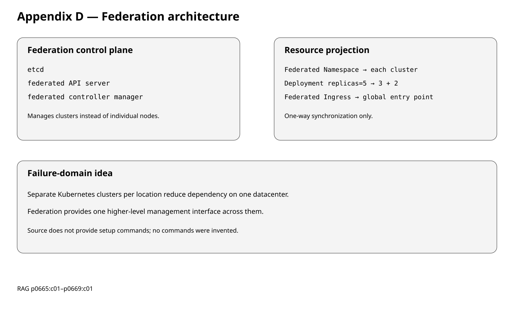

# Приложение D — Кластерная федерация

RAG-grounded анализ приложения D.





## Идентификация

- Book ID: `kubernetes-in-action-marko-luksa-ru`
- Appendix: D
- Slug: `cluster-federation`
- Source policy: `rag_only`
- External sources/model memory: запрещены

## Provenance

- RAG chunks: `p0665:c01–p0669:c01`
- PDF pages: 665–669
- Printed pages: 664–668
- `p0665:c01` начинает приложение D.
- `p0670:c01` начинает предметный указатель.
- Boundary verified: yes
- Source SHA-256: `0d50f167ed86088d0cc65d15e27f1ab397e7c0a0c8de4db3801b50439f24266f`

## Карта приложения

1. Отказ всего дата-центра рассматривается как причина использовать несколько отдельных clusters.
2. Federation объединяет несколько Kubernetes clusters в управляемый «cluster of clusters».
3. Цель: multi-datacenter/multi-cloud management и higher availability.
4. Federation control plane включает etcd, federated API server и federated controller manager.
5. Пользователь создает federated resources через federated API.
6. Federation controllers создают/управляют обычными resources в member clusters.
7. Source-era supported resources включают Namespace, ConfigMap, Secret, Service, Ingress, Deployment, ReplicaSet, Job, DaemonSet, HPA и Cluster.
8. Синхронизация односторонняя: federation → member clusters.
9. Изменения вручную в member cluster не синхронизируются обратно.
10. Для Namespace/ConfigMap/Secret/Service/DaemonSet source описывает replication в member clusters.
11. Deployment/ReplicaSet replicas распределяются между clusters так, чтобы суммарное desired количество соответствовало federated object.
12. Federated Ingress представляет global entry point, а не простое копирование Ingress в каждый cluster.
13. Список Pods всех clusters через federated API в source недоступен.
14. Настройка federation cluster в приложении не выполняется — только концептуальная архитектура.

## Основной принцип

```text
Federated API object
       ↓
Federation controller
       ↓
member cluster API servers
       ↓
ordinary Kubernetes resources
```

## Ограничения

Материал описывает source-era Kubernetes federation. Текущий статус технологии и современная архитектура multi-cluster management: **[Needs confirmation]**.

## Conditional artifacts

Отдельных summary/review questions нет.
