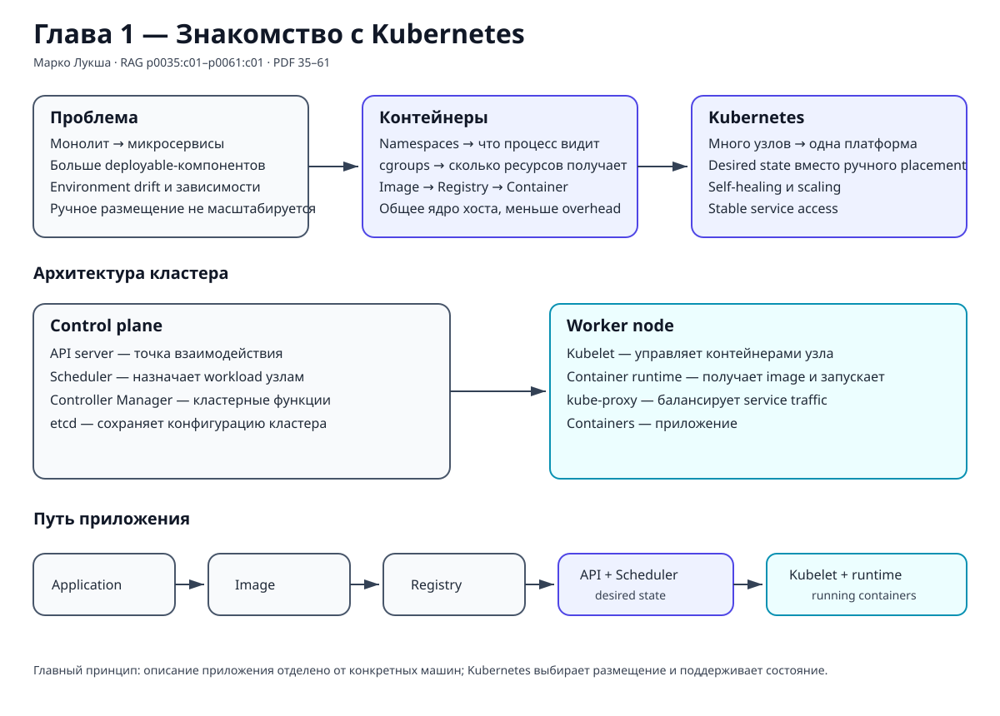
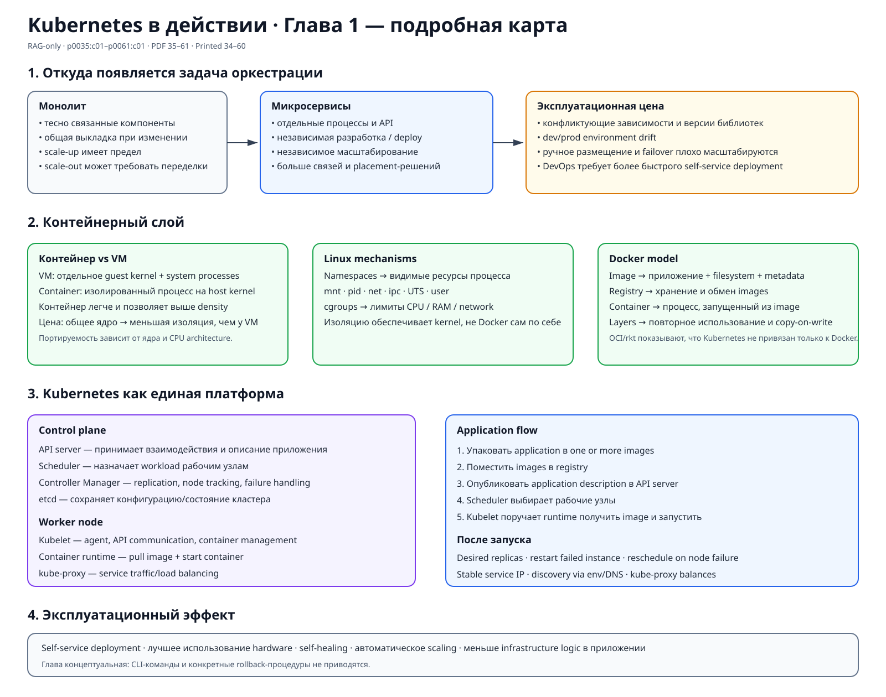

# Глава 1 — Знакомство с Kubernetes

Практические и концептуальные заметки по главе 1 книги «Kubernetes в действии» Марко Лукши.

## Идентификация

- Book ID: `kubernetes-in-action-marko-luksa-ru`
- Глава: 1
- Название: «Знакомство с Kubernetes»
- Slug: `introducing-kubernetes`
- Source policy: `rag_only`
- External sources: запрещены
- Model memory: запрещена
- Прямой доступ к canonical PDF: не использовался

## Provenance

- RAG chunks: `p0035:c01`–`p0061:c01`
- PDF pages: 35–61
- Printed pages: 34–60
- Оглавление в `p0007:c01` задаёт начало главы 1 на печатной странице 34 и начало главы 2 на печатной странице 61.
- `p0035:c01` начинается заголовком «Глава 1. Знакомство с Kubernetes».
- `p0061:c01` содержит раздел `1.4 Резюме` и завершение главы.
- Следующий чанк `p0062:c01` начинается заголовком «Глава 2. Первые шаги с Docker и Kubernetes».
- Chapter boundary verified: yes
- Source SHA-256: `0d50f167ed86088d0cc65d15e27f1ab397e7c0a0c8de4db3801b50439f24266f`

## Содержимое

- [cheatsheet.md](cheatsheet.md) — карта проблем, контейнерного слоя и роли Kubernetes.
- [commands.md](commands.md) — только инструменты и интерфейсы, явно поддержанные главой; CLI-синтаксис не додумывается.
- [diagram.md](diagram.md) — Mermaid-схемы: эволюция задач, архитектура кластера и путь приложения.
- [summary.md](summary.md) — RAG-grounded перенос смысла явного раздела `1.4 Резюме`.
- [visual-cheatsheet.svg](visual-cheatsheet.svg) — компактный обзор.
- [visual-cheatsheet-detailed.svg](visual-cheatsheet-detailed.svg) — подробный обзор.

`review-questions.md` и `review-answers.md` не создавались: в проверенной границе главы отсутствуют отдельные контрольные вопросы или упражнения.

## Карта главы

1. Почему рост числа компонентов делает ручное размещение, конфигурирование и восстановление приложений непрактичными.
2. Переход от монолитов к микросервисам: независимые процессы, API и независимое масштабирование.
3. Цена микросервисов: усложнение размещения, обнаружения, сетевого взаимодействия и управления зависимостями.
4. Необходимость одинакового окружения разработки и production.
5. DevOps и идея самообслуживания разработчиков при сохранении инфраструктурной ответственности системных администраторов.
6. Контейнеры как изоляция процессов с меньшими накладными расходами, чем отдельная VM для каждого компонента.
7. Linux namespaces как механизм разделения представления системы и cgroups как механизм ограничения ресурсов.
8. Docker: image, registry, container; слоистая файловая система и распространение образов.
9. Ограничения переносимости контейнеров: зависимость от ядра хоста и аппаратной архитектуры.
10. OCI/rkt как подтверждение того, что Kubernetes не сводится к конкретному контейнерному движку.
11. Происхождение Kubernetes из опыта Google с Borg и Omega.
12. Kubernetes как единая платформа развертывания поверх множества узлов.
13. Базовая архитектура: control plane и worker nodes.
14. Компоненты control plane: API server, scheduler, controller manager, etcd.
15. Компоненты worker node: container runtime, Kubelet, kube-proxy.
16. Путь приложения: образ → registry → описание приложения → API server → scheduler → Kubelet → container runtime.
17. Поддержание желаемого состояния, восстановление после отказов, масштабирование и единая точка доступа к репликам службы.
18. Выгоды: самообслуживание разработчиков, лучшее использование ресурсов, self-healing, автоматическое масштабирование и упрощение разработки.

## Краткий анализ главы

Глава строит мотивацию Kubernetes от эксплуатационной проблемы, а не от API или команд. Автор начинает с изменения архитектуры приложений: монолиты уступают место множеству независимо развертываемых микросервисов. Это упрощает развитие и масштабирование отдельных компонентов, но одновременно резко увеличивает количество объектов, которые требуется разместить, связать, настроить и восстановить после отказов.

Вторая линия аргумента — окружение выполнения. Разные версии библиотек, различия между ноутбуком разработчика и production и постепенный drift серверов делают ручное сопровождение нестабильным. Контейнеры используются как способ упаковать приложение вместе с ожидаемой файловой системой и зависимостями и изолировать процессы друг от друга.

Глава отдельно проводит границу между виртуальной машиной и контейнером. VM предоставляет отдельное ядро и более сильную изоляцию ценой дополнительных системных процессов и ресурсов. Контейнер использует ядро хоста; изоляция достигается функциями ядра Linux. Namespaces ограничивают то, что процесс видит, а cgroups — объём ресурсов, который процесс может потреблять.

Docker представлен не как сама технология изоляции, а как удобная платформа упаковки, распространения и запуска контейнеризированных приложений. Три базовых объекта — image, registry и container. Слоистые образы уменьшают объём передачи и хранения, но переносимость контейнера не абсолютна: приложение по-прежнему зависит от совместимого ядра и аппаратной архитектуры.

После этой базы Kubernetes вводится как система, абстрагирующая множество машин в одну платформу развертывания. Разработчик описывает, что нужно запустить и в каком количестве, а Kubernetes выбирает рабочие узлы, запускает контейнеры и стремится удерживать фактическое состояние в соответствии с описанием.

Архитектурная модель главы делит кластер на control plane и worker nodes. Control plane содержит API server, scheduler, controller manager и etcd. Worker node содержит container runtime, Kubelet и kube-proxy. При публикации описания приложения API server принимает желаемое состояние, scheduler назначает workload на узлы, Kubelet инициирует получение образов и запуск контейнеров.

Последняя часть связывает архитектуру с эксплуатационным эффектом: Kubernetes может восстанавливать экземпляры после отказов, перемещать workload при потере узла, изменять число реплик, обеспечивать стабильную точку доступа к группе контейнеров и улучшать размещение приложений по доступным ресурсам.

## Основной принцип

Kubernetes отделяет желаемое состояние приложения от конкретных машин:

`описание приложения → Kubernetes → выбор узлов → запуск → постоянное поддержание состояния`.

Разработчик формулирует требования приложения, а платформа берёт на себя значительную часть инфраструктурного размещения и сопровождения.

## Ограничения

- Глава вводная: она объясняет модель и архитектуру, но почти не содержит эксплуатационного CLI.
- Конкретный синтаксис команд Docker/Kubernetes в этой главе не приводится; он начинается в следующей главе.
- Глава использует терминологию и набор runtime-компонентов своего издания, включая «ведущий узел (мастер)», Docker и rkt. Артефакты сохраняют исходную терминологию и не модернизируют её из внешних источников.
- Рисунки 1.1–1.10 в RAG представлены извлечённым текстом и подписями; отдельные графические объекты RAG не кодирует.
