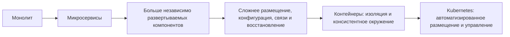
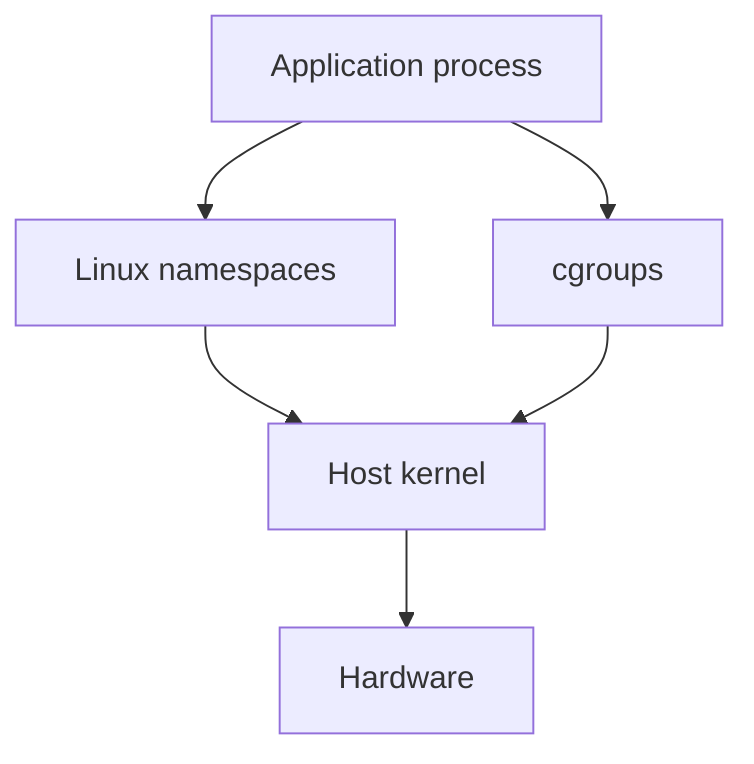
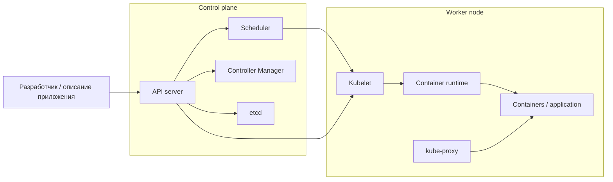
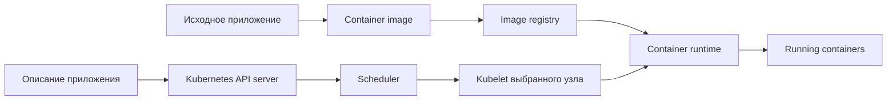
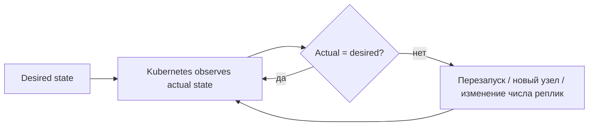

# Диаграммы: логика главы 1

## 1. Почему появляется Kubernetes

Глава связывает Kubernetes с ростом операционной сложности: микросервисы дают независимость компонентам, но требуют автоматизации размещения и сопровождения.

## 2. Контейнерная граница

Namespaces определяют, какие системные ресурсы видит процесс. cgroups ограничивают объём ресурсов, который процесс может потреблять.

## 3. Базовая архитектура Kubernetes

Control plane хранит и управляет состоянием кластера; worker nodes выполняют контейнеризированные приложения.

## 4. Путь приложения

Описание приложения задаёт требуемое состояние, а Kubernetes выбирает узлы и инициирует запуск.

## 5. Поддержание состояния

Диаграмма отражает описанный в главе принцип постоянного поддержания количества и состояния экземпляров.
