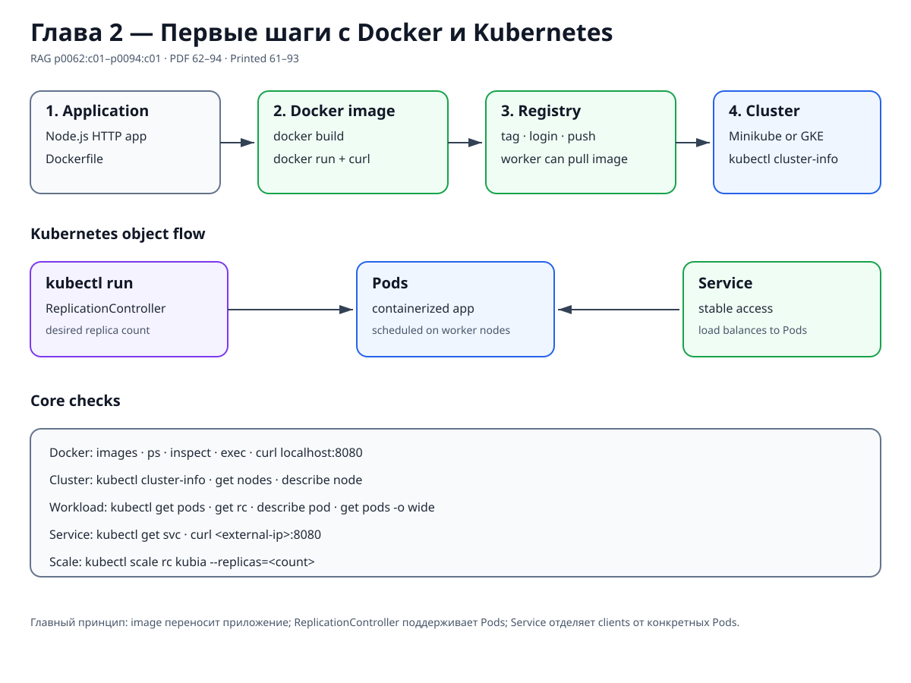
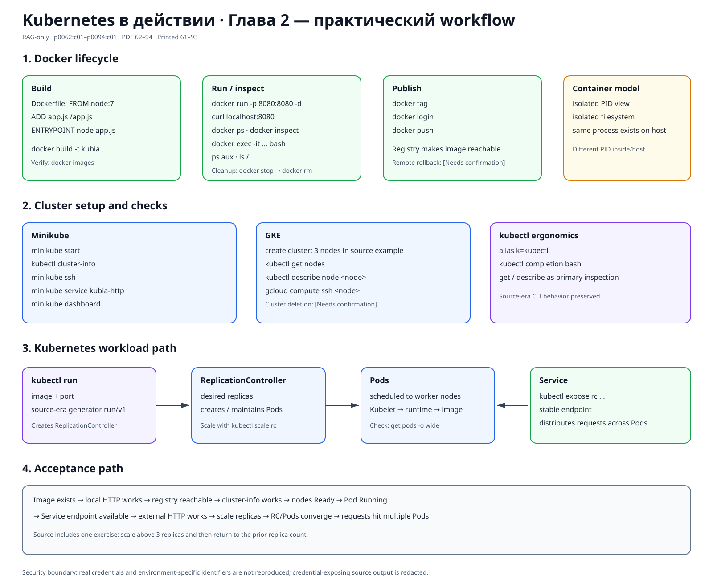

# Глава 2 — Первые шаги с Docker и Kubernetes

Практические и концептуальные заметки по главе 2 книги «Kubernetes в действии» Марко Лукши.

## Идентификация

- Book ID: `kubernetes-in-action-marko-luksa-ru`
- Глава: 2
- Название: «Первые шаги с Docker и Kubernetes»
- Slug: `first-steps-with-docker-and-kubernetes`
- Source policy: `rag_only`
- External sources: запрещены
- Model memory: запрещена
- Прямой доступ к canonical PDF: не использовался

## Provenance

- RAG chunks: `p0062:c01`–`p0094:c01`
- PDF pages: 62–94
- Printed pages: 61–93
- Оглавление в `p0008:c01` задаёт разделы главы 2 и начало главы 3 на печатной странице 94.
- `p0062:c01` начинается заголовком «Глава 2. Первые шаги с Docker и Kubernetes».
- `p0094:c01` содержит явный раздел `2.4 Резюме`.
- Следующий чанк `p0095:c01` начинается заголовком «Глава 3. Модули: запуск контейнеров в Kubernetes».
- Chapter boundary verified: yes
- Source SHA-256: `0d50f167ed86088d0cc65d15e27f1ab397e7c0a0c8de4db3801b50439f24266f`

## Содержимое

- [cheatsheet.md](cheatsheet.md) — end-to-end workflow: код → image → registry → cluster → workload → service → scale.
- [commands.md](commands.md) — команды Docker, Minikube, gcloud и kubectl, явно поддержанные главой.
- [diagram.md](diagram.md) — Mermaid-карта сборки, развертывания, доступа и масштабирования.
- [summary.md](summary.md) — RAG-grounded резюме явного раздела `2.4 Резюме`.
- [review-questions.md](review-questions.md) — одно ненумерованное упражнение, явно присутствующее в главе.
- [review-answers.md](review-answers.md) — RAG-grounded решение упражнения; не официальный издательский answer key.
- [visual-cheatsheet.svg](visual-cheatsheet.svg) — компактный обзор.
- [visual-cheatsheet-detailed.svg](visual-cheatsheet-detailed.svg) — подробный обзор.

## Карта главы

1. Запуск готового образа Docker из Docker Hub.
2. Создание простого HTTP-приложения Node.js.
3. Dockerfile: базовый image, добавление приложения и entrypoint.
4. Сборка image и просмотр локальных images.
5. Запуск контейнера, публикация порта и проверка через HTTP.
6. Исследование контейнера: `docker ps`, `docker inspect`, `docker exec`, процессы и файловая система.
7. Остановка и удаление контейнера.
8. Дополнительный тег image, Docker Hub login и push.
9. Запуск опубликованного image на другой машине.
10. Локальный одноузловой Kubernetes через Minikube.
11. Управляемый многоузловой Kubernetes через Google Kubernetes Engine.
12. Проверка кластера через `kubectl cluster-info`, `get` и `describe`.
13. Alias и shell completion для `kubectl`.
14. `kubectl run`: создание ReplicationController и запуск Pod.
15. `kubectl expose`: создание Service и внешний доступ.
16. Связь ReplicationController → Pod → Service.
17. Горизонтальное масштабирование через изменение числа реплик.
18. Проверка распределения запросов по нескольким Pod.
19. Просмотр назначения Pod на узлы.
20. Доступ к Kubernetes Dashboard.

## Краткий анализ главы

Глава переводит модель из главы 1 в практический end-to-end сценарий. Исходной точкой является небольшой Node.js HTTP-сервис. Автор сначала показывает, как получить готовый Docker image и запустить его, затем упаковывает собственное приложение в image через Dockerfile.

Docker-часть главы формирует полный базовый цикл: build → inspect → run → test → enter container → stop/remove → tag → push → run elsewhere. Это демонстрирует, что приложение и его ожидаемая файловая среда перемещаются как image, а runtime-машине не требуется локальная установка Node.js.

Исследование контейнера закрепляет модель изоляции: внутри контейнера виден небольшой набор процессов и собственная файловая система, тогда как на хосте тот же application process существует с другим PID. Практический вывод главы — `docker exec -it ... bash` используется как способ посмотреть фактическое окружение, которое видит приложение.

После публикации image глава переходит к Kubernetes. Для локальной практики используется Minikube, для многоузлового примера — Google Kubernetes Engine. `kubectl` выступает клиентом, который обращается к Kubernetes API; базовые проверки выполняются через `cluster-info`, `get` и `describe`.

Первое приложение запускается командой `kubectl run`. В контексте версии из книги эта команда создаёт ReplicationController, который обеспечивает существование Pod. Kubelet на выбранном узле получает назначение, container runtime загружает image из registry и запускает контейнер.

Для доступа извне создаётся Service через `kubectl expose`. Service отделяет стабильную точку доступа от конкретного Pod. При увеличении числа реплик ReplicationController создаёт дополнительные Pod, а Service распределяет запросы между ними.

Глава завершает практическую модель Kubernetes связкой:

`ReplicationController → Pods ← Service`

Контроллер отвечает за требуемое количество Pod, а Service предоставляет стабильный сетевой вход к группе Pod.

## Основной принцип

Рабочий путь главы:

`source code → Docker image → registry → Kubernetes desired state → Pod replicas → Service`.

Image переносит приложение и окружение, Kubernetes управляет экземплярами, а Service отделяет клиентов от конкретных Pod.

## Ограничения

- Команды и версии сохраняются в контексте издания книги; совместимость с современными Docker/Kubernetes/GKE не проверялась и не достраивалась извне.
- В главе используются source-era объекты и параметры, включая ReplicationController и `kubectl run ... --generator=run/v1`.
- Примеры установки Minikube/kubectl содержат версии и URL из источника; они приведены как материал главы, а не как актуальная инструкция установки.
- Environment-specific Docker Hub ID, node names и IP-адреса в артефактах заменены placeholders.
- Команда из источника, выводящая GKE username/password, классифицирована как credential-exposing; реальный пример пароля не переносится.
- Глава не предоставляет cleanup/rollback-команды для созданного GKE-кластера, Service или ReplicationController; такие rollback помечены `[Needs confirmation]`.
