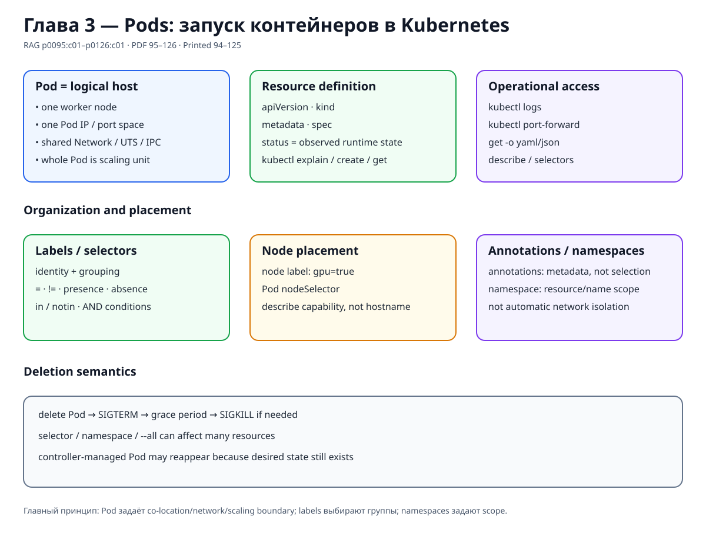
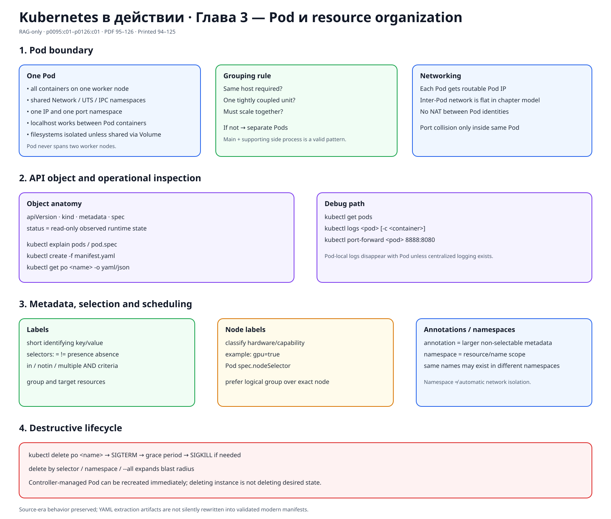

# Глава 3 — Модули: запуск контейнеров в Kubernetes

Практические и концептуальные заметки по главе 3 книги «Kubernetes в действии» Марко Лукши.

## Идентификация

- Book ID: `kubernetes-in-action-marko-luksa-ru`
- Глава: 3
- Название: «Модули: запуск контейнеров в Kubernetes»
- Slug: `pods-running-containers-in-kubernetes`
- Source policy: `rag_only`
- External sources: запрещены
- Model memory: запрещена
- Прямой доступ к canonical PDF: не использовался

## Provenance

- RAG chunks: `p0095:c01`–`p0126:c01`
- PDF pages: 95–126
- Printed pages: 94–125
- Оглавление в `p0008:c01`–`p0009:c01` задаёт разделы главы 3 и начало главы 4 на печатной странице 126.
- `p0095:c01` начинается заголовком «Глава 3. Модули: запуск контейнеров в Kubernetes».
- `p0126:c01` содержит явный раздел `3.9 Резюме`.
- Следующий чанк `p0127:c01` начинается заголовком главы 4.
- Chapter boundary verified: yes
- Source SHA-256: `0d50f167ed86088d0cc65d15e27f1ab397e7c0a0c8de4db3801b50439f24266f`

## Содержимое

- [cheatsheet.md](cheatsheet.md) — operational map Pod → labels/selectors → node placement → annotations → namespaces → deletion.
- [commands.md](commands.md) — source-confirmed команды `kubectl`, logs, port-forward, labels, selectors, annotations, namespaces и delete semantics.
- [diagram.md](diagram.md) — Mermaid-карта Pod, flat network, grouping, labels/selectors и namespaces.
- [summary.md](summary.md) — RAG-grounded резюме явного раздела `3.9 Резюме`.
- [visual-cheatsheet.svg](visual-cheatsheet.svg) — компактный обзор.
- [visual-cheatsheet-detailed.svg](visual-cheatsheet-detailed.svg) — подробный обзор.

`review-questions.md` и `review-answers.md` не создавались: в проверенной границе главы нет отдельного блока контрольных вопросов и нет явно обозначенного упражнения.

## Карта главы

1. Pod как центральная развёртываемая единица Kubernetes.
2. Все контейнеры одного Pod всегда работают на одном worker node.
3. Один основной процесс на контейнер; несколько тесно связанных контейнеров объединяются Pod.
4. Контейнеры Pod совместно используют Network/UTS/IPC namespaces; файловые системы по умолчанию раздельны.
5. Контейнеры одного Pod используют один IP/port space и могут общаться через `localhost`.
6. Между Pod используется плоская сеть без NAT на уровне модели главы.
7. Решение «один Pod или несколько» определяется совместным размещением, связностью и совместным масштабированием.
8. YAML/JSON manifests как полное декларативное описание Kubernetes resources.
9. Общая структура API object: `apiVersion`, `kind`, `metadata`, `spec`, runtime `status`.
10. `kubectl explain` для исследования полей resource API.
11. Создание Pod через `kubectl create -f`, чтение YAML/JSON, logs и port-forward.
12. Labels как организация и идентификация ресурсов.
13. Label selectors как фильтрация подмножеств и выполнение операций над группами.
14. Node labels + `nodeSelector` для описания требований к placement.
15. Предпочтение логических групп nodes конкретным node names.
16. Annotations как неидентифицирующие metadata blobs; annotation selector отсутствует.
17. Namespaces как scope имён и группировка ресурсов.
18. Namespace не означает автоматическую network isolation.
19. Удаление Pod по имени, selector, namespace или массовой командой.
20. Контроллер может воссоздать удалённый Pod, если desired state всё ещё требует его существования.

## Краткий анализ главы

Глава переводит Pod из объекта, который уже встречался в главе 2, в центральную модель Kubernetes. Pod — это не просто контейнер: это логический host для одного или нескольких тесно связанных контейнеров, которые всегда размещаются совместно на одном worker node.

Ключевой принцип группировки — процессы не следует без причины помещать в один container и не следует без причины помещать независимые компоненты в один Pod. Если компоненты могут работать на разных hosts, являются независимыми либо должны масштабироваться отдельно, глава рекомендует отдельные Pods. Несколько containers в одном Pod оправданы для тесно связанных main/supporting processes.

Контейнеры одного Pod разделяют сетевую среду: один IP и один namespace портов, поэтому внутри Pod возможен `localhost`, но появляется риск port collision. Между Pods глава описывает flat network: каждый Pod получает адрес и может напрямую видеть адрес другого Pod без NAT на логическом уровне Kubernetes.

Вторая крупная тема — декларативное описание ресурсов. Kubernetes objects создаются из YAML/JSON manifests. Глава закрепляет общую анатомию API object: `apiVersion`, `kind`, `metadata`, `spec`; `status` представляет наблюдаемое runtime state и при создании не задаётся. `kubectl explain` используется как встроенная справка по структуре API.

После создания Pod глава вводит базовые operational checks: `kubectl get`, получение полного YAML/JSON, `kubectl logs` и `kubectl port-forward`. Logs относятся к существующему container; при удалении Pod его локальные logs исчезают, если не настроено централизованное логирование.

Labels и selectors формируют основной механизм организации. Labels — короткие идентифицирующие key/value metadata. Selectors позволяют выбрать ресурсы по наличию, отсутствию, равенству/неравенству и наборам значений. Несколько условий объединяются так, что resource должен удовлетворять им всем.

Node labels развивают ту же модель для scheduling. Вместо привязки приложения к конкретному hostname глава рекомендует описывать свойство нужного node, например `gpu=true`, и использовать `nodeSelector`. Это сохраняет абстракцию Kubernetes над инфраструктурой.

Annotations похожи на labels по форме, но предназначены не для отбора ресурсов, а для более крупных metadata. Namespace обеспечивает scope имён и логическую группировку, но глава прямо предупреждает: namespace сам по себе не гарантирует network isolation между запущенными Pods.

Финальный раздел показывает lifecycle удаления. Удаление Pod вызывает graceful termination через SIGTERM и затем SIGKILL после периода ожидания. Но если Pod создан ReplicationController, контроллер создаст замену: для устранения workload недостаточно удалить только текущий Pod.

## Основной принцип

Рабочая модель главы:

`Pod = unit of co-location + networking + scaling`

и поверх неё:

`labels/selectors → grouping`

`node labels/nodeSelector → placement constraints`

`namespaces → naming/resource scope`.

## Ограничения

- Термин «модуль» сохранён как перевод Pod из источника; в артефактах рядом используется `Pod` для однозначности.
- Source-era команды и API behavior не модернизировались.
- RAG extraction некоторых YAML listings содержит типографические артефакты в list markers; executable manifests из них не реконструируются молча.
- Строка `curl` в `p0108:c01` извлечена как `curl localhost: 8888`; артефакт сохранён и помечен, а не исправлен из внешнего знания.
- Namespace isolation не трактуется как network isolation: источник прямо говорит, что это зависит от networking solution.
- `kubectl delete all --all` не удаляет буквально все resource types и в примере также удаляет Service `kubernetes`, который затем должен быть автоматически воссоздан.
