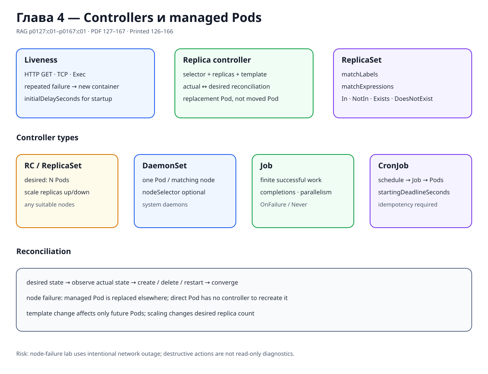
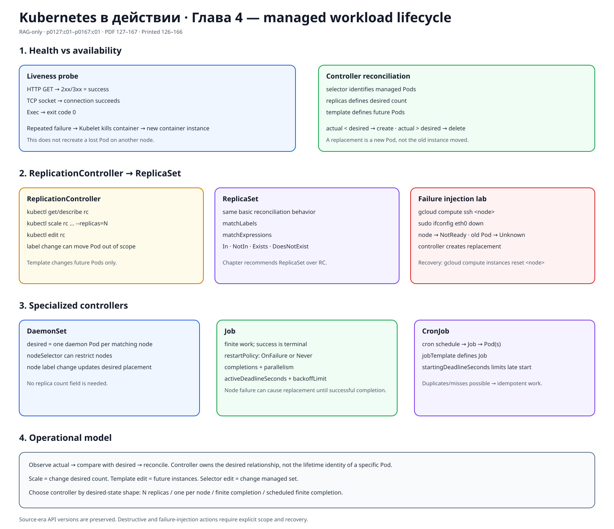

# Глава 4 — Контроллер репликации и другие контроллеры: развертывание управляемых модулей

Практические и концептуальные заметки по главе 4 книги «Kubernetes в действии» Марко Лукши.

## Идентификация

- Book ID: `kubernetes-in-action-marko-luksa-ru`
- Глава: 4
- Название: «Контроллер репликации и другие контроллеры: развертывание управляемых модулей»
- Slug: `replication-and-other-controllers`
- Source policy: `rag_only`
- External sources: запрещены
- Model memory: запрещена
- Прямой доступ к canonical PDF: не использовался

## Provenance

- RAG chunks: `p0127:c01`–`p0167:c01`
- PDF pages: 127–167
- Printed pages: 126–166
- Оглавление в `p0009:c01`–`p0010:c01` задаёт разделы главы 4 и начало главы 5 на печатной странице 167.
- `p0127:c01` начинается заголовком главы 4.
- `p0166:c01`–`p0167:c01` содержат явный раздел `4.7 Резюме`.
- Следующий чанк `p0168:c01` начинается заголовком главы 5.
- Chapter boundary verified: yes
- Source SHA-256: `0d50f167ed86088d0cc65d15e27f1ab397e7c0a0c8de4db3801b50439f24266f`

## Содержимое

- [cheatsheet.md](cheatsheet.md) — карта self-healing и controller types.
- [commands.md](commands.md) — source-confirmed checks/actions с отделением failure injection и destructive operations.
- [diagram.md](diagram.md) — Mermaid-схемы reconciliation, liveness, ReplicationController/ReplicaSet, DaemonSet, Job и CronJob.
- [summary.md](summary.md) — RAG-grounded резюме раздела `4.7 Резюме`.
- [review-questions.md](review-questions.md) — три явных упражнения из главы.
- [review-answers.md](review-answers.md) — RAG-grounded ответы/процедуры; не официальный издательский answer key.
- [visual-cheatsheet.svg](visual-cheatsheet.svg) — компактный обзор.
- [visual-cheatsheet-detailed.svg](visual-cheatsheet-detailed.svg) — подробный обзор.

## Карта главы

1. Liveness probes: HTTP GET, TCP socket и Exec.
2. Перезапуск нездорового container через Kubelet.
3. Почему напрямую созданный Pod не переживает потерю node.
4. ReplicationController как reconciliation loop: selector + replicas + Pod template.
5. Восстановление desired replica count после удаления Pod или потери node.
6. Pods не «принадлежат» ReplicationController жёстко: область управления определяется selector.
7. Изменение Pod template влияет только на будущие Pods.
8. Horizontal scaling как изменение `spec.replicas`.
9. Удаление ReplicationController с сохранением Pods через `--cascade=false`.
10. ReplicaSet как замена ReplicationController с более выразительными selectors.
11. `matchLabels` и `matchExpressions` с операторами In/NotIn/Exists/DoesNotExist.
12. DaemonSet: один Pod на каждом подходящем node.
13. DaemonSet + `nodeSelector`: системный Pod только на выбранной группе nodes.
14. Job: заканчиваемая задача, успешное завершение вместо бесконечного restart loop.
15. `completions` и `parallelism` для многократного/параллельного выполнения Job.
16. `activeDeadlineSeconds` и `backoffLimit` для ограничений выполнения.
17. CronJob: создание Job по cron schedule.
18. `startingDeadlineSeconds` и требование идемпотентности запланированных задач.

## Краткий анализ главы

Глава вводит важный переход от ручного управления Pod к управлению желаемым состоянием через controllers. Pod сам по себе — одноразовый объект: если node теряется, control plane не создаёт replacement для Pod, созданного напрямую. Для устойчивого приложения требуется ресурс более высокого уровня.

Первая линия self-healing работает внутри существующего Pod: liveness probe проверяет container через HTTP GET, TCP socket или Exec. При повторной неудаче Kubernetes убивает нездоровый container и создаёт новый container в рамках Pod. Это не замена Pod и не перенос instance на другой node.

Вторая линия self-healing — controller reconciliation. ReplicationController постоянно считает Pods, совпадающие с label selector, и сравнивает фактическое число с `spec.replicas`. Если Pods мало — создаёт новые из template; если много — удаляет лишние. Desired state выражается числом и selector, а не последовательностью императивных действий.

Глава подчёркивает, что replacement — новый Pod. При падении node controller после обнаружения недоступности создаёт replacement на доступном node. Старый Pod не «переезжает».

Selector задаёт текущую область управления. Изменив label Pod, можно вывести его из области ReplicationController; controller создаст replacement, потому что matching replica count уменьшился. Изменение template, напротив, не модифицирует уже существующие Pods — оно применяется только к будущим экземплярам.

Horizontal scaling — простой частный случай reconciliation: изменение `spec.replicas`. `kubectl scale` и редактирование object через `kubectl edit` меняют desired state, после чего controller приводит actual state к новому значению.

ReplicaSet представлен как рекомендуемая замена ReplicationController. Основное преимущество главы — более выразительные selectors: помимо `matchLabels`, `matchExpressions` поддерживает In, NotIn, Exists и DoesNotExist.

DaemonSet решает другую задачу: не «N реплик где угодно», а один Pod на каждом подходящем node. С `nodeSelector` он может ограничиться nodes определённого класса, например `disk=ssd`. Изменение node labels автоматически меняет набор nodes, на которых должны существовать daemon Pods.

Job моделирует finite work. При успешном завершении container не должен бесконечно перезапускаться, поэтому Job использует `restartPolicy: OnFailure` или `Never`. `completions` задаёт требуемое число успешных завершений, `parallelism` — максимальное число одновременно выполняющихся Pods.

CronJob строится поверх Job: schedule создаёт Job, а Job создаёт Pods. Глава отдельно предупреждает, что scheduled execution не абсолютно точен: возможны duplicate или missed Jobs, поэтому работа должна быть идемпотентной и уметь компенсировать пропуски.

## Основной принцип

`controller = desired state + selector/template + reconciliation loop`

Разные controller types выражают разные формы desired state:

- ReplicationController / ReplicaSet → `N` matching Pods;
- DaemonSet → один matching Pod на каждом подходящем node;
- Job → заданное число успешных завершений;
- CronJob → создание Job по расписанию.

## Ограничения

- Source-era API versions и команды не модернизировались.
- ReplicationController сохранён как центральный учебный объект главы, хотя сама глава рекомендует ReplicaSet/Deployment как замену.
- RAG YAML listings местами содержат типографские артефакты list markers; executable manifests не реконструируются молча.
- Failure-injection exercise с `sudo ifconfig eth0 down` намеренно нарушает сеть worker node и не является безопасной диагностической командой.
- Точное ожидание до rescheduling в эксперименте не фиксируется как SLA: источник говорит о нескольких минутах.
- Команды создания некоторых ресурсов описаны через общий `kubectl create`; если точная строка отсутствует в RAG, она не придумывается.
