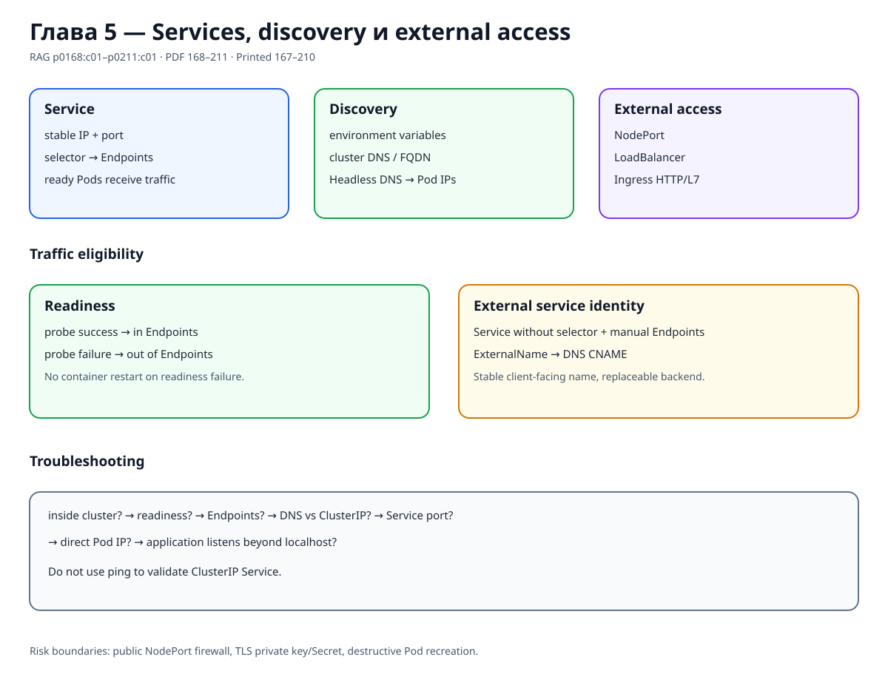
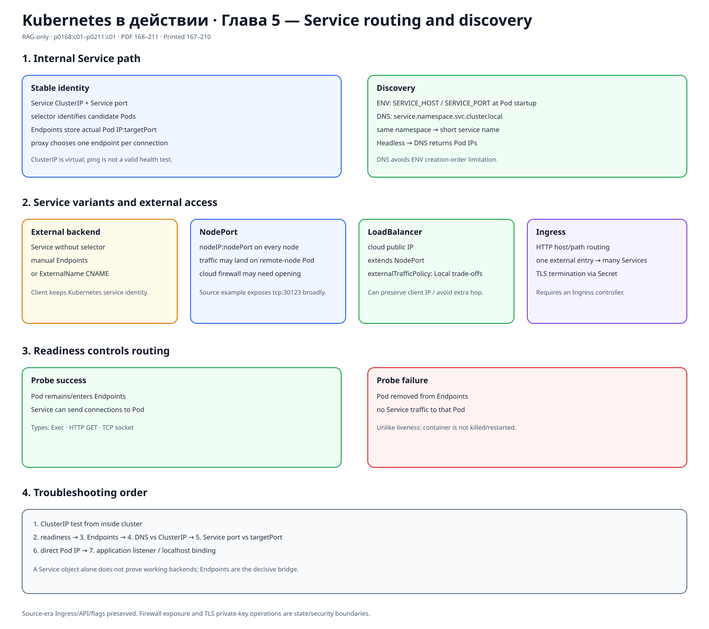

# Глава 5 — Службы: обеспечение клиентам возможности обнаруживать модули и обмениваться с ними информацией

Практические и концептуальные заметки по главе 5 книги «Kubernetes в действии» Марко Лукши.

## Идентификация

- Book ID: kubernetes-in-action-marko-luksa-ru
- Глава: 5
- Название: «Службы: обеспечение клиентам возможности обнаруживать модули и обмениваться с ними информацией»
- Slug: services-discovery-and-access
- Source policy: rag_only
- External sources: запрещены
- Model memory: запрещена
- Прямой доступ к canonical PDF: не использовался

## Provenance

- RAG chunks: p0168:c01–p0211:c01
- PDF pages: 168–211
- Printed pages: 167–210
- Оглавление в p0010:c01–p0011:c01 задаёт структуру главы 5 и начало главы 6 на печатной странице 211.
- p0168:c01 начинается заголовком главы 5.
- p0210:c01–p0211:c01 содержат явный раздел 5.8 Резюме.
- Следующий чанк p0212:c01 начинается заголовком главы 6.
- Chapter boundary verified: yes
- Source SHA-256: 0d50f167ed86088d0cc65d15e27f1ab397e7c0a0c8de4db3801b50439f24266f

## Содержимое

- [cheatsheet.md](cheatsheet.md) — operational map Service → Endpoints → discovery → external access → readiness → Headless → troubleshooting.
- [commands.md](commands.md) — source-confirmed команды kubectl, curl, gcloud, Minikube, TLS и DNS с risk classification.
- [diagram.md](diagram.md) — Mermaid-схемы Service/Endpoints, discovery, NodePort/LoadBalancer/Ingress, readiness и Headless DNS.
- [summary.md](summary.md) — RAG-grounded резюме явного раздела 5.8 Резюме.
- [review-questions.md](review-questions.md) — два явных упражнения главы.
- [review-answers.md](review-answers.md) — RAG-grounded ответы/процедуры; не официальный издательский answer key.
- [visual-cheatsheet.svg](visual-cheatsheet.svg) — компактная визуальная карта.
- [visual-cheatsheet-detailed.svg](visual-cheatsheet-detailed.svg) — подробная визуальная карта.

## Карта главы

1. Service как стабильный IP/port перед динамическим набором Pods.
2. Label selector Service определяет backend Pods; фактические адреса хранятся в Endpoints.
3. ClusterIP доступен изнутри кластера.
4. kubectl exec для проверки Service из существующего Pod.
5. Session affinity: None и ClientIP.
6. Multi-port Service и named ports.
7. Service discovery через environment variables.
8. Service discovery через cluster DNS/FQDN.
9. ClusterIP является виртуальным адресом: ping не является валидной проверкой Service.
10. Service без selector + вручную созданный Endpoints для внешней системы.
11. ExternalName как DNS CNAME alias к внешнему FQDN.
12. NodePort: Service доступен на порту каждого node.
13. LoadBalancer: infrastructure load balancer поверх NodePort.
14. External traffic policy и trade-off между extra hop, source IP и равномерностью нагрузки.
15. Ingress как HTTP/L7 routing множества Services через один внешний вход.
16. TLS termination на Ingress с Secret.
17. Readiness probe определяет, должен ли Pod входить в Endpoints Service.
18. Headless Service: clusterIP: None, DNS возвращает Pod IPs.
19. Source-era механизм обнаружения unready endpoints.
20. Последовательный troubleshooting Service через scope → readiness → Endpoints → DNS/IP → ports → direct Pod connectivity.

## Краткий анализ главы

Глава решает фундаментальную проблему динамических Pod IP. Pods могут появляться, исчезать и заменяться, поэтому клиенту нельзя надёжно привязываться к отдельному Pod. Service создаёт стабильную сетевую точку входа перед набором Pods.

Связь Service с Pods проходит не напрямую. Label selector используется для формирования ресурса Endpoints, содержащего фактические пары IP/port. Service proxy направляет connection на один из endpoints. Это различие важно для troubleshooting: если Service существует, но Endpoints пуст, проблема находится между selector/readiness и фактическими Pods.

ClusterIP предназначен для внутрикластерного доступа. Глава показывает проверку через kubectl exec ... curl из работающего Pod. Она отдельно предупреждает, что ping ClusterIP не является полезной диагностикой: Service IP виртуален и имеет смысл вместе с transport port.

Discovery имеет два механизма. Environment variables создаются при запуске Pod и отражают Services, существовавшие к этому моменту. DNS снимает это ограничение: Service получает запись в cluster DNS и может быть доступен по FQDN вида service.namespace.svc.cluster.local, а внутри того же namespace — по короткому имени.

Service без selector позволяет отделить stable service identity от backend implementation. В таком случае Endpoints задаются вручную и могут указывать на внешние IP. ExternalName решает похожую задачу через DNS CNAME и не получает ClusterIP.

Для внешнего доступа глава последовательно вводит NodePort, LoadBalancer и Ingress. NodePort открывает одинаковый port на nodes; LoadBalancer добавляет инфраструктурный балансировщик; Ingress работает на HTTP/L7 и может маршрутизировать разные host/path к разным Services через один внешний IP.

Глава рассматривает сетевой trade-off externalTrafficPolicy: Local: можно избежать дополнительного hop и сохранить исходный client IP, но только если принимающий node имеет локальный backend Pod; кроме того, распределение нагрузки между Pods может стать неравномерным.

Ingress требует отдельного controller. В source-era примере Minikube ingress addon разворачивает Nginx controller. TLS завершается на Ingress: private key и certificate хранятся в Secret, а backend приложение может продолжать принимать обычный HTTP.

Readiness probe принципиально отличается от liveness. Неуспешная readiness probe не убивает container; Pod просто исключается из Endpoints и перестаёт получать Service traffic. Это позволяет не направлять запросы на запускающийся или временно неготовый экземпляр.

Headless Service (clusterIP: None) меняет модель discovery: DNS возвращает Pod IPs, а не единый Service IP. Клиент может подключаться непосредственно к отдельным Pods. В source-era тексте также показана alpha-аннотация для публикации неготовых endpoints; она явно помечена как устаревающий механизм самого источника.

Финальный troubleshooting checklist строится от сетевого scope к application listener: проверить, откуда идёт доступ, readiness, Endpoints, DNS vs ClusterIP, Service port vs target port, прямой Pod IP и binding приложения не только к localhost.

## Основной принцип

Service = stable identity + dynamic Endpoints

selector + readiness → Endpoints → Service traffic

Для внешнего доступа:

NodePort → LoadBalancer → Ingress (HTTP/L7).

## Ограничения

- API versions, flags и command behavior сохраняются в source-era виде и не модернизируются.
- Ingress использует extensions/v1beta1 из источника.
- Headless unready discovery использует source-era alpha annotation; источник сам предупреждает о её замене.
- RAG YAML listings местами содержат типографские артефакты list markers; они не выдаются за copy-paste validated manifests.
- IP-адреса из примеров книги не рассматриваются как универсальные значения; в commands используются placeholders там, где это operationally важно.
- Source chapter говорит «создать через kubectl create», но не всегда содержит точную командную строку; отсутствующие строки не реконструируются.
- Firewall rule из GKE-примера имеет широкий source range 0.0.0.0/0; это лабораторный пример, а не безопасный production default.
