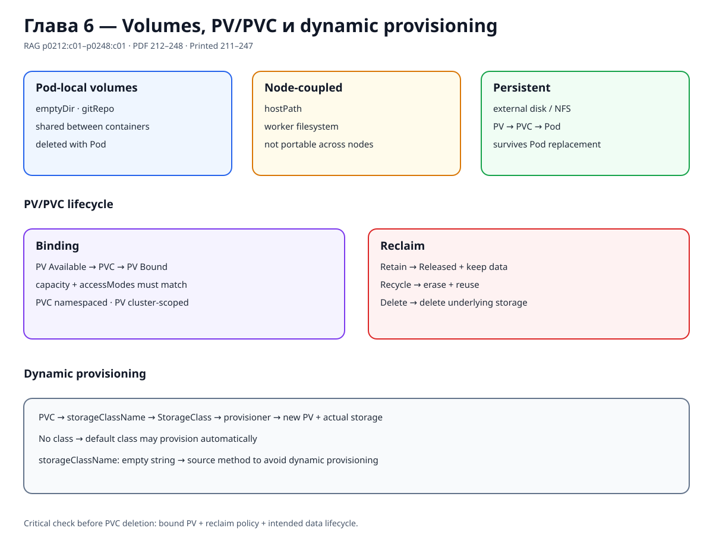
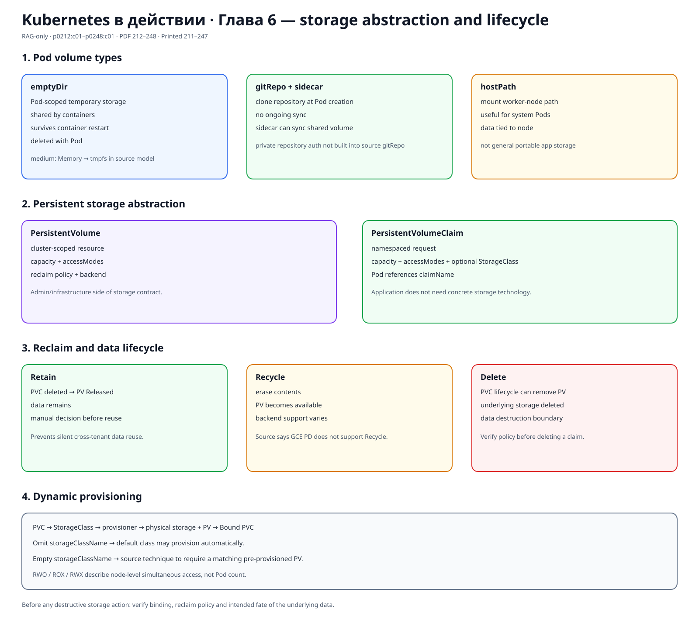

# Глава 6 — Тома: подключение дискового хранилища к контейнерам

Практические и концептуальные заметки по главе 6 книги «Kubernetes в действии» Марко Лукши.

## Идентификация

- Book ID: kubernetes-in-action-marko-luksa-ru
- Глава: 6
- Название: «Тома: подключение дискового хранилища к контейнерам»
- Slug: volumes-attaching-disk-storage
- Source policy: rag_only
- External sources: запрещены
- Model memory: запрещена
- Прямой доступ к canonical PDF: не использовался

## Provenance

- RAG chunks: p0212:c01–p0248:c01
- PDF pages: 212–248
- Printed pages: 211–247
- p0212:c01 начинается заголовком главы 6.
- p0247:c01–p0248:c01 содержат явный раздел 6.7 Резюме.
- p0249:c01 начинается заголовком главы 7.
- Chapter boundary verified: yes
- Source SHA-256: 0d50f167ed86088d0cc65d15e27f1ab397e7c0a0c8de4db3801b50439f24266f

## Содержимое

- [cheatsheet.md](cheatsheet.md) — storage decision map и lifecycle PV/PVC.
- [commands.md](commands.md) — source-confirmed команды Docker, kubectl и gcloud с risk classification.
- [diagram.md](diagram.md) — Mermaid-схемы volume sharing, hostPath, persistent storage, PV/PVC и dynamic provisioning.
- [summary.md](summary.md) — RAG-grounded резюме раздела 6.7.
- [review-questions.md](review-questions.md) — два явных упражнения.
- [review-answers.md](review-answers.md) — RAG-grounded решения; не официальный издательский answer key.
- [visual-cheatsheet.svg](visual-cheatsheet.svg) — компактный обзор.
- [visual-cheatsheet-detailed.svg](visual-cheatsheet-detailed.svg) — подробный обзор.

## Карта главы

1. Filesystem container не является надёжным местом для данных между restart container.
2. Volume существует в контексте Pod и монтируется в один или несколько containers.
3. emptyDir — временное shared storage на время жизни Pod.
4. emptyDir с medium: Memory — tmpfs-backed storage.
5. gitRepo — emptyDir, первоначально заполненный содержимым Git repository.
6. gitRepo не синхронизируется с repository после создания Pod.
7. Sidecar container может поддерживать shared volume в синхронизации.
8. hostPath монтирует файл/каталог worker node и привязывает данные к конкретному node.
9. External persistent storage переживает удаление и повторное создание Pod.
10. PersistentVolume отделяет storage resource от Pod.
11. PersistentVolumeClaim выражает требования пользователя к storage.
12. PVC namespaced; PV cluster-scoped.
13. Access modes RWO, ROX, RWX описывают число nodes, а не Pods.
14. Pod использует PVC по claimName, а не PV напрямую.
15. Reclaim policy определяет судьбу PV/storage после удаления PVC.
16. Retain сохраняет данные и переводит PV в Released.
17. Recycle очищает storage и возвращает PV в Available, если backend поддерживает.
18. Delete удаляет базовое storage.
19. StorageClass описывает provisioner и параметры динамического provisioning.
20. PVC со storageClassName вызывает dynamic provisioning соответствующего класса.
21. PVC без storageClassName может использовать default StorageClass.
22. storageClassName: "" используется в source, чтобы не запускать dynamic provisioning и привязаться к заранее созданному PV.

## Краткий анализ главы

Глава отделяет lifecycle контейнера от lifecycle данных. Файлы, записанные в writable layer container, исчезают при замене container. Kubernetes Volume позволяет вынести данные из этого слоя и смонтировать их в filesystem containers.

emptyDir живёт столько же, сколько Pod. Он особенно полезен как shared directory между containers одного Pod. В примере generator пишет HTML в общий volume, а Nginx читает тот же файл через другое mountPath. Restart отдельного container не уничтожает volume, но удаление Pod уничтожает emptyDir вместе с данными.

gitRepo в модели книги инициализирует volume клонированием Git repository при создании Pod. После этого automatic synchronization отсутствует. Глава использует это для введения sidecar pattern: дополнительный container выполняет вспомогательную функцию, не усложняя основной application container.

hostPath монтирует path worker node. Данные переживают Pod, но остаются привязанными к конкретному node. Поэтому source не рекомендует hostPath как обычное persistent storage для приложений, которые могут быть rescheduled на другой node.

External block/network storage переживает Pod replacement, но прямое указание gcePersistentDisk, awsElasticBlockStore или NFS связывает Pod manifest с конкретной инфраструктурой.

PV/PVC вводят abstraction boundary. Cluster administrator предоставляет PV с capacity, access modes, reclaim policy и backend storage. User создаёт PVC с требованиями; Kubernetes связывает claim с подходящим PV. Pod затем ссылается только на PVC.

Lifecycle после удаления PVC критичен. При Retain PV становится Released и не выдаётся новой claim автоматически, поскольку может содержать данные предыдущего tenant. Recycle очищает storage и возвращает PV, а Delete удаляет underlying storage; поддержка policies зависит от backend.

Dynamic provisioning переносит резервирование storage на provisioner. StorageClass определяет provisioner и параметры, PVC указывает нужный class. Если class не указан, default StorageClass может создать storage автоматически. Source отдельно подчёркивает пустое storageClassName, когда нужен заранее подготовленный PV и dynamic provisioner не должен вмешиваться.

## Основной принцип

Volume отделяет данные от container filesystem.

PV/PVC отделяют application от конкретной storage infrastructure:

application Pod → PVC → PV → physical storage

Dynamic provisioning:

PVC → StorageClass → provisioner → PV + actual storage.

## Ограничения

- Типы volume, API versions, provisioners и storage behavior сохранены в source-era виде.
- gitRepo описан так, как в книге; современный статус feature не проверялся.
- RAG YAML listings местами содержат typographic list markers и не считаются copy-paste validated manifests.
- Source не всегда содержит точную строку kubectl create; отсутствующее не реконструируется.
- hostPath не трактуется как portable persistent storage.
- Reclaim policy Delete рассматривается как data-destructive boundary.
- Команда удаления underlying GCE disk в главе не приведена и не добавляется.
