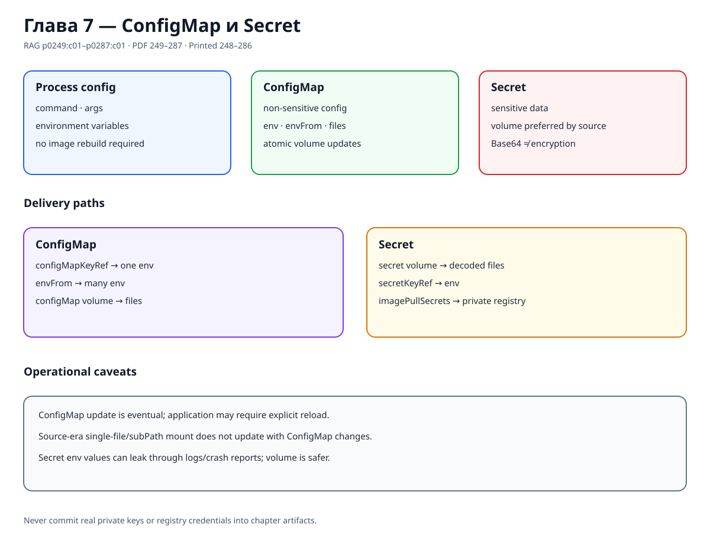
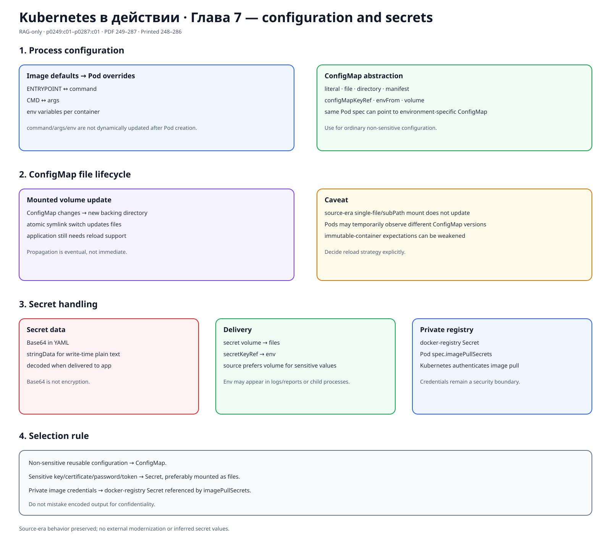

# Глава 7 — ConfigMap и Secret: настройка приложений

Практические и концептуальные заметки по главе 7 книги «Kubernetes в действии» Марко Лукши.

## Идентификация

- Book ID: kubernetes-in-action-marko-luksa-ru
- Глава: 7
- Название: «Словари конфигурации (ConfigMap) и секреты (Secret): настройка приложений»
- Slug: configmaps-and-secrets
- Source policy: rag_only
- External sources: запрещены
- Model memory: запрещена
- Прямой доступ к canonical PDF: не использовался

## Provenance

- RAG chunks: p0249:c01–p0287:c01
- PDF pages: 249–287
- Printed pages: 248–286
- p0249:c01 начинается заголовком главы 7.
- p0286:c01–p0287:c01 содержат явный раздел 7.6 Резюме.
- p0288:c01 начинается заголовком главы 8.
- Chapter boundary verified: yes
- Source SHA-256: 0d50f167ed86088d0cc65d15e27f1ab397e7c0a0c8de4db3801b50439f24266f

## Содержимое

- [cheatsheet.md](cheatsheet.md) — command/args, env, ConfigMap, Secret и imagePullSecrets.
- [commands.md](commands.md) — source-confirmed Docker/kubectl/openssl commands с risk classification.
- [diagram.md](diagram.md) — Mermaid-схемы потоков configuration data.
- [summary.md](summary.md) — RAG-grounded резюме раздела 7.6.
- [review-questions.md](review-questions.md) — две явные practical tasks.
- [review-answers.md](review-answers.md) — RAG-grounded решения; не официальный answer key.
- [visual-cheatsheet.svg](visual-cheatsheet.svg)
- [visual-cheatsheet-detailed.svg](visual-cheatsheet-detailed.svg)

## Карта главы

1. Конфигурация container через command и arguments.
2. Соотношение Docker ENTRYPOINT/CMD и Kubernetes command/args.
3. Environment variables container-level.
4. Ограничение hardcoded env: конфигурация остаётся в Pod spec.
5. ConfigMap как отдельный resource для non-sensitive configuration.
6. Создание ConfigMap из literal, file, directory или manifest.
7. configMapKeyRef для одной env variable.
8. envFrom для всех entries ConfigMap.
9. ConfigMap values как command-line arguments.
10. configMap volume для передачи entries как files.
11. items для выбора отдельных keys и переименования paths.
12. subPath для mount одного файла.
13. defaultMode для permissions.
14. Update ConfigMap и eventual propagation в mounted volume.
15. Atomic update через symlink switching.
16. Ограничение source-era subPath: отдельный mounted file не обновляется.
17. Secret для sensitive data.
18. default-token Secret и автоматически смонтированный service-account volume.
19. generic Secret из files.
20. data Base64 vs stringData.
21. Secret volume: decoded files, source говорит о tmpfs.
22. secretKeyRef для env variable, но source рекомендует volume как более безопасный способ.
23. docker-registry Secret + imagePullSecrets для private image.

## Краткий анализ главы

Глава строит иерархию способов конфигурации. Самый простой уровень — переопределить command/args container. Следующий — env variables. Оба способа остаются частью Pod definition, поэтому environment-specific значения приходится дублировать между manifests.

ConfigMap отделяет non-sensitive configuration от Pod. Pod ссылается на ConfigMap по имени, а один и тот же Pod manifest может использовать разные ConfigMap в разных environments.

ConfigMap можно передавать в container тремя основными путями: отдельная env variable через configMapKeyRef, набор env variables через envFrom, либо files через configMap volume. ConfigMap value также может косвенно использоваться как command-line argument через env variable expansion.

Volume path даёт важное lifecycle behavior: source показывает, что Kubernetes обновляет ConfigMap-backed files спустя некоторое время и делает переключение атомарно через symlink. Но application itself может не reload configuration автоматически. Это создаёт риск рассинхронизации running instances.

Source отдельно предупреждает о subPath/single-file mount: в версии книги такой file не получает update при изменении ConfigMap. Для auto-update нужен mount всего ConfigMap volume.

Secret логически похож на ConfigMap, но предназначен для sensitive data. Base64 в Secret YAML нужен для text transport/binary data и не является encryption. Приложение получает decoded value в file или env variable.

Secret volume в source model хранится в memory-backed tmpfs на node. Source настоятельно рекомендует volume вместо env variables, потому что env может утечь в logs/crash reports и наследуется child processes.

Для private registry создаётся docker-registry Secret, затем его имя указывается в imagePullSecrets Pod spec.

## Основной принцип

Non-sensitive configuration:
Pod → ConfigMap → env / args / files

Sensitive configuration:
Pod → Secret → preferably volume files

Private image:
Pod imagePullSecrets → registry Secret → registry credentials

## Ограничения

- Source-era Kubernetes behavior и API details не модернизируются.
- Base64 не трактуется как encryption.
- Source statement об encryption-at-rest Secret относится к version context книги и не обновляется извне.
- Real credentials/private keys не переносятся в artifacts.
- docker-registry command normalized with placeholders; literal passwords should not be stored in shared shell history.
- RAG YAML list-marker artifacts не превращаются молча в validated manifests.
- ConfigMap propagation delay в source не трактуется как SLA.
