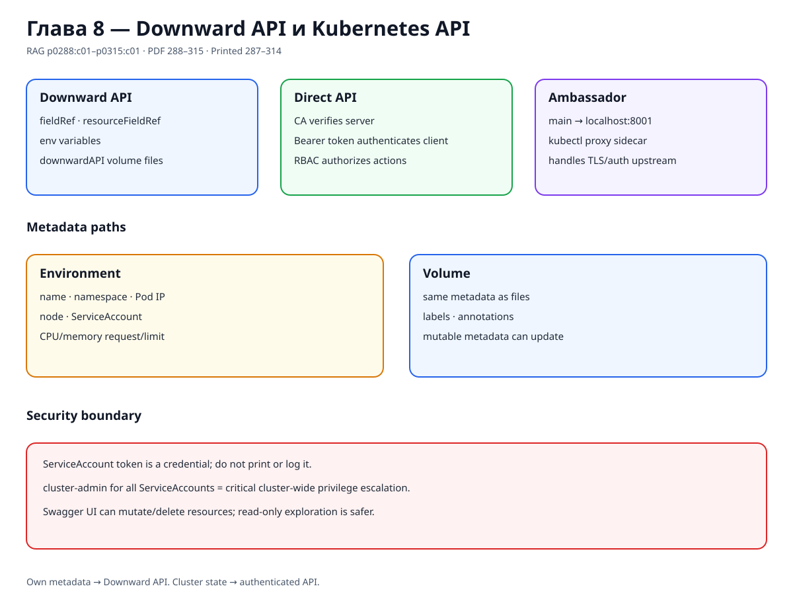
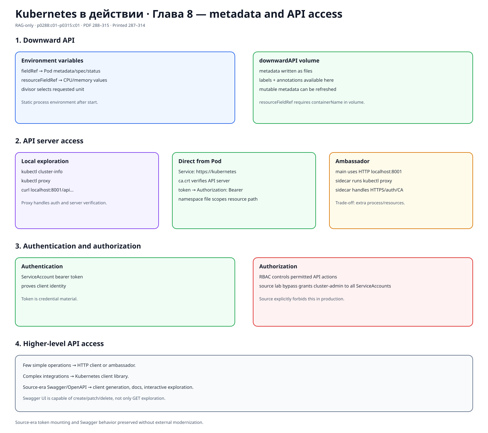

# Глава 8 — Доступ к метаданным модуля и другим ресурсам из приложений

Практические и концептуальные заметки по главе 8 книги «Kubernetes в действии» Марко Лукши.

## Идентификация

- Book ID: kubernetes-in-action-marko-luksa-ru
- Глава: 8
- Slug: accessing-pod-metadata-and-other-resources
- Source policy: rag_only
- External sources: запрещены
- Model memory: запрещена
- Прямой доступ к canonical PDF: не использовался

## Provenance

- RAG chunks: p0288:c01–p0315:c01
- PDF pages: 288–315
- Printed pages: 287–314
- p0288:c01 начинается заголовком главы 8.
- p0315:c01 содержит явный раздел 8.3 Резюме.
- p0316:c01 начинается заголовком главы 9.
- Chapter boundary verified: yes
- Source SHA-256: 0d50f167ed86088d0cc65d15e27f1ab397e7c0a0c8de4db3801b50439f24266f

## Содержимое

- [cheatsheet.md](cheatsheet.md) — Downward API, REST API, ServiceAccount credentials, ambassador и client libraries.
- [commands.md](commands.md) — source-confirmed commands с separation read-only/state-changing/security-sensitive.
- [diagram.md](diagram.md) — Mermaid-схемы metadata/API flows.
- [summary.md](summary.md) — RAG-grounded резюме раздела 8.3.
- [review-questions.md](review-questions.md) — явная самостоятельная задача Swagger UI.
- [review-answers.md](review-answers.md) — RAG-grounded procedure; не официальный answer key.
- [visual-cheatsheet.svg](visual-cheatsheet.svg)
- [visual-cheatsheet-detailed.svg](visual-cheatsheet-detailed.svg)

## Карта главы

1. Downward API предоставляет приложению metadata собственного Pod/container.
2. fieldRef передаёт Pod-level fields.
3. resourceFieldRef передаёт CPU/memory requests/limits.
4. Через env доступны name, namespace, Pod IP, node name, ServiceAccount и resource values.
5. Labels/annotations доступны через downwardAPI volume, а не env.
6. downwardAPI volume может обновлять изменяемые metadata во время жизни Pod.
7. Для resourceFieldRef в volume нужно явно указать containerName.
8. Downward API ограничен собственными metadata; для других resources нужен Kubernetes API.
9. kubectl proxy упрощает локальное исследование REST API и берёт на себя authentication/server verification.
10. REST resource paths зависят от API group/version/namespace/resource/name.
11. Из Pod API server обнаруживается через Service environment/DNS.
12. CA certificate, token и namespace source получает из автоматически смонтированного service-account Secret volume.
13. Direct HTTPS access требует server verification и bearer token authentication.
14. Ambassador sidecar с kubectl proxy скрывает TLS/auth complexity от main container.
15. Client libraries предоставляют higher-level API.
16. Source-era Swagger/OpenAPI endpoints позволяют генерировать clients/docs и исследовать API через Swagger UI.

## Краткий анализ главы

Первая половина главы отделяет configuration data от runtime metadata. Downward API позволяет приложению получить сведения о собственном Pod без запроса к API server. Через fieldRef доступны поля Pod, через resourceFieldRef — resource requests/limits container с заданным divisor.

Environment variables удобны для неизменяемых при жизни process значений, но labels и annotations source передаёт через downwardAPI volume, потому что они могут меняться. Kubernetes обновляет соответствующие files, поэтому application может видеть актуальные metadata без recreation Pod.

Downward API намеренно ограничен. Если application нужно узнать о других Pods, Jobs или иных resources, источник переводит работу на Kubernetes REST API.

Локально глава использует kubectl proxy. Proxy знает server URL, credentials и CA context из kubectl configuration и предоставляет local HTTP endpoint. Через него source исследует /api, /apis, group versions и concrete resource paths.

Изнутри Pod глава показывает более низкоуровневый путь. Service kubernetes позволяет найти API server. TLS certificate проверяется CA certificate из service-account volume; bearer token из того же volume используется для authentication. Namespace file позволяет строить namespace-scoped API paths без hardcoding namespace.

Это security boundary. Source-era default-token model и RBAC details не модернизируются. Особенно опасен lab-only пример, который создаёт ClusterRoleBinding cluster-admin для всех ServiceAccounts. Сам источник прямо говорит, что это опасно и никогда не должно использоваться в production.

Ambassador pattern переносит TLS/auth handling в sidecar с kubectl proxy. Main container обращается по HTTP к localhost:8001, а sidecar выполняет secure request к API server. Trade-off — дополнительный process/resource consumption.

Для более сложных integrations source рекомендует Kubernetes client libraries. В финале chapter показывает Swagger/OpenAPI definitions и source-era Swagger UI как interactive interface, который способен не только читать API, но и изменять/удалять resources.

## Основной принцип

Собственные metadata:
Pod → Downward API → env/files → application

Cluster state:
application → authenticated Kubernetes API

Complexity isolation:
main container → localhost ambassador → authenticated API server

## Ограничения

- Source-era ServiceAccount token mounting, Swagger UI и API behavior не модернизируются.
- RAG YAML list-marker artifacts не выдаются за validated manifests.
- Реальные bearer tokens, CA contents и namespace values не копируются в artifacts.
- Lab-only RBAC bypass сохраняется только как опасный source example.
- curl -k сохраняется как демонстрация failed/unsafe verification path, не как recommended production practice.
