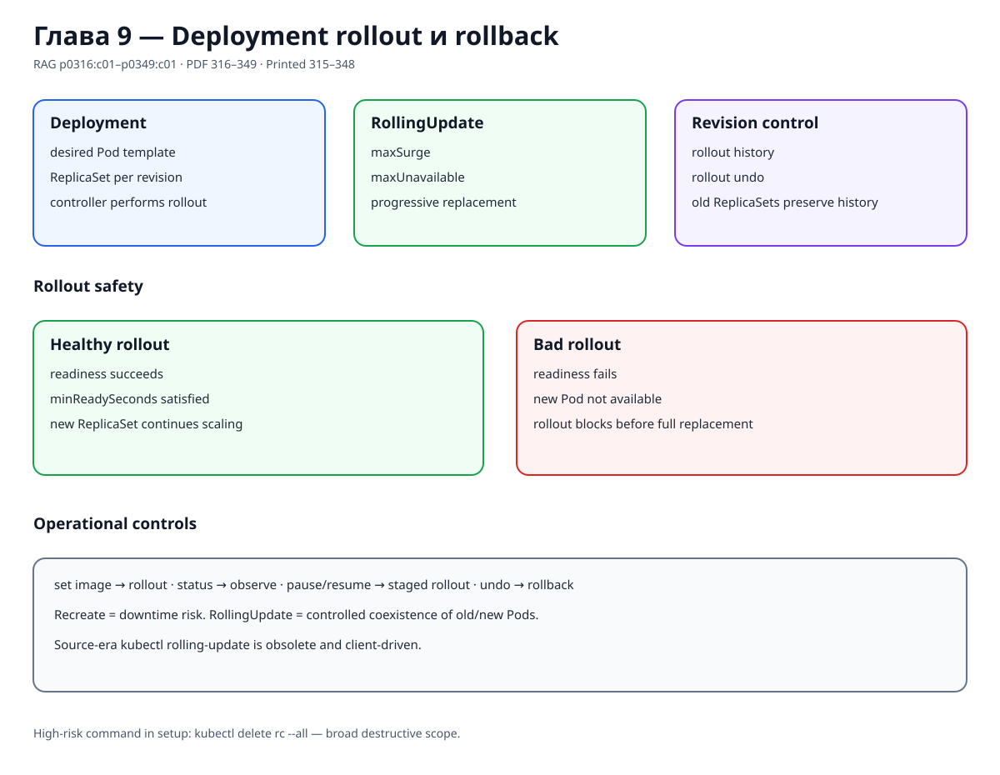
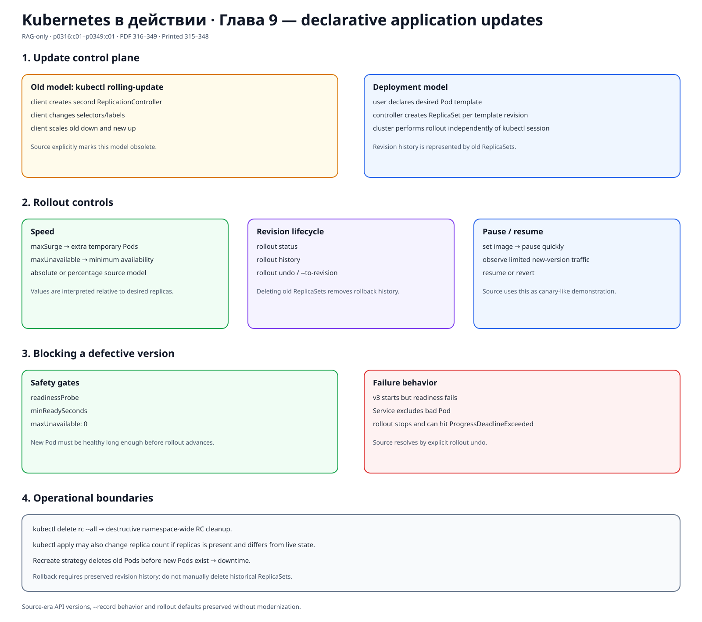

# Глава 9 — Развертывания: декларативное обновление приложений

Практические и концептуальные заметки по главе 9 книги «Kubernetes в действии» Марко Лукши.

## Идентификация

- Book ID: kubernetes-in-action-marko-luksa-ru
- Глава: 9
- Slug: deployments-declarative-application-updates
- Source policy: rag_only
- External sources: запрещены
- Model memory: запрещена
- Прямой доступ к canonical PDF: не использовался

## Provenance

- RAG chunks: p0316:c01–p0349:c01
- PDF pages: 316–349
- Printed pages: 315–348
- p0316:c01 начинается заголовком главы 9.
- p0349:c01 содержит явный раздел 9.4 Резюме.
- p0350:c01 начинается заголовком главы 10.
- Chapter boundary verified: yes
- Source SHA-256: 0d50f167ed86088d0cc65d15e27f1ab397e7c0a0c8de4db3801b50439f24266f

## Содержимое

- [cheatsheet.md](cheatsheet.md) — update strategies, Deployment rollout/rollback и safety boundaries.
- [commands.md](commands.md) — source-confirmed commands с разделением read-only/state-changing/destructive.
- [diagram.md](diagram.md) — Mermaid-схемы rolling update, revision history, pause/resume и blocked rollout.
- [summary.md](summary.md) — RAG-grounded резюме раздела 9.4.
- [review-questions.md](review-questions.md) — одно явное упражнение главы.
- [review-answers.md](review-answers.md) — RAG-grounded решение; не официальный answer key.
- [visual-cheatsheet.svg](visual-cheatsheet.svg)
- [visual-cheatsheet-detailed.svg](visual-cheatsheet-detailed.svg)

## Карта главы

1. Два базовых подхода к обновлению: replace-all и rolling replacement.
2. Rolling update вручную через два ReplicationController.
3. Source-era kubectl rolling-update координирует два RC на стороне client.
4. Почему client-driven rolling-update устарел: процесс зависит от клиента и сложнее восстанавливается.
5. Deployment как декларативный объект поверх ReplicaSet.
6. Deployment создаёт отдельный ReplicaSet для каждой версии Pod template.
7. RollingUpdate и Recreate как стратегии Deployment.
8. Изменение Pod template запускает rollout.
9. kubectl edit/patch/apply/replace/set image — разные способы изменить один desired state.
10. rollout status для наблюдения.
11. rollout undo для rollback.
12. rollout history и revision history через старые ReplicaSet.
13. revisionHistoryLimit ограничивает сохраняемые revisions.
14. maxSurge ограничивает количество дополнительных Pods.
15. maxUnavailable задаёт минимально допустимую доступность относительно desired replicas.
16. pause/resume позволяет временно остановить rollout.
17. Source демонстрирует canary-like проверку одного нового Pod через pause.
18. Readiness + minReadySeconds блокируют продолжение rollout плохой версии.
19. maxUnavailable: 0 не позволяет уменьшить число доступных replicas ниже desired count.
20. progressDeadlineSeconds определяет, когда rollout считается failed.
21. Плохой rollout source завершает вручную через rollout undo.

## Краткий анализ главы

Глава показывает переход от процедурного обновления к декларативному desired state.

В первой части source разбирает старый механизм kubectl rolling-update поверх ReplicationController. Client создаёт новый RC, временно модифицирует selectors/labels, затем постепенно масштабирует старый RC вниз, а новый — вверх. Это работает, но orchestration выполняется самим kubectl. Потеря клиента или connection усложняет process, поэтому source прямо объявляет этот подход устаревшим.

Deployment переносит coordination в cluster control plane. Пользователь меняет Pod template, а Deployment controller создаёт новый ReplicaSet и постепенно переносит replicas. Старый ReplicaSet сохраняется как часть revision history.

Главный operational boundary — изменение template. Изменения вроде minReadySeconds сами по себе не создают новую ревизию Pod template; set image или apply с изменённым template запускают rollout.

Rollback становится декларативной операцией над history. kubectl rollout undo возвращает Deployment к предыдущей или указанной revision. Старые ReplicaSet нельзя удалять вручную, если нужна возможность rollback, потому что они содержат revision state.

RollingUpdate управляется maxSurge и maxUnavailable. maxSurge определяет дополнительную capacity выше desired replica count, а maxUnavailable — насколько ниже desired count разрешено опуститься по available replicas. Это не просто «сколько Pod одновременно сломано»: source отдельно подчёркивает расчёт относительно desired replica count.

pause/resume source использует как canary-like механизм: после запуска новой версии rollout быстро приостанавливается, один новый Pod получает часть traffic, после проверки rollout продолжается. Source сам отмечает, что в будущем/правильной production-модели canary лучше реализовывать отдельными Deployments, но внутри главы pause используется для демонстрации.

Последний раздел связывает readiness и rollout safety. Без readiness плохой v3 успешно раскатывается и начинает возвращать HTTP 500. С readiness probe, minReadySeconds и maxUnavailable: 0 новый Pod не считается available, поэтому rollout блокируется до массовой замены healthy v2. Это превращает readiness из routing-механизма ещё и в gate rollout progress.

progressDeadlineSeconds отмечает rollout как failed после длительного отсутствия progress. Source-era behavior не выполняет автоматический rollback; cleanup демонстрации делается kubectl rollout undo.

## Основной принцип

Deployment = desired Pod template + ReplicaSet history + rollout controller

Update:
change Pod template → new ReplicaSet → controlled convergence

Rollback:
revision history → previous ReplicaSet/template → controlled convergence

Safety:
readiness + minReadySeconds + maxUnavailable/maxSurge → rollout gating

## Ограничения

- API versions, defaults и commands сохранены в source-era виде.
- kubectl rolling-update сохранён только как исторический/устаревший механизм главы.
- Source-era --record/revision behavior не модернизируется.
- IP из curl examples не считается универсальным и не переносится как operational default.
- Recreate strategy предполагает downtime между old и new Pods.
- pause-based canary сохранён в framing книги; современная canary практика не добавляется извне.
- RAG YAML list-marker artifacts не выдаются за validated manifests.
