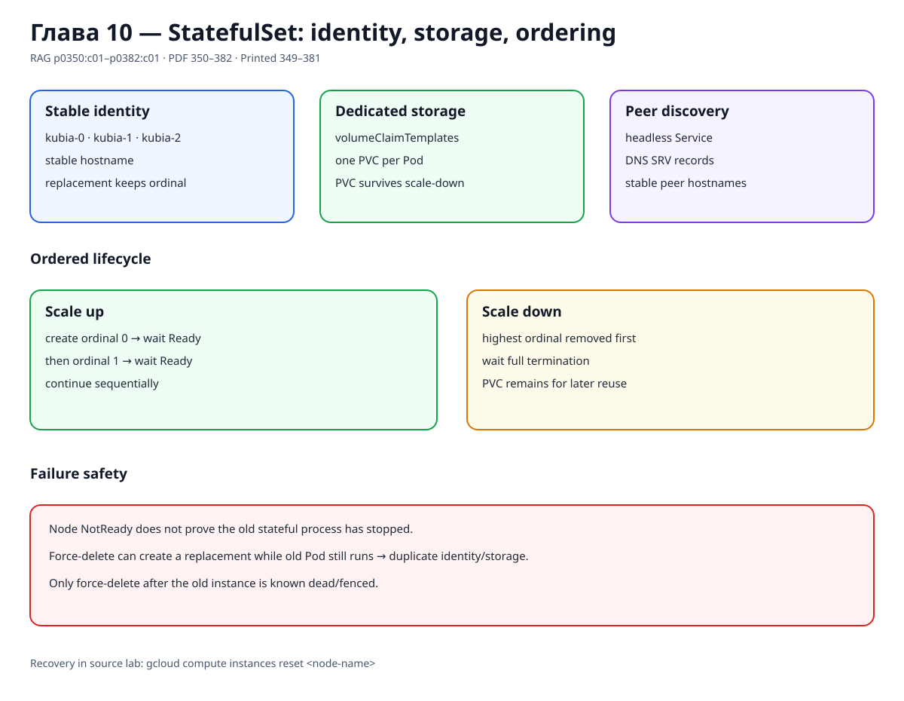
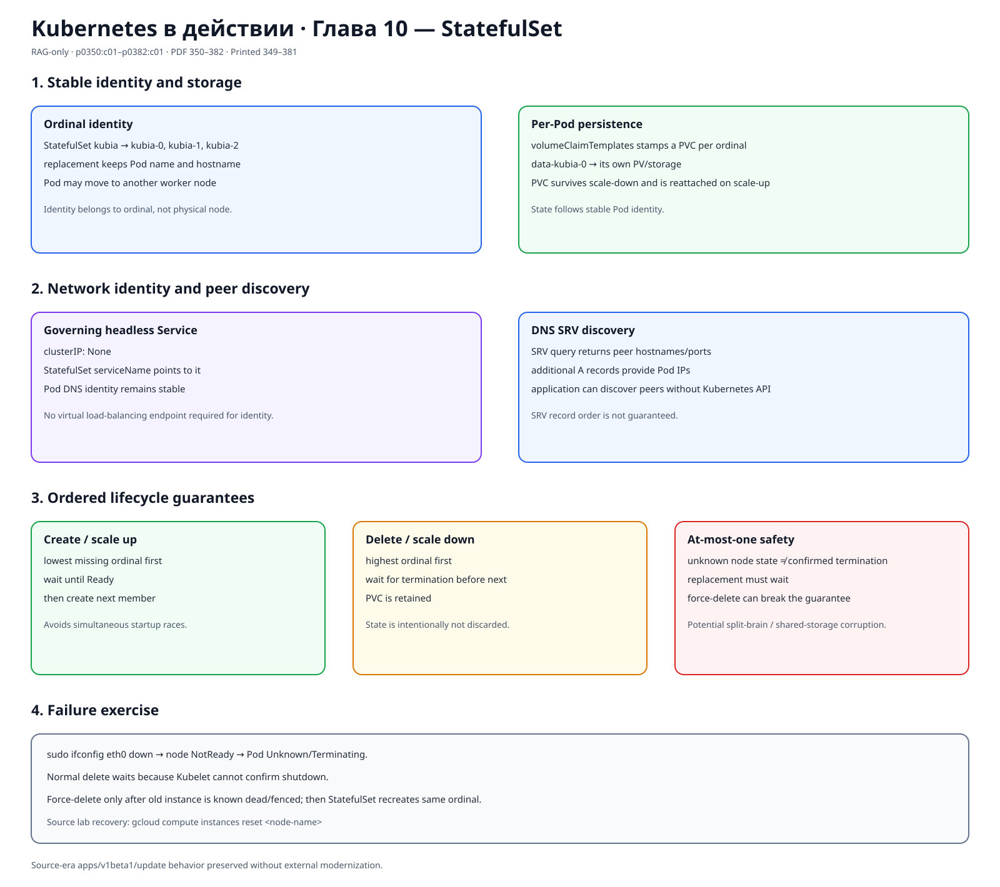

# Глава 10 — StatefulSet: развертывание реплицируемых приложений с внутренним состоянием

Практические и концептуальные заметки по главе 10 книги «Kubernetes в действии» Марко Лукши.

## Идентификация

- Book ID: kubernetes-in-action-marko-luksa-ru
- Глава: 10
- Slug: statefulsets-replicated-stateful-applications
- Source policy: rag_only
- External sources: запрещены
- Model memory: запрещена
- Прямой доступ к canonical PDF: не использовался

## Provenance

- RAG chunks: p0350:c01–p0382:c01
- PDF pages: 350–382
- Printed pages: 349–381
- p0350:c01 начинается заголовком главы 10.
- p0382:c01 содержит явный раздел 10.6 Резюме.
- p0383:c01 начинается заголовком главы 11.
- Chapter boundary verified: yes
- Source SHA-256: 0d50f167ed86088d0cc65d15e27f1ab397e7c0a0c8de4db3801b50439f24266f

## Содержимое

- [cheatsheet.md](cheatsheet.md) — stable identity, per-Pod storage, headless Service, ordered lifecycle и peer discovery.
- [commands.md](commands.md) — source-confirmed commands с separation read-only/state-changing/high-risk failure injection.
- [diagram.md](diagram.md) — Mermaid-схемы StatefulSet identity/storage/DNS/failure handling.
- [summary.md](summary.md) — RAG-grounded резюме раздела 10.6.
- [review-questions.md](review-questions.md) — одно явно обозначенное упражнение главы.
- [review-answers.md](review-answers.md) — RAG-grounded procedure; не официальный answer key.
- [visual-cheatsheet.svg](visual-cheatsheet.svg)
- [visual-cheatsheet-detailed.svg](visual-cheatsheet-detailed.svg)

## Карта главы

1. ReplicaSet подходит для взаимозаменяемых replicas без стабильной индивидуальной identity.
2. StatefulSet предназначен для replicated stateful applications.
3. Каждый Pod StatefulSet получает стабильный ordinal.
4. Имя Pod и hostname выводятся из StatefulSet name + ordinal.
5. Replacement Pod получает ту же identity, что и удалённый экземпляр.
6. Headless Service предоставляет stable network identity.
7. DNS SRV records позволяют обнаруживать peers без прямого Kubernetes API.
8. volumeClaimTemplates создаёт отдельный PVC для каждого Pod.
9. PVC переживает scale-down и может быть повторно присоединён после scale-up.
10. StatefulSet создаёт Pods последовательно и ждёт readiness предыдущего.
11. Scale-down выполняется в обратном ordinal order.
12. Source формулирует гарантию at-most-one экземпляра с одной identity/storage.
13. StatefulSet replacement может быть назначен на другой node, сохраняя name/hostname/storage.
14. kubectl proxy/API proxy используется для адресации конкретных Pods в demo.
15. Обычный ClusterIP Service используется для client access, headless Service — для identity/discovery.
16. Peer discovery реализуется через DNS SRV lookup.
17. Source-era StatefulSet template update сначала не заменяет существующие Pods автоматически.
18. Source note: начиная с Kubernetes 1.7 StatefulSet поддерживает updateStrategy.
19. При node failure StatefulSet не создаёт replacement, пока не уверен, что старый instance больше не работает.
20. Force deletion снимает API object без подтверждения termination и может нарушить at-most-one guarantee.

## Краткий анализ главы

Глава объясняет, почему ReplicaSet недостаточен для приложений, где экземпляры не взаимозаменяемы. Stateful application обычно требует, чтобы конкретная replica имела устойчивое имя, сетевую идентичность и собственное persistent storage.

StatefulSet вводит ordinal identity: kubia-0, kubia-1 и т. д. При replacement новый Pod получает ту же identity. Он может оказаться на другом node, но его имя, hostname и связанный storage сохраняются.

Сетевой identity boundary задаётся headless Service. В source example serviceName StatefulSet указывает на Service с clusterIP: None. Kubernetes публикует DNS records для Pods, а SRV lookup service domain возвращает hostnames членов набора. Это позволяет приложению обнаруживать peers без обращения к Kubernetes API.

Storage identity строится через volumeClaimTemplates. StatefulSet создаёт отдельную PVC для каждого Pod. При scale-down PVC не удаляются; это защищает state от случайной потери и позволяет последующему scale-up снова подключить тот же storage к Pod с тем же ordinal.

Lifecycle StatefulSet преднамеренно последовательный. При создании следующий Pod появляется только после readiness предыдущего. При уменьшении масштаба сначала удаляется Pod с максимальным ordinal. Source связывает это с безопасностью clustered stateful systems и уменьшением race conditions.

Особенно важна гарантия at-most-one. StatefulSet не должен запускать два Pod с одной identity и одним storage. Поэтому при network partition/node failure control plane не может просто создать replacement: старый Pod может фактически продолжать работать, хотя его status уже Unknown/Terminating с точки зрения API server.

Финальное упражнение показывает этот failure mode. После отключения eth0 node становится NotReady, Pod — Unknown/Terminating. Обычное delete не завершает object, потому что Kubelet недоступен и не может подтвердить shutdown. Force-delete удаляет API object немедленно и позволяет StatefulSet создать новый kubia-0.

Это очень опасная операция. Source прямо предупреждает: force-delete stateful Pod допустим только когда администратор знает, что исходный node/Pod действительно больше не работает и не вернётся. Иначе старый и новый экземпляр могут одновременно использовать одну identity/storage.

## Основной принцип

StatefulSet = stable ordinal identity + stable network name + dedicated persistent storage + ordered lifecycle

Replacement:
same ordinal → same identity → same PVC/storage

Peer discovery:
headless Service → DNS SRV → Pod hostnames

Safety:
never create replacement until old instance is known dead

## Ограничения

- API versions, update behavior и commands сохранены в source-era виде.
- StatefulSet manifest использует apps/v1beta1 из источника.
- Source-era update behavior до Kubernetes 1.7 сохранён; note о spec.updateStrategy также сохранён.
- GCE disk examples относятся к source lab и не являются portable defaults.
- Static PV listing в source сохраняется без исправления его значений.
- Source-era dnsutils image/command не модернизируется.
- Force-delete рассматривается как critical split-brain/data-corruption boundary.
- Реальные node names/IPs из source не переносятся как универсальные значения.
