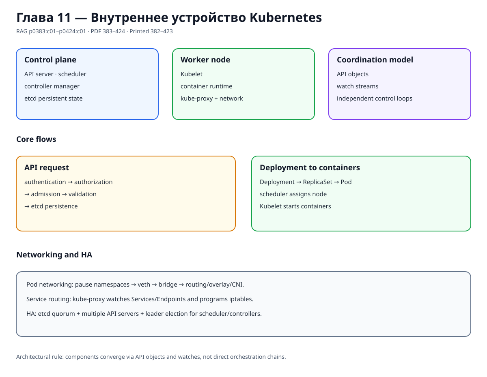
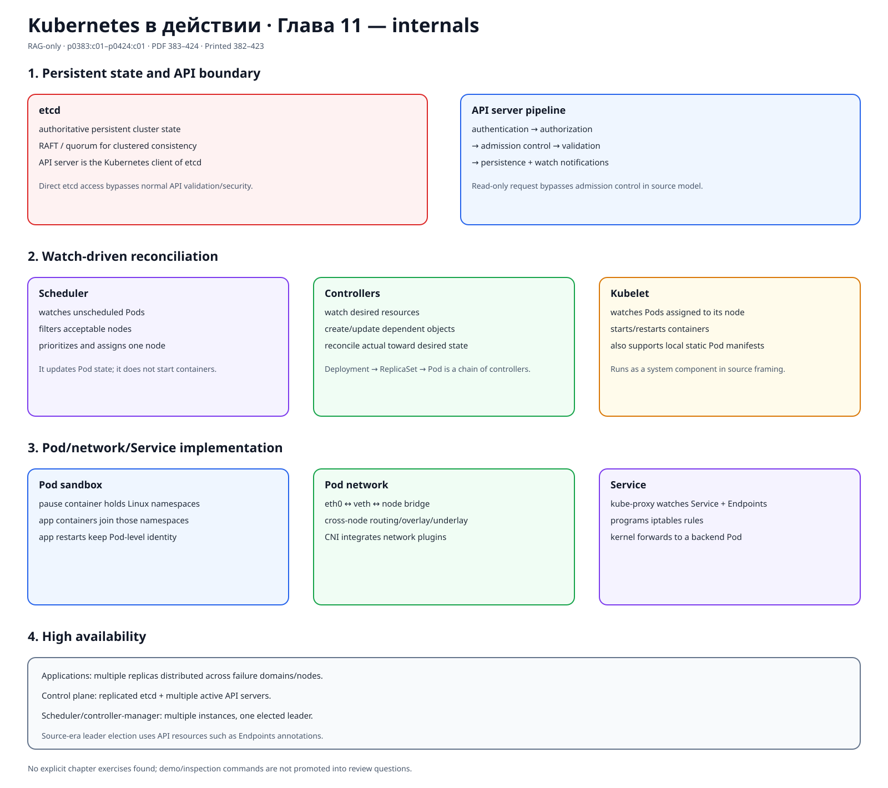

# Глава 11 — Внутреннее устройство Kubernetes

Практические и концептуальные заметки по главе 11 книги «Kubernetes в действии» Марко Лукши.

## Идентификация

- Book ID: kubernetes-in-action-marko-luksa-ru
- Глава: 11
- Slug: kubernetes-internals
- Source policy: rag_only
- External sources: запрещены
- Model memory: запрещена
- Прямой доступ к canonical PDF: не использовался

## Provenance

- RAG chunks: p0383:c01–p0424:c01
- PDF pages: 383–424
- Printed pages: 382–423
- p0383:c01 начинается заголовком главы 11.
- p0424:c01 содержит явный раздел 11.7 Резюме.
- p0425:c01 начинает главу 12.
- Chapter boundary verified: yes
- Source SHA-256: 0d50f167ed86088d0cc65d15e27f1ab397e7c0a0c8de4db3801b50439f24266f

## Содержимое

- [cheatsheet.md](cheatsheet.md) — control plane, API request flow, scheduler/controllers, kubelet, networking, Services и HA.
- [commands.md](commands.md) — source-confirmed inspection commands и их operational classification.
- [diagram.md](diagram.md) — Mermaid-схемы архитектуры и control loops.
- [summary.md](summary.md) — RAG-grounded резюме раздела 11.7.
- [visual-cheatsheet.svg](visual-cheatsheet.svg)
- [visual-cheatsheet-detailed.svg](visual-cheatsheet-detailed.svg)

## Conditional artifacts

- review-questions.md: не создан — в проверенной границе не найден явно обозначенный блок упражнений.
- review-answers.md: не создан по той же причине.
- Дополнительные inspection/demo-команды не переименовываются в упражнения.

## Карта главы

1. Control plane и worker-node components.
2. Распределённый характер control-plane components.
3. etcd как единственное persistent cluster-state storage.
4. Прямой доступ к etcd обходит API-server validation/security boundary.
5. etcd cluster использует RAFT и quorum.
6. API server обрабатывает authentication → authorization → admission → validation → etcd.
7. API server предоставляет watch mechanism.
8. Scheduler не запускает Pod сам — он только выбирает node и обновляет Pod object.
9. Scheduler сначала фильтрует acceptable nodes, затем prioritizes candidates.
10. Controller Manager содержит независимые control loops.
11. Controllers наблюдают API resources и создают/изменяют другие resources через API server.
12. Kubelet наблюдает Pods, назначенные его node, и запускает containers.
13. Static Pods могут создаваться из local manifest directory Kubelet.
14. kube-proxy наблюдает Services/Endpoints и программирует packet forwarding.
15. Add-ons работают как обычные Kubernetes workloads.
16. Создание Deployment запускает цепочку Deployment controller → ReplicaSet controller → Scheduler → Kubelet.
17. Events позволяют наблюдать действия controllers.
18. Pod включает infrastructure/pause container, удерживающий shared Linux namespaces.
19. Kubernetes требует flat Pod network without NAT between Pods.
20. CNI plugins реализуют node/container network integration.
21. kube-proxy в source-era iptables mode реализует Service routing через kernel rules.
22. HA applications требуют multiple replicas and distribution across nodes.
23. HA control plane требует replicated etcd/API servers и leader election для scheduler/controller-manager.
24. Leader election в source-era реализации использует API resource coordination.

## Краткий анализ главы

Глава переводит Kubernetes из набора пользовательских abstractions в систему взаимодействующих control loops.

etcd хранит cluster state. Source подчёркивает, что остальные Kubernetes components не должны работать с etcd напрямую: API server является единственным клиентом etcd. Это central consistency/security boundary. API server валидирует objects, применяет optimistic concurrency и контролирует доступ.

В clustered etcd source описывает RAFT/quorum model. Изменение состояния требует большинства. Поэтому нечётное число members обычно эффективнее соседнего чётного числа: три members выдерживают один failure так же, как четыре, но без лишнего member.

API request проходит pipeline: authentication, authorization, admission control, resource validation, persistence в etcd. Read-only request не проходит admission control согласно source note. После изменения объекта API server может уведомить watchers через long-lived HTTP connection.

Scheduler работает исключительно через API objects. Он наблюдает unscheduled Pods, выбирает подходящий node, затем обновляет Pod definition. Сам container он не запускает. Node selection source делит на filtering predicates и prioritization.

Controllers работают по тому же принципу: watches + reconciliation. Deployment controller создаёт ReplicaSet; ReplicaSet controller создаёт Pods; scheduler assigns node; Kubelet замечает assignment и запускает containers. Между components нет необходимости в direct orchestration calls.

Kubelet — worker-node execution agent. Он получает desired Pods через API server и может также читать local static Pod manifests. Source отдельно подчёркивает, что Kubelet является компонентом, который всегда запускается как system process, даже когда другие Kubernetes components работают как Pods.

Running Pod состоит не только из application containers. Source показывает infrastructure/pause container, жизненный цикл которого привязан к Pod. Он удерживает shared Linux namespaces, чтобы application containers могли restart, сохраняя Pod-level namespace identity.

Networking chapter описывает requirements, а не одну конкретную implementation. Pod видит тот же IP, который видят другие Pods; Pod-to-Pod communication не должна требовать NAT. На одном node veth pairs соединяются bridge. Между nodes нужны routing/overlay/underlay mechanisms. CNI стандартизирует подключение network plugins.

Service implementation source объясняет через kube-proxy. kube-proxy watches Services и Endpoints и программирует iptables. Service ClusterIP не является интерфейсом, который «слушает» процесс; routing реализуется kernel rules, выбирающими backend endpoint.

HA control plane состоит из нескольких etcd/API-server instances и standby copies scheduler/controller-manager. API servers active-active, а scheduler/controller-manager используют leader election. Source-era leader election coordination показана через Endpoints object annotation.

## Основной принцип

Kubernetes не является цепочкой синхронных RPC-команд.

Это система desired state + API objects + watches + independent reconciliation loops:

client → API server → etcd
                   ↓ watches
      scheduler / controllers / kubelet / kube-proxy
                   ↓
             converged cluster state

## Ограничения

- Component names, API behavior, leader-election storage и command syntax сохраняются в source-era виде.
- Source-era direct etcd examples показывают internal storage and should not be treated as supported application API.
- Source-era Docker/pause-container examples отражают container runtime context книги.
- kube-proxy iptables mode рассматривается так, как описан источник; современные alternatives не добавляются.
- CNI plugin list и flags сохраняются без external modernization.
- HA topology/leader election framing не обновляется по внешней документации.
